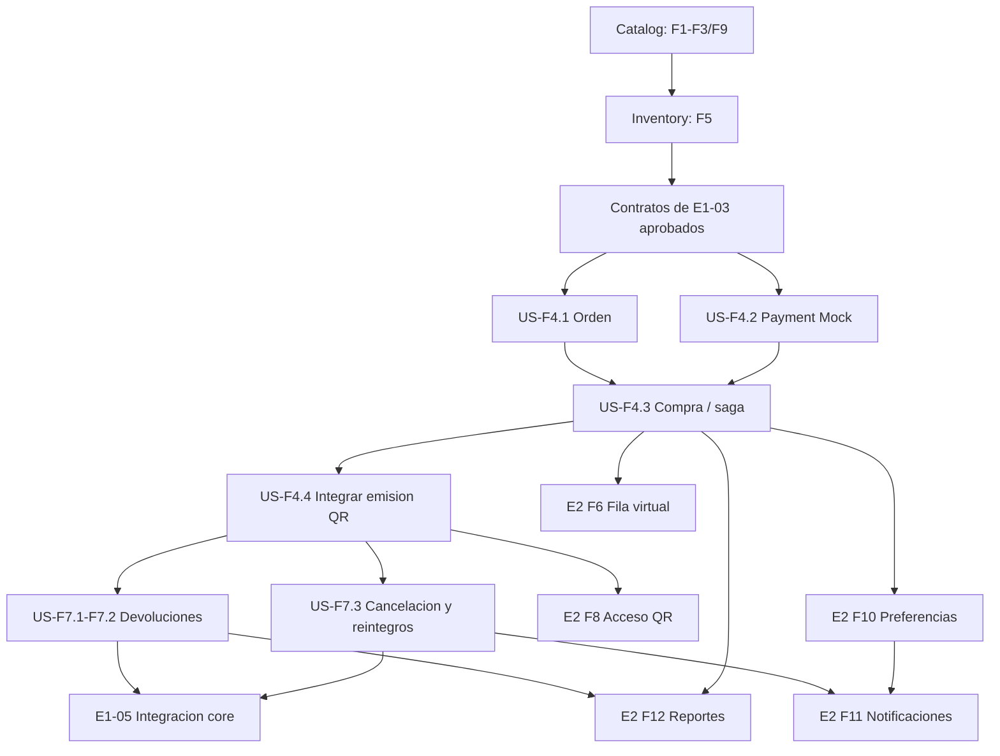

# Checklist — Entrega 1: Core del sistema

> **Doble checklist:** el primer casillero indica cobertura por una especificacion OpenSpec completada; el segundo indica implementacion completada en el codigo.
> - [x] [ ]: especificado, implementacion pendiente.
> - [ ] [x]: implementado, sin especificacion OpenSpec completada.
> - [x] [x]: especificado e implementado.
> - [ ] [ ]: ambos pendientes.

> Si un item esta parcialmente cubierto, manten abierto el punto principal y desglosa debajo subitems con su propio estado. El punto principal se completa cuando todos sus subitems requeridos esten cubiertos e implementados.

Basado en `TPE-ArqWeb-TicketYa-2026.pdf`, secciones “Modalidad de entrega”, “Tareas — Entrega 1” y “Entregable 1”.

## Requisitos funcionales

- [x] [x] Modelar eventos con ID, nombre, descripción, tipo, organizador, participantes, fecha y hora, lugar y estado (borrador, publicado, agotado, cancelado, finalizado).
- [x] [x] Modelar lugares con ID, nombre, dirección, ubicación y sectores.
- [x] [x] Soportar sectores numerados (filas y asientos identificados) y sectores no numerados con capacidad máxima.
- [x] [x] Permitir al organizador crear eventos en borrador, configurar sectores y precios por sector, y publicar eventos.
- [ ] [ ] Permitir a administradores suspender o cancelar eventos.
  - [x] [x] Suspender eventos publicados con rol ADMIN.
  - [ ] [x] Cancelar eventos desde Catalog y bloquear nuevas reservas en Inventory.
- [x] [ ] Permitir al cliente seleccionar evento, sector y, cuando corresponda, asientos específicos.
  - [x] [x] Consultar eventos publicados y su detalle, incluidos sectores, precios y asientos.
  - [x] [x] Inventory acepta el sector/asientos seleccionados en la solicitud interna de reserva.
  - [ ] [x] Implementar Purchase para crear la orden y orquestar la reserva, el pago y la emision de tickets. La ruta existe; la prueba completa aun termina en RECOVERY_REQUIRED.
  - [ ] [ ] Completar y verificar el flujo E2E de seleccion y compra del cliente.
- [ ] [ ] Reservar temporalmente los lugares durante el proceso de pago y liberarlos si el pago se rechaza o vence la reserva.
  - [x] [x] Retener asientos o cupos con TTL y liberarlos automaticamente al vencer la reserva.
  - [x] [x] Exponer la liberacion idempotente de una reserva activa.
  - [ ] [x] Purchase implementa la liberacion de la reserva ante pago rechazado y el manejo de vencimiento; falta validar los casos E2E.
- [ ] [ ] Registrar el detalle de la compra y el medio de pago; limitar la cantidad de entradas por cliente y evento.
  - [ ] [x] Purchase persiste orden, items, snapshot de precio y medio de pago, con clave idempotente y limite configurable.
  - [ ] [ ] Verificar persistencia, limite e idempotencia en pruebas integradas.
- [ ] [ ] Emitir entradas con un código QR único cuando el pago sea aprobado.
  - [x] [x] Emitir tickets con QR firmado, guardar el hash unico y hacer idempotente la emision por orden/item.
  - [ ] [x] Purchase invoca Ticket despues de aprobar el pago y confirmar Inventory.
  - [ ] [ ] Verificar que el recorrido aprobado emita y devuelva los QR; la prueba E2E actual queda en RECOVERY_REQUIRED.
- [x] [ ] Garantizar que un asiento o lugar no pueda venderse dos veces, incluso ante compras simultáneas o reintentos.
- [ ] [ ] Permitir solicitar devoluciones hasta 72 horas antes del evento; permitir que un administrador apruebe o rechace cada solicitud.
- [ ] [ ] Al aprobar una devolución, liberar el lugar y solicitar el reintegro a la pasarela de pagos.
  - [x] [x] Inventory permite liberar una reserva activa de forma idempotente (capacidad base, no un ticket ya vendido).
  - [ ] [ ] Implementar aprobacion de devolucion de un ticket vendido, liberar su lugar y solicitar el reintegro.
- [ ] [ ] Al cancelar un evento, pasar las entradas vendidas a reintegro y notificar a sus compradores.
  - [ ] [x] Catalog permite cancelar un evento y notifica a Inventory para bloquear nuevas reservas.
  - [ ] [ ] Invalidar los tickets vendidos, iniciar reintegros y notificar a los compradores.
- [x] [x] Permitir buscar eventos por tipo, organizador, participante, ciudad y rango de fechas, ordenando por fecha, precio o relevancia.
- [ ] [ ] Proveer una pasarela de pagos simulada (mock) para el flujo de compra.
  - [ ] [x] Payment Mock implementa cobros aprobados/rechazados, persistencia e idempotencia; Purchase integra el contrato.
  - [ ] [ ] Confirmar el flujo completo de compra con pago aprobado y rechazado mediante una prueba E2E.

## Roadmap funcional: user stories y dependencias

Este roadmap convierte F1-F12 del PDF en historias priorizadas. Los IDs ayudan a abrir cambios OpenSpec, relacionar tareas y ver el orden. Catalog e Inventory estan cubiertos; Purchase y Payment Mock ya tienen implementacion. La integracion E2E de compra sigue pendiente: la ultima compra aprobada quedo en RECOVERY_REQUIRED.

### Base disponible

- **US-F1/F2/F3/F9 - Catalog:** lugares, eventos, borradores, publicacion, busqueda y detalle ya estan implementados. La cancelacion esta iniciada, pero la orquestacion de reintegros aun no.
- **US-F5 - Inventory:** disponibilidad, reservas temporales, expiracion y prevencion de doble reserva bajo concurrencia estan implementadas.
- **US-F4 QR - Ticket:** `issue-ticket-qr` implementa emision interna e idempotente. Falta invocarla desde una compra con pago aprobado.

### Prioridad y secuencia

| Orden | Historia / criterio de aceptacion | Dependencias y paralelismo |
|---|---|---|
| **P0 / siguiente** | **US-F4.1 - Crear orden (implementado; verificacion pendiente).** Purchase persiste cliente, evento, items, sector/asiento, snapshot de precio, medio de pago y estado; incluye limite por cliente/evento y clave idempotente. Faltan pruebas propias y verificaciones integradas. | Catalog e Inventory existentes. El contrato esta definido en el change OpenSpec `establish-purchase-and-ticketing`. |
| **P0 / paralelo** | **US-F4.2 - Simular pago (implementado; E2E pendiente).** Payment Mock autoriza/cobra con respuestas configurables, conserva referencia y resuelve reintentos sin duplicar cargos. Falta demostrarlo dentro de la compra completa. | El contrato con Purchase esta definido; falta validar cobro y rechazo en la compra E2E. |
| **P0 / luego** | **US-F4.3 - Completar compra (implementacion parcial; bloqueada en E2E).** Purchase contiene la saga de reserva, pago, confirmacion/liberacion y estados consultables; la prueba aprobada actual queda en RECOVERY_REQUIRED y falta resolver la llamada downstream. | Depende de US-F4.1, US-F4.2 y los comandos internos de Inventory. Este es el primer flujo vertical E2E. |
| **P0 / luego** | **US-F4.4 - Emitir y consultar entradas compradas (integracion implementada; E2E pendiente).** Purchase invoca Ticket tras aprobacion y confirmacion; falta verificar la emision y consulta de QR en el recorrido completo. | Depende de US-F4.3 y del contrato interno existente de Ticket Service. |
| **P1** | **US-F7.1 - Solicitar devolucion.** El titular puede solicitarla hasta 72 horas antes; se guarda estado y se impiden solicitudes duplicadas. | Depende de ordenes/tickets de US-F4.4 y fecha del evento de Catalog. |
| **P1** | **US-F7.2 - Resolver devolucion.** ADMIN aprueba o rechaza. Al aprobar: revocar ticket, solicitar reintegro idempotente y solo despues liberar la unidad/cupo; fallos parciales quedan reintentables. | Depende de US-F7.1, Ticket revocable, Payment Mock con reintegro e Inventory con liberacion de unidad vendida. |
| **P1** | **US-F7.3 - Cancelar evento con reintegros.** ADMIN inicia el proceso; Catalog marca `CANCELLED`; Purchase revoca tickets, procesa reintegros y cierra inventario de forma idempotente. | Depende de US-F4.3/4.4 y de las primitivas de US-F7.2. Alinear con el blueprint: Purchase orquesta; Catalog no orquesta reintegros. La notificacion a compradores se completa en US-F11 (E2). |
| **P1 / cierre E1** | **US-E1-05 - Integrar y entregar el core.** Gateway publica las rutas necesarias; OpenAPI/Postman cubren los flujos; README/datos de prueba permiten ejecutar; pruebas integradas verifican compra, rechazo, vencimiento, idempotencia y competencia. | Depende de US-F4.1-F4.4 y US-F7.1-F7.3. Se pueden preparar contratos y ejemplos en paralelo, pero cerrar la verificacion E2E al final. |
| **P2 / E2** | **US-F6 - Fila virtual.** Para evento de alta demanda, informar posicion y habilitar tandas ordenadas; el token de admision no garantiza disponibilidad de inventario. | Se puede especificar en paralelo con P0; la integracion depende del endpoint de compra de US-F4.3 e Inventory. |
| **P2 / E2** | **US-F8 - Validar acceso QR.** Personal valida existencia, evento correcto y no usado; el primer escaneo marca uso atomico y los siguientes se rechazan. | Depende del contrato de tickets emitidos de US-F4.4. Puede implementarse en paralelo con devoluciones cuando se acuerden los estados de revocacion/uso. |
| **P2 / E2** | **US-F10 - Preferencias y recomendaciones.** Guardar tipos, artistas y ciudad; sugerir eventos por preferencias e historial de compras. | Catalog ya existe; historial depende de US-F4.1-F4.4. Definir NoSQL y su justificacion en esta historia. |
| **P2 / E2** | **US-F11 - Notificar al cliente.** Enviar confirmacion de compra, cancelacion/cambio y eventos de artistas favoritos en su ciudad. | Confirmacion depende de US-F4.3; cancelacion de US-F7.3; alertas personalizadas de US-F10. Se puede desarrollar el adaptador de notificaciones en paralelo una vez acordado el contrato de eventos. |
| **P2 / E2** | **US-F12 - Reportes del organizador.** Mostrar vendidos/devueltos por sector, ocupacion y recaudacion por evento propio. | Depende de compras de US-F4 y devoluciones/cancelacion de US-F7; requiere filtrar por ownership del organizador. |

### Grafo de dependencias y trabajo paralelo

**Como elegir la siguiente tarea:** diagnosticar la llamada downstream que deja la compra aprobada en `RECOVERY_REQUIRED`, agregar pruebas de Purchase y demostrar compra aprobada/rechazada por Gateway. Luego completar la consulta de tickets, devoluciones/cancelacion y el cierre E1. E2 puede refinarse en paralelo cuando sus dependencias contractuales esten definidas.

## Historias y especificaciones

- [x] [x] Transformar los requerimientos del sistema completo en features y user stories.
- [x] [x] Incluir criterios de aceptación para las historias.
- [x] [x] Versionar las especificaciones en el repositorio si se usa OpenSpec u otra práctica similar.

Evidencia: [`docs/Documentacion-de-diseño.md`](docs/Documentacion-de-diseño.md) reúne features y user stories con criterios de aceptación; [`openspec/`](openspec/) versiona los cambios con `proposal.md`, `design.md`, `specs/` y `tasks.md`.

## Arquitectura y diseño

- [x] [x] Definir los microservicios, sus responsabilidades y su API pública.
- [x] [x] Implementar cada microservicio como proyecto Spring Boot independiente, construible y ejecutable por separado.
- [x] [x] Usar APIs REST síncronas para la comunicación de esta entrega.
- [x] [x] Centralizar el acceso externo mediante un API Gateway (punto de entrada único).
- [x] [x] Definir una base de datos relacional por microservicio (se permiten esquemas separados en una misma tecnología).
- [x] [x] Diseñar y documentar el mecanismo contra la doble venta, válido aunque haya varias instancias del microservicio.
- [x] [x] Crear un diagrama de módulos de la arquitectura de solución.
- [x] [x] Crear un diagrama de secuencia de compra de una entrada numerada, incluidos pago rechazado y vencimiento de la reserva.
- [x] [x] Crear un diagrama entidad-relación por microservicio, con claves y relaciones entre servicios.
- [x] [x] Indicar entidades solapadas entre las bases de datos de los servicios, si las hubiera.

Evidencia: [`docs/architecture.md`](docs/architecture.md) reúne servicios y responsabilidades, diagrama de módulos, secuencia de compra, mecanismo contra la doble venta, ER por servicio (Catalog, Inventory, Ticket, Purchase y Payment) y la tabla de entidades solapadas. Los diagramas están en Mermaid y se renderizan desde el README y desde el propio documento.

## API REST

- [x] [x] Documentar los endpoints con método HTTP, ruta, parámetros y códigos de respuesta.
- [x] [x] Incluir ejemplos JSON de request y response.
- [x] [x] Documentar la API con OpenAPI/Swagger, incluyendo descripciones, ejemplos y códigos de error.

Evidencia: [`docs/openapi.yaml`](docs/openapi.yaml) es el contrato consolidado de la entrega (16 paths, 17 operaciones) con ejemplos, errores `application/problem+json` y los esquemas de Purchase, Payment, Catalog e Inventory. Cada servicio expone además su `/v3/api-docs` y Swagger UI en su puerto interno.

## Implementación y ejecución

- [x] [x] Implementar completamente en Spring Boot los microservicios y el API Gateway necesarios para el alcance de Entrega 1.
- [x] [x] No exigir autenticación en esta entrega; identificar al usuario mediante parámetro o encabezado.
- [x] [x] Preparar instrucciones de ejecución local de los microservicios; las bases de datos pueden iniciarse con Docker.
- [x] [x] Incluir README con instrucciones para ejecutar el sistema.
- [x] [x] Incluir documentación técnica adicional de diseño.
- [x] [x] Incluir datos de prueba.
- [x] [x] Incluir una colección de requests de Postman o herramienta similar para probar los endpoints.

Evidencia: el `README.md` documenta requisitos, variables de entorno, build, Compose, healthchecks, OpenAPI, Postman y reset de volúmenes. La identidad viaja en `X-User-Id` (y `X-User-Role` para ADMIN), sin autenticación. Los datos de prueba los genera la colección Postman con un `runId` por corrida sobre un stack limpio; el README incluye ejemplos de compra y la colección cubre desde la creación del lugar hasta la compra aprobada y rechazada.

## Pruebas

- [ ] [ ] Agregar pruebas unitarias de lógica de negocio para compra.
- [ ] [ ] Agregar pruebas unitarias de lógica de negocio para devoluciones.
- [ ] [ ] Agregar pruebas unitarias de lógica de negocio para búsqueda.
- [x] [ ] Agregar una prueba con muchas compras simultáneas del mismo asiento (o del último lugar de una zona) y verificar que solo una resulte exitosa.
  - [x] [x] Probar competencia multi-instancia por el mismo asiento o el ultimo cupo durante la reserva.
  - [ ] [ ] Probar la compra completa concurrente, incluyendo pago y emision de tickets.

## Entrega del repositorio

- [x] [x] Incluir especificaciones (si se utilizó OpenSpec u otra práctica similar), documentación de diseño, README, datos de prueba y colección de requests.
