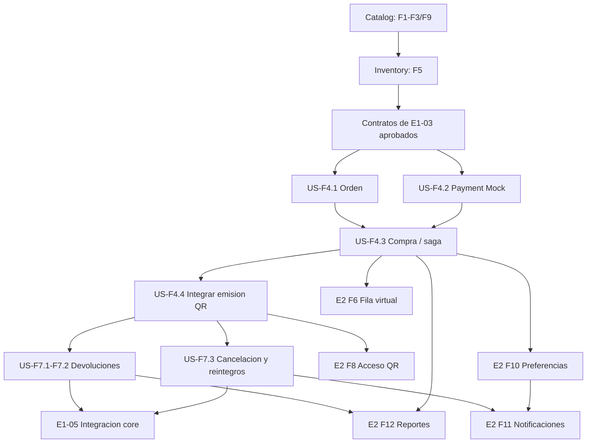

# Checklist — Entrega 1: Core del sistema

## Ampliación PDF-F11 activa (2026-11-22)

- [ ] [x] Registrar email propio de `CLIENT` y validar acceso por Gateway con PostgreSQL real; el cambio OpenSpec sigue activo.
- [ ] [ ] Entregar `EMAIL` por SMTP: código y pruebas de módulo listos; falta correo real en Mailpit y caída/recuperación SMTP en Compose.
- [ ] [ ] Postergar eventos publicados y avisar a compradores: Catalog y Notification pasan pruebas de módulo; falta el flujo completo por Gateway/Postman.
- [ ] [ ] Cerrar verificación integral: reactor limpio interrumpido a pedido del usuario; faltan Compose, Postman, Mailpit y controles finales de OpenSpec. Detalle en `openspec/changes/complete-f11-notifications-and-event-postponement/tasks.md` y `docs/verification.md`.

> **Doble checklist:** el primer casillero indica cobertura por una especificacion OpenSpec completada; el segundo indica implementacion completada en el codigo.
> - [x] [ ]: especificado, implementacion pendiente.
> - [ ] [x]: implementado, sin especificacion OpenSpec completada.
> - [x] [x]: especificado e implementado.
> - [ ] [ ]: ambos pendientes.

> Si un item esta parcialmente cubierto, manten abierto el punto principal y desglosa debajo subitems con su propio estado. El punto principal se completa cuando todos sus subitems requeridos esten cubiertos e implementados.

Basado en `TPE-ArqWeb-TicketYa-2026.pdf`, secciones “Modalidad de entrega”, “Tareas — Entrega 1” y “Entregable 1”.

## Requisitos funcionales

- [x] [x] Modelar eventos con ID, nombre, descripción, tipo, organizador, participantes, fecha y hora, lugar y estado (borrador, publicado, agotado, cancelado, finalizado).
- [x] [x] Modelar lugares con ID, nombre, dirección, ubicación y sectores.
- [x] [x] Soportar sectores numerados (filas y asientos identificados) y sectores no numerados con capacidad máxima.
- [x] [x] Permitir al organizador crear eventos en borrador, configurar sectores y precios por sector, y publicar eventos.
- [x] [x] Permitir a administradores suspender o cancelar eventos.
  - [x] [x] Suspender eventos publicados con rol ADMIN.
  - [x] [x] Cancelar eventos desde Catalog con rol ADMIN y bloquear nuevas reservas en Inventory.
- [x] [x] Permitir al cliente seleccionar evento, sector y, cuando corresponda, asientos específicos.
  - [x] [x] Consultar eventos publicados y su detalle, incluidos sectores, precios y asientos.
  - [x] [x] Inventory acepta el sector/asientos seleccionados en la solicitud interna de reserva.
- [x] [x] Purchase crea orden y orquesta reserva, pago, confirmación de Inventory y emisión de tickets. E2E aprobado por Gateway en admisión general y asiento numerado (42 requests, 72 aserciones, 0 fallos).
  - [x] [x] Flujo E2E verificado por Gateway: compra aprobada, compra rechazada, reintento idempotente, consulta de tickets por titular y límite secuencial.
- [x] [x] Reservar temporalmente los lugares durante el proceso de pago y liberarlos si el pago se rechaza o vence la reserva.
  - [x] [x] Retener asientos o cupos con TTL y liberarlos automaticamente al vencer la reserva.
  - [x] [x] Exponer la liberacion idempotente de una reserva activa.
  - [x] [x] Purchase libera la reserva ante pago rechazado; el E2E confirma orden REJECTED, sin tickets ni cupos retenidos. Inventory libera reservas vencidas; la evidencia del comportamiento exigido por el PDF quedó registrada en `docs/verification.md`. El PDF no exige una prueba E2E específica de compra vencida.
- [x] [x] Registrar el detalle de la compra y el medio de pago; limitar la cantidad de entradas por cliente y evento.
  - [x] [x] Purchase persiste orden, ítems, snapshot de precio y medio de pago, con clave idempotente y límite configurable.
  - [x] [x] E2E confirma reintento con la misma clave, conflicto al reutilizarla con otro payload y límite secuencial de seis entradas. La prueba de muchas compras simultáneas está cubierta en la sección Pruebas.
- [x] [x] Emitir entradas con un código QR único cuando el pago sea aprobado.
  - [x] [x] Emitir tickets con QR firmado, guardar el hash unico y hacer idempotente la emision por orden/item.
  - [x] [x] Purchase invoca Ticket después de aprobar el pago y confirmar Inventory.
  - [x] [x] E2E aprobado emite QR y la consulta del titular devuelve el ticket; otro titular recibe 404.
- [x] [x] Impedir la doble venta mediante Inventory/PostgreSQL e idempotencia ante reintentos; la prueba de compras completas concurrentes por Gateway deja una sola venta.
- [x] [x] Permitir solicitar devoluciones hasta 72 horas antes del evento; permitir que un administrador apruebe o rechace cada solicitud.
- [x] [x] Al aprobar una devolución, liberar el lugar y solicitar el reintegro a la pasarela de pagos.
  - [x] [x] Inventory permite liberar una reserva activa de forma idempotente (capacidad base, no un ticket ya vendido).
  - [x] [x] Implementar aprobación de devolución de un ticket vendido, liberar su lugar y solicitar el reintegro.
- [x] [x] Al cancelar un evento, pasar las entradas vendidas a reintegro. La notificación a compradores corresponde a US-F11 (Entrega 2, funcionalidad 11 del PDF).
  - [x] [x] Catalog permite cancelar un evento y notifica a Inventory para bloquear nuevas reservas.
  - [x] [x] Revocar los tickets vendidos e iniciar reintegros de forma reintentable.
- [x] [x] Permitir buscar eventos por tipo, organizador, participante, ciudad y rango de fechas, ordenando por fecha, precio o relevancia.
- [x] [x] Proveer una pasarela de pagos simulada (mock) para el flujo de compra.
  - [x] [x] Payment Mock implementa cobros aprobados/rechazados, persistencia e idempotencia; Purchase integra el contrato.
  - [x] [x] Confirmar el flujo completo de compra con pago aprobado y rechazado mediante una prueba E2E por Gateway.

## Roadmap funcional: user stories y dependencias

Este roadmap convierte F1-F12 del PDF en historias priorizadas. Para cerrar Entrega 1 se aplican los criterios expresos de las páginas 2 a 5 del PDF: comportamiento de reserva temporal y liberación al vencer o rechazarse el pago; pruebas unitarias de compra, devoluciones y búsqueda; y una prueba de muchas compras simultáneas del mismo asiento o último cupo con una sola venta exitosa. Las pruebas adicionales de resiliencia se registran aparte y no bloquean este cierre.

### Base disponible

- **US-F1/F2/F3/F9 - Catalog:** lugares, eventos, borradores, publicación, búsqueda y detalle implementados; la cancelación con reintegros está integrada en F7.
- **US-F5 - Inventory:** disponibilidad, reservas temporales, expiracion y prevencion de doble reserva bajo concurrencia estan implementadas.
- **US-F4 QR - Ticket:** `issue-ticket-qr` implementa emision interna e idempotente, integrada con Purchase; compra aprobada E2E emite y permite consultar el QR por el titular.

### Prioridad y secuencia

| Orden | Historia / criterio de aceptacion | Dependencias y paralelismo |
|---|---|---|
| **P0 / verificación** | **US-F4.1 - Crear orden (implementado; E2E verificado).** Purchase persiste cliente, evento, ítems, sector/asiento, snapshot de precio, medio de pago y estado; incluye límite por cliente/evento y clave idempotente. Las reglas de sector tienen prueba unitaria en `PurchaseBusinessRulesTest`. | Catalog e Inventory existentes. El contrato está definido en `establish-purchase-and-ticketing`. |
| **P0 / verificacion** | **US-F4.2 - Simular pago (implementado; E2E aprobado/rechazado verificado).** Payment Mock conserva referencias y resuelve reintentos sin duplicar cargos; ambas respuestas se ejercitaron por el flujo de compra. | El contrato con Purchase esta implementado y se verificaron cobros aprobados y rechazados a traves del Gateway. |
| **P0 / pruebas** | **US-F4.3 - Completar compra (implementado; E2E verificado).** La saga reserva, cobra, confirma o libera inventario y expone estados consultables. Aprobación, rechazo e idempotencia pasan; Inventory prueba la liberación por vencimiento. `postman/concurrent-purchases.py` prueba 12 compras simultáneas por Gateway y una sola venta. | Depende de US-F4.1, US-F4.2 y los comandos internos de Inventory. |
| **P0 / verificación** | **US-F4.4 - Emitir y consultar entradas compradas (implementado; E2E verificado).** Purchase invoca Ticket tras aprobación y confirmación; QR emitido y consulta autorizada del titular comprobados por Gateway. | Depende de US-F4.3 y del contrato interno existente de Ticket Service. |
| **P1 / pruebas** | **US-F7.1 - Solicitar devolución (implementado; E2E verificado).** El titular puede solicitarla hasta 72 horas antes; se guarda estado y se impiden solicitudes duplicadas. `RefundPolicyTest` cubre el límite exacto de 72 horas y las reglas de decisión. | Depende de órdenes/tickets de US-F4.4 y fecha del evento de Catalog. |
| **P1 / verificación** | **US-F7.2 - Resolver devolución (implementado; E2E verificado).** ADMIN aprueba o rechaza; la aprobación revoca el ticket, reintegra su importe y libera la unidad vendida. La colección actual prueba dos reintegros parciales de un mismo pago. | Depende de US-F7.1, Ticket revocable, Payment Mock con reintegro parcial e Inventory con liberación de unidad vendida. |
| **P1 / pruebas** | **US-F7.3 - Cancelar evento con reintegros (implementado; E2E verificado).** ADMIN inicia el proceso; Catalog marca `CANCELLED`; Purchase revoca tickets, procesa reintegros y cierra inventario de forma idempotente. La colección ampliada pasó 42 requests y 72 aserciones, incluidos siete tickets vendidos (seis generales y uno numerado), rechazo previo, reintento y bloqueo de compra posterior. | Depende de US-F4.3/4.4 y de las primitivas de US-F7.2. Purchase orquesta; Catalog no orquesta reintegros. La notificacion a compradores se completa en US-F11 (E2). |
| **P1 / cierre E1** | **US-E1-05 - Integrar y entregar el core (14/14 tareas OpenSpec, archivadas).** El reactor Java 21/Testcontainers pasó 260 pruebas sin fallos ni omisiones; 11 servicios Compose quedaron saludables; Postman pasó 42 requests y 72 aserciones; 12 compras simultáneas por Gateway dejaron una sola venta. `docs/verification.md` registra los comandos y la evidencia. | Depende de US-F4.1-F4.4 y US-F7.1-F7.3. Las pruebas adicionales de fallos downstream, pago incierto y reintento QR quedaron cubiertas por contratos de Purchase. |
| **F6 / implementado** | **US-F6 - Fila virtual (implementado; E2E por Gateway).** Para evento de alta demanda, informa posición y habilita tandas ordenadas con token de admisión de un solo uso; el token no garantiza disponibilidad de inventario. Implementado con PostgreSQL (`queue-service` + `queue-db`), no con Redis. | Se puede especificar en paralelo con P0; la integración depende del endpoint de compra de US-F4.3 e Inventory. |
| **E2-03 / implementado** | **US-F8 - Validar acceso QR (implementado; E2E verificado).** Personal valida existencia, evento correcto y no usado; el primer escaneo marca uso atomico y los siguientes se rechazan. 25 escaneos simultaneos: 1 ingreso. | Depende del contrato de tickets emitidos de US-F4.4. Puede implementarse en paralelo con devoluciones cuando se acuerden los estados de revocacion/uso. |
| **F10 / implementado** | **US-F10 - Preferencias y recomendaciones.** Guardar tipos, artistas y ciudad; sugerir eventos por preferencias e historial de compras. | Implementado con `preferences-service` + MongoDB 7; justificación NoSQL en `openspec/changes/archive/2026-11-20-add-preferences-and-recommendations/design.md`. |
| **P2 / E2** | **US-F11 - Notificar al cliente.** Enviar confirmacion de compra, cancelacion/cambio y eventos de artistas favoritos en su ciudad. | Confirmacion depende de US-F4.3; cancelacion de US-F7.3; alertas personalizadas de US-F10. Se puede desarrollar el adaptador de notificaciones en paralelo una vez acordado el contrato de eventos. |
| **E2-04 / implementado** | **US-F12 - Reportes del organizador (implementado; E2E verificado).** Mostrar vendidos/devueltos por sector, ocupacion y recaudacion por evento propio. | Depende de compras de US-F4 y devoluciones/cancelacion de US-F7; requiere filtrar por ownership del organizador. |

### Grafo de dependencias y trabajo paralelo

**Estado del cierre E1:** el reactor Java 21/Testcontainers pasó 260 pruebas sin fallos ni omisiones; Compose aislado quedó 11/11 healthy; Newman por Gateway pasó 42 requests y 72 aserciones. La prueba de 12 compras simultáneas dejó una orden confirmada, 11 conflictos y un asiento vendido. Las pruebas expresas del PDF para Entrega 1 están cubiertas y las tareas `establish-purchase-and-ticketing` quedaron archivadas con 14/14.

## Historias y especificaciones

- [x] [x] Transformar los requerimientos del sistema completo en features y user stories.
- [x] [x] Incluir criterios de aceptación para las historias.
- [x] [x] Versionar las especificaciones en el repositorio si se usa OpenSpec u otra práctica similar.

Evidencia: [`docs/Documentacion-de-diseño.md`](docs/Documentacion-de-diseño.md) reúne features y user stories con criterios de aceptación; [`openspec/`](openspec/) versiona los cambios con `proposal.md`, `design.md`, `specs/` y `tasks.md`.

## Arquitectura y diseño

- [x] [x] Definir los microservicios, sus responsabilidades y su API pública.
- [x] [x] Implementar cada microservicio como proyecto Spring Boot independiente, construible y ejecutable por separado.
- [x] [x] Usar APIs REST síncronas para la comunicación de esta entrega.
- [x] [x] Centralizar el acceso externo mediante un API Gateway (punto de entrada único).
- [x] [x] Definir una base de datos relacional por microservicio (se permiten esquemas separados en una misma tecnología).
- [x] [x] Diseñar y documentar el mecanismo contra la doble venta, válido aunque haya varias instancias del microservicio.
- [x] [x] Crear un diagrama de módulos de la arquitectura de solución.
- [x] [x] Crear un diagrama de secuencia de compra de una entrada numerada, incluidos pago rechazado y vencimiento de la reserva.
- [x] [x] Crear un diagrama entidad-relación por microservicio, con claves y relaciones entre servicios.
- [x] [x] Indicar entidades solapadas entre las bases de datos de los servicios, si las hubiera.

Evidencia: [`docs/architecture.md`](docs/architecture.md) reúne servicios y responsabilidades, diagrama de módulos, secuencia de compra, mecanismo contra la doble venta, ER por servicio (Catalog, Inventory, Ticket, Purchase y Payment) y la tabla de entidades solapadas. Los diagramas están en Mermaid y se renderizan desde el README y desde el propio documento.

## API REST

- [x] [x] Documentar los endpoints con método HTTP, ruta, parámetros y códigos de respuesta.
- [x] [x] Incluir ejemplos JSON de request y response.
- [x] [x] Documentar la API con OpenAPI/Swagger, incluyendo descripciones, ejemplos y códigos de error.

Evidencia: [`docs/openapi.yaml`](docs/openapi.yaml) es el contrato consolidado de la entrega (49 paths, 56 operaciones) con ejemplos, errores `application/problem+json` y esquemas de Catalog, Inventory, Purchase, Ticket, Payment, Queue, Audit y Preferences. Cada servicio expone además su `/v3/api-docs` y Swagger UI en su puerto interno.

## Implementación y ejecución

- [x] [x] Implementar completamente en Spring Boot los microservicios y el API Gateway necesarios para el alcance de Entrega 1.
- [x] [x] No exigir autenticación en esta entrega; identificar al usuario mediante parámetro o encabezado. *(Superado por la épica E2-01: desde 2026-11-16 las rutas protegidas exigen JWT y la identidad viaja como `Authorization: Bearer`; ver la sección "Entrega 2".)*
- [x] [x] Preparar instrucciones de ejecución local de los microservicios; las bases de datos pueden iniciarse con Docker.
- [x] [x] Incluir README con instrucciones para ejecutar el sistema.
- [x] [x] Incluir documentación técnica adicional de diseño.
- [x] [x] Incluir datos de prueba.
- [x] [x] Incluir una colección de requests de Postman o herramienta similar para probar los endpoints.

Evidencia: el `README.md` documenta requisitos, variables de entorno, build, Compose, healthchecks, OpenAPI, Postman y reset de volúmenes. La identidad viaja en `X-User-Id` (y `X-User-Role` para ADMIN), sin autenticación. Los datos de prueba los genera la colección Postman con un `runId` por corrida sobre un stack limpio; el README incluye ejemplos de compra y la colección cubre desde la creación del lugar hasta la compra aprobada y rechazada.

## Entrega 2: Seguridad JWT y roles (E2-01)

- [x] [x] Autenticar las operaciones protegidas con un JWT firmado por un proveedor de identidad externo, validado en el API Gateway (`PDF-NF-SECURITY`; cambio archivado `add-jwt-and-role-security`).
- [x] [x] Autorizar por rol (`CLIENT`, `ORGANIZER`, `ADMIN`, `ACCESS_STAFF`) y por ownership, conservando las reglas de dominio de Catalog y Purchase.
- [x] [x] Mantener públicas las consultas de eventos y de disponibilidad, sin exigir token.
- [x] [x] No confiar en los encabezados de identidad enviados por el cliente: el Gateway deriva la identidad de los claims validados y no reenvía el Bearer.
- [x] [x] Documentar el esquema Bearer en OpenAPI, actualizar la colección Postman y el README, y verificar el flujo protegido por el Gateway.

Evidencia: el Gateway valida firma, expiración, `sub` UUID y un único rol permitido (`GatewayJwtSecurityIntegrationTest`, 5 pruebas con 13 variantes de token inválido). `docs/openapi.yaml` declara el esquema HTTP `BearerJWT` con `security: []` explícito en las operaciones públicas (`ConsolidatedOpenApiDocumentContractTest`, 18 pruebas). Verificación completa, con IdP de prueba local y Compose aislado, en [`docs/verification.md`](docs/verification.md) y en `NEXT.md`.

## Entrega 2: Fila virtual y alta demanda (E2-02)

- [x] [x] Marcar los eventos de alta demanda desde el borrador (`events.high_demand NOT NULL DEFAULT FALSE`) y publicar la marca en snapshots y consultas públicas, sin exponer disponibilidad en la fila (PDF-F6; cambio `add-virtual-queue`).
- [x] [x] Implementar `queue-service` con posiciones monótonas por evento bajo bloqueo, tandas en orden de llegada, estados `WAITING → ADMITTED → CONSUMED | EXPIRED | LEFT` y token HMAC de un solo uso con TTL corto.
- [x] [x] Exigir `X-Admission-Token` en `POST /api/orders` sólo para eventos de alta demanda, después del chequeo de idempotencia y antes de reservar o cobrar, con `403`/`503` según el caso.
- [x] [x] Documentar `/api/queue/**`, `/internal/admissions/validate` y el encabezado de admisión en `docs/openapi.yaml`, y rutear la fila por el Gateway con JWT y `401` sin token.
- [x] [x] Agregar `queue-db` y `queue-service` al Compose con variables propias, healthcheck y documentación de arranque en el README.

Evidencia: reactor **330 pruebas, 0 fallos, 0 errores, 0 omitidos**; Compose aislado **13/13 healthy**; Newman vía Gateway **65 requests, 110 aserciones, 0 fallos** con 17 casos E2-02; `postman/concurrent-purchases.py` sin regresiones. El detalle está en [`docs/verification.md`](docs/verification.md) y en `NEXT.md`. El `400` heredado de la request `09` no se reproduce y no requirió cambiar reglas de negocio.

## Pruebas

- [x] [x] Agregar pruebas unitarias de lógica de negocio para compra (PDF, Tareas — Entrega 1; `complete-e1-core-delivery` 3.2; `PurchaseBusinessRulesTest`, 2 pruebas; spec principal `purchase-orders`).
- [x] [x] Agregar pruebas unitarias de lógica de negocio para devoluciones (PDF, Tareas — Entrega 1; `complete-e1-core-delivery` 3.3; `RefundPolicyTest`, 4 pruebas).
- [x] [x] Agregar pruebas unitarias de lógica de negocio para búsqueda (PDF, Tareas — Entrega 1; `complete-e1-core-delivery` 3.4; `EventDiscoveryServiceTest`, 4 pruebas).
- [x] [x] Agregar una prueba con muchas compras simultáneas del mismo asiento (o del último lugar de una zona) y verificar que solo una resulte exitosa.
  - [x] [x] Probar competencia multi-instancia por el mismo asiento o el último cupo durante la reserva; evidencia del mecanismo, sin simular la compra completa pedida por el PDF.
  - [x] [x] Simular muchas compras completas concurrentes con compradores y claves distintas; verificar una sola compra exitosa y una sola venta (`complete-e1-core-delivery` 3.5; `postman/concurrent-purchases.py`: 12 solicitudes, 1 `CONFIRMED`, 11 `409`, `sold=1`; specs de Purchase archivadas).

La expiración de la reserva es un **comportamiento funcional expreso** del PDF. Inventory tiene pruebas de contrato de expiración y liberación; `complete-e1-core-delivery` 3.1 registró en `docs/verification.md` la evidencia de que el lugar vuelve a estar disponible. El PDF no exige una prueba E2E específica del pago aprobado después del vencimiento.

**Cobertura adicional de OpenSpec:** la suite de Purchase cubre además compensación por reserva no confirmable, pagos `PENDING` reconciliados a `APPROVED`/`REJECTED`, pérdida de la respuesta después de un cobro aprobado, fallos 503 de dependencias, reintento de emisión QR y concurrencia del límite por cliente. No se afirma una espera E2E de diez minutos para el vencimiento: su liberación autoritativa está verificada en Inventory con PostgreSQL real.

## Entrega del repositorio

- [x] [x] Incluir especificaciones (si se utilizó OpenSpec u otra práctica similar), documentación de diseño, README, datos de prueba y colección de requests.

## Entrega 2: Trazabilidad y bitácora centralizada (E2-02)

- [x] [x] Registrar cada solicitud HTTP con endpoint, usuario, código de respuesta y tiempo de procesamiento (PDF-NF-TRACE; cambio archivado `add-request-tracing-and-audit-log`).
  - [x] [x] Gateway: `AccessLogWebFilter` registra también los `401`/`403` que no llegan a los servicios, con el usuario del JWT.
  - [x] [x] Servicios: `RequestLoggingFilter` en Catalog, Inventory, Ticket, Purchase, Payment Mock y Audit; el patrón de log incluye servicio y `X-Correlation-Id`.
- [x] [x] Registrar compra, devolución, cancelación e ingreso al evento en un log centralizado con un identificador que permita seguir la operación entre servicios.
  - [x] [x] `audit-service` + `audit-db` (PostgreSQL), ingesta interna idempotente y consulta `ADMIN` por filtros o por `X-Correlation-Id`.
  - [x] [x] Productores Purchase, Catalog y Ticket con publicación asíncrona, timeouts, reintentos y respaldo en el log local (resiliencia ante la caída de Audit).

Evidencia: `AuditServiceContractTest` (7), `AuditPublisherTest` (5 por productor), `RequestLoggingFilterTest` (2 por servicio), `GatewayEntrega2RoleAuthorizationTest` (4); Postman 44-47 siguen una compra y una cancelación a través de Purchase, Catalog y Ticket. Con Audit Service detenido, `postman/concurrent-purchases.py` sigue en PASS.

## Entrega 2: Control de acceso con QR (E2-03, US-F8)

- [x] [x] Validar en el ingreso que la entrada exista, corresponda al evento y no haya sido usada, y marcarla como utilizada (cambio archivado `validate-ticket-access`).
- [x] [x] Impedir el doble ingreso aun con escaneos simultáneos en varias instancias (`UPDATE` condicional + índice único parcial).
- [x] [x] Rechazar entradas revocadas, de otro evento y QR falsificados; registrar cada intento y consultarlo (`ACCESS_STAFF`/`ADMIN`).
- [x] [x] Autorizar por rol en el Gateway y en el servicio (`ACCESS_STAFF` valida).

Evidencia: `AccessControlContractTest` (6, incluye 25 escaneos concurrentes → 1 `ADMITTED`), `TicketQrVerificationTest` (2); Postman 32 y 37-42.

## Entrega 2: Reportes del organizador (E2-04, US-F12)

- [x] [x] Entradas vendidas y devueltas por sector, porcentaje de ocupación y recaudación de un evento propio (cambio archivado `add-organizer-event-reports`).
- [x] [x] Ownership del organizador delegado en Catalog; `ADMIN` consulta cualquier evento; `CLIENT`/`ACCESS_STAFF` reciben `403`.
- [x] [x] Degradación controlada si Inventory no responde.

Evidencia: `OrganizerReportCalculatorTest` (4), `OrganizerReportIntegrationTest` (6); Postman 28-31 y 43.

## PDF-F10: preferencias y recomendaciones

- [x] [x] Servicio propio `preferences-service` con base NoSQL MongoDB 7 (`preferences-db`), justificada frente a PostgreSQL JSONB en `design.md` (D2).
- [x] [x] Documento por cliente con `_id` = UUID del `sub`, upsert atómico de un solo documento y `version` gestionada por el servidor.
- [x] [x] `PUT`/`GET /api/customers/me/preferences` con validación D14, rechazo de identidad en el cuerpo y representación vacía (`version` `0`) para clientes nuevos.
- [x] [x] `GET /api/customers/me/recommendations` con puntaje explicable, motivos, exclusión de comprados, orden determinista y `limit` 1..20.
- [x] [x] Contratos internos de señales (Purchase) y candidatos (Catalog), sin acceso cruzado a bases.
- [x] [x] Degradación asimétrica: `HISTORY_UNAVAILABLE` si falla Purchase, `503` si falla Catalog, y `UPCOMING_FALLBACK` sin señales.
- [x] [x] Ruta del Gateway con rol `CLIENT` antes del comodín; contratos internos no publicados.
- [x] [x] Contrato OpenAPI (5 operaciones y 8 esquemas), 9 pasos Postman (`F10-01`…`F10-09`), Compose con 17 contenedores y documentación actualizada.

## Pendiente de Entrega 2

- [x] [x] US-F6 Fila virtual (implementada con PostgreSQL; ver «Entrega 2: Fila virtual y alta demanda»).
- [x] [x] US-F10 Preferencias y recomendaciones (MongoDB 7, con justificación; ver «PDF-F10: preferencias y recomendaciones»).
- [x] [x] US-F11 Notificaciones (asíncronas; `notification-service`, ver «PDF-F11: notificaciones»).
- [x] [x] Cache del catálogo y de las búsquedas (TTL, invalidación y justificación de lo no cacheado; ver «Caché del catálogo» en README).
- [x] [x] Circuit breaker y fallback hacia Payment y Notificaciones (cambio archivado `2026-11-20-add-circuit-breaker-and-fallback`; timeouts + circuito de tres estados + fallback local).
- [x] [x] Pruebas de integración entre microservicios reales (`postman/integration-harness.py`) y prueba de carga con informe (`docs/load-test-report.md`).
- [x] [x] Justificación de patrones (Gateway, Circuit Breaker, BFF, Saga, Service Discovery) y estrategias de consistencia en `docs/patterns-and-consistency.md`.

## PDF-F11: notificaciones

- [x] [x] Avisar por email y push (simulados) al confirmar una compra, también al reconciliarla, y al compensar una orden (cambio archivado `add-customer-notifications`).
- [x] [x] Avisar a los compradores la suspensión, la reanudación y la cancelación de un evento (Catalog publica después del commit; Purchase informa los compradores).
- [x] [x] Avisar a los clientes cuyo artista favorito publica un evento en su ciudad (consulta interna sobre MongoDB de Preferences).
- [x] [x] Ingesta idempotente, inbox/outbox con `FOR UPDATE SKIP LOCKED`, reintentos exponenciales y estado `FAILED`; los flujos de negocio nunca fallan por las notificaciones.
- [x] [x] Bandeja `GET /api/notifications/me` sólo para `CLIENT`, ruta del Gateway, OpenAPI, Compose (19 contenedores) y Postman `F11-01`…`F11-12`.

Evidencia: `NotificationServiceContractTest` (10, incluye procesamiento concurrente sin duplicados), `NotificationRulesTest` (3), `EventChangeNotificationIntegrationTest` (3), `EventNotificationPublisherTest` (3), `EventBuyersIntegrationTest` (2), `NotificationDispatcherPayloadTest` (1), `PreferenceMatchesMongoIntegrationTest` (4) y `GatewayEntrega2RoleAuthorizationTest`.
