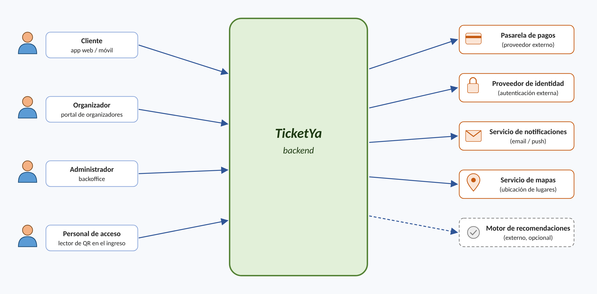
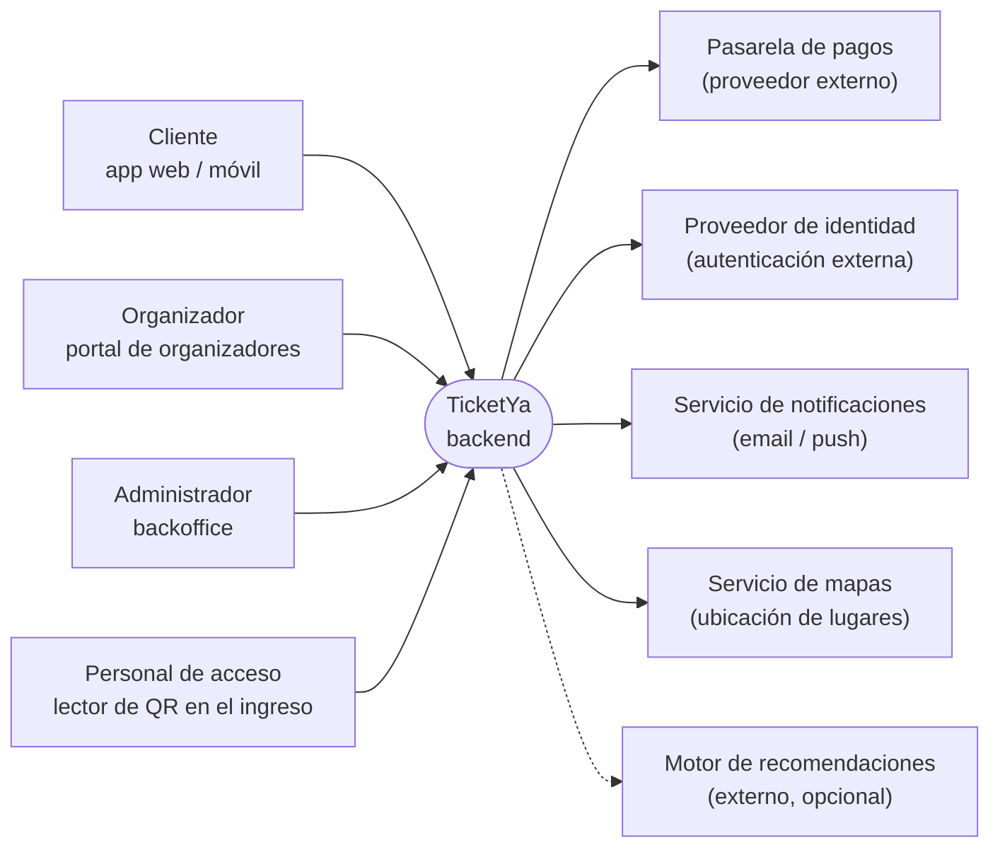

Arquitectura Web (TUDAI)

# TRABAJO PRÁCTICO GRUPAL: TICKETYA

TicketYa es un startup que busca construir una plataforma de venta de entradas (ticketera virtual) para todo tipo de eventos: recitales, festivales, obras de teatro, partidos y conferencias. La misión es que cualquier organizador, desde un club de barrio hasta una gran productora, pueda publicar sus eventos y vender entradas en forma simple, segura y a bajo costo, y que el público pueda encontrar y comprar entradas desde su celular sin filas ni sobresaltos.

La plataforma trabaja con tres tipos de usuarios: administradores (gestión completa, mantenimiento y tareas operativas), organizadores (diseñan y publican eventos) y clientes (buscan eventos y compran entradas). Además, en el ingreso a cada evento, el personal de acceso escanea el código QR de las entradas para validarlas.

El mayor desafío del negocio aparece en los eventos masivos: cuando se abre la venta de un recital convocante, decenas de miles de personas intentan comprar en los mismos minutos. En esas condiciones el sistema debe seguir funcionando, ser justo con quienes llegaron primero y, sobre todo, garantizar que una misma entrada nunca se venda dos veces. Con el tiempo, se pretende también personalizar la oferta de eventos según los gustos e historial de cada cliente. Un diagrama de contexto del sistema es el siguiente:

*Descripción del diagrama (representación textual):* el sistema **TicketYa (backend)** está en el centro.

- A la izquierda, cuatro actores humanos que acceden al sistema (flechas hacia TicketYa):
  - **Cliente** — app web / móvil
  - **Organizador** — portal de organizadores
  - **Administrador** — backoffice
  - **Personal de acceso** — lector de QR en el ingreso
- A la derecha, sistemas externos con los que TicketYa se comunica (flechas desde TicketYa):
  - **Pasarela de pagos** (proveedor externo)
  - **Proveedor de identidad** (autenticación externa)
  - **Servicio de notificaciones** (email / push)
  - **Servicio de mapas** (ubicación de lugares)
  - **Motor de recomendaciones** (externo, opcional) — flecha punteada y recuadro punteado, por ser opcional

El trabajo debe centrarse en el backend, que orquesta todas las interacciones, si bien deben contemplarse en el diseño los sistemas adicionales (aplicaciones de clientes y organizadores, backoffice administrativo, lectores de acceso, pasarela de pagos, notificaciones, etc.).

## FUNCIONALIDAD

1. Cada evento tiene: ID, nombre, descripción, tipo (recital, teatro, deporte, conferencia, etc.), organizador, participantes (artistas, equipos, disertantes), fecha y hora, lugar, y estado (borrador, publicado, agotado, cancelado, finalizado).

2. Cada lugar (estadio, teatro, sala) tiene: ID, nombre, dirección, ubicación (latitud/longitud) y un conjunto de sectores. Un sector puede ser numerado (filas y asientos identificados) o no numerado (zona con una capacidad máxima, p. ej. "Campo"). Para cada evento, el organizador define el precio de cada sector.

3. Los organizadores crean sus eventos en estado borrador, configuran sectores y precios, y luego los publican. Los administradores pueden suspender o cancelar cualquier evento.

4. Un cliente elige un evento, un sector y, si es numerado, asientos específicos. El sistema reserva temporalmente esos lugares (por ej. por 10 minutos) mientras el cliente paga. Si el pago es aprobado, se emiten las entradas con un código QR único; si el pago es rechazado o la reserva vence, los lugares se liberan. Se debe registrar el detalle de la compra y el medio de pago, y limitar la cantidad de entradas por cliente para un mismo evento.

5. Una entrada nunca puede venderse dos veces, aun cuando muchos clientes intenten comprar el mismo asiento (o el último lugar de una zona) al mismo tiempo, o cuando un cliente reintente el pago por un problema de conexión.

6. Para eventos marcados como de alta demanda, al abrirse la venta los clientes ingresan a una fila virtual: el sistema les informa su posición y los habilita a comprar en orden, por tandas.

7. Un cliente puede solicitar la devolución de una entrada hasta 72 horas antes del evento. Un administrador aprueba o rechaza la solicitud; si la aprueba, el asiento o lugar en la zona se libera y se solicita el reintegro del dinero a la pasarela de pagos. Si un evento se cancela, todas sus entradas vendidas pasan a reintegro y se notifica a los compradores.

8. En el ingreso al evento, el personal de acceso escanea el QR. El sistema valida que la entrada exista, corresponda a ese evento y no haya sido usada, y la marca como utilizada (un QR no puede ingresar dos veces).

9. El sistema debe permitir búsquedas por múltiples criterios: tipo de evento, organizador, participante, ciudad y rango de fechas, con ordenamiento por fecha, precio o relevancia.

10. El sistema debe registrar las preferencias de los clientes (tipos de evento, artistas favoritos, ciudad) y sugerir eventos en función de su historial (similar a "quienes compraron entradas para este evento también compraron para…").

11. Enviar notificaciones (email o push) al confirmar una compra, ante la cancelación o cambio de un evento, y cuando un artista favorito de un cliente publica un evento en su ciudad.

12. Los organizadores deben poder consultar reportes de sus eventos: entradas vendidas y devueltas por sector, porcentaje de ocupación y recaudación.

13. *(El ítem 13 figura vacío en el documento original.)*

## CONSIDERACIONES DE ARQUITECTURA Y NO FUNCIONALES

- Utilizar arquitectura de microservicios, implementando cada microservicio con Spring Boot como un proyecto independiente, que pueda construirse y ejecutarse por separado.

- Punto de entrada único: los clientes externos acceden al sistema a través de un API Gateway.

- Comunicación: utilizar APIs REST, mayormente síncronas, aunque podría utilizarse comunicación asíncrona (fire-and-forget o mensajería) donde se justifique, por ejemplo para notificaciones o para la fila virtual.

- Persistencia: cada microservicio debe tener preferentemente su propia base de datos (puede ser la misma tecnología, pero esquemas separados). Al menos un microservicio debe utilizar una base de datos NoSQL (por ej. MongoDB para el catálogo de eventos o las preferencias de los clientes), justificando la elección. Se valorará el uso de otras tecnologías según el tipo de datos (por ej. Redis para reservas temporales o la fila virtual).

- Concurrencia e idempotencia: el mecanismo que impide la doble venta debe funcionar aun con varias instancias del mismo microservicio ejecutándose a la vez. Debe explicarse y probarse el mecanismo elegido (bloqueos, control de versiones, restricciones de unicidad, claves de idempotencia, etc.).

- Consistencia entre servicios: una compra involucra a más de un microservicio (disponibilidad de lugares, pagos, emisión de entradas). Dado que no existe una única transacción de base de datos que los abarque, se debe definir cómo se mantiene la consistencia y cómo se deshacen los pasos ya realizados si uno falla (por ej., via compensaciones).

- Resiliencia: implementar reintentos, timeouts y fallback ante fallos de servicios externos (pasarela de pagos, servicio de notificaciones).

- Cache: definir qué datos se cachean (por ej. catálogo y detalle de eventos, resultados de búsqueda), dónde, con qué tiempo de vida (TTL) y cómo se invalidan, y justificar qué datos no deben cachearse (p. ej. la disponibilidad de asientos).

- Trazabilidad: cada solicitud HTTP debe quedar registrada en en log con el endpoint, el usuario, el código de respuesta y el tiempo de procesamiento. Cada operación crítica (compra, devolución, cancelación, ingreso al evento) debe quedar registrada en un log centralizado, con un identificador que permita seguir una misma operación a través de los distintos microservicios.

- Seguridad: autenticación y autorización con JWT (usuarios y roles: cliente, organizador, administrador y personal de acceso).

- Despliegue: cada microservicio (y cada base de datos, el gateway, etc.) debe poder desplegarse en su propio contenedor Docker, y todo el sistema debe poder levantarse con un único docker-compose.yml.

- Rendimiento: el sistema debe soportar la apertura de venta de un evento masivo. Se debe realizar al menos una prueba de carga sobre el flujo de compra (por ej. con Jmeter, y reportar sus resultados.

## METODOLOGÍA SUGERIDA

Se sugiere seguir prácticas de desarrollo guiado por especificaciones (spec-driven development), por ejemplo utilizando OpenSpec. La idea es que cada funcionalidad o cambio comience con una especificación escrita y revisada por el grupo (propuesta → especificación de requisitos y escenarios → diseño → tareas) antes de implementarse, y que esas especificaciones queden versionadas en el repositorio junto al código. Las especificaciones sirven además como base para los contratos OpenAPI y para los casos de prueba. Si se utilizan coding agents de IA para programar, las especificaciones son el insumo que debe guiar a esto agentes.

## INTERFAZ GRÁFICA

El foco del trabajo es el backend. Sin embargo, se valorará positivamente que el sistema no sea solo backend y cuente con una interfaz gráfica (p. ej. una aplicación web en React, Angular, Vue o Thymeleaf) que consuma la API a través del gateway. Como mínimo, sería deseable cubrir los flujos principales del cliente: buscar eventos, elegir sector y asientos, comprar y ver sus entradas.

## MODALIDAD DE ENTREGA

El trabajo se realiza en grupo y se entrega en dos partes incrementales, sobre el mismo repositorio. La primera entrega se focaliza en el núcleo del sistema (el circuito de publicación, búsqueda y compra sin doble venta); la segunda completa la funcionalidad y los aspectos no funcionales restantes. Los números entre paréntesis refieren a la sección FUNCIONALIDAD.

|  | Entrega 1 — Core del sistema | Entrega 2 — Sistema completo |
|---|---|---|
| **Funcionalidad** | Eventos y lugares (1, 2), publicación (3), compra con reserva temporal y emisión de QR (4), no doble venta (5), devoluciones y cancelación de eventos (7), búsqueda por múltiples criterios (9). | Fila virtual (6), control de acceso con QR (8), preferencias y recomendaciones (10), notificaciones (11), reportes para organizadores (12). |
| **Arquitectura** | Microservicios Spring Boot con API REST síncrona, API Gateway, una base relacional por microservicio, mecanismo contra la doble venta. Pasarela de pagos simulada (mock). | Base NoSQL (MongoDB) en al menos un servicio, consistencia entre servicios y compensaciones, resiliencia, cache, bitácora y log centralizado, comunicación asíncrona donde se justifique. |
| **Seguridad** | Sin autenticación (el usuario se identifica por parámetro o encabezado). | Autenticación y autorización con JWT y roles. |
| **Despliegue** | Ejecución local de los microservicios (las bases de datos pueden levantarse con Docker). | Cada microservicio en un contenedor Docker separado; todo el sistema con un docker-compose.yml. |
| **Testing** | Pruebas unitarias de la lógica de negocio y una prueba que verifique la no doble venta. | Pruebas de integración entre servicios, pruebas de seguridad de endpoints y prueba de carga. |

## TAREAS — ENTREGA 1 (CORE)

- Features y User Stories:
  - Transformar los requerimientos dados en una serie de features y user stories (de todo el sistema), incluyendo criterios de aceptación para las historias.
- Arquitectura de microservicios:
  - Definir los microservicios, sus responsabilidades y API pública.
  - Diagrama de módulos de la arquitectura de solución.
  - Diagrama de secuencia del flujo de compra de una entrada numerada, incluyendo qué ocurre si el pago es rechazado o la reserva vence.
- Modelo de datos:
  - Diagrama entidad-relación por microservicio, indicando claves y relaciones entre servicios. Se debe indicar también si existen entidades solapadas entre bases.
- Diseño de API REST:
  - Listado de endpoints con método, ruta, parámetros, códigos de respuesta, ejemplos de request/response (JSON).
  - Documentar utilizando OpenAPI (Swagger), incluyendo descripciones, ejemplos y códigos de error.
- Implementación:
  - Desarrollar en Spring Boot los microservicios y el API Gateway necesarios para la funcionalidad de esta entrega, en forma completa.
  - Incluir mínimamente un README de como ejecutar, pero también documentación técnica adicional.
- Testing:
  - Pruebas unitarias de la lógica de negocio (compra, devoluciones, búsqueda).
  - Una prueba que simule muchas compras simultáneas del mismo asiento (o del último lugar de una zona) y verifique que solo una resulta exitosa.

**Entregable 1 (fecha: ____/____/2026):** Repositorio Git con código fuente, especificaciones (si se utilizó OpenSpec u otra práctica similar), documentación de diseño, README con instrucciones de ejecución, datos de prueba y una colección de requests (Postman o similar) para probar los endpoints.

## TAREAS — ENTREGA 2 (SISTEMA COMPLETO)

- Features y User Stories:
  - Completar los criterios de aceptación de las historias restantes y actualizar las que hayan cambiado.
- Arquitectura y modelo de datos:
  - Actualizar los diagramas de módulos y entidad-relación con los nuevos servicios y la base NoSQL.
  - Estrategias de consistencia (eventual vs. fuerte) y manejo de fallos parciales en la compra (compensaciones).
- Decisiones tecnológicas:
  - Justificar elección de las tecnologías (en particular, la base NoSQL elegida y para qué datos).
  - Justificar uso de patrones: API Gateway, Circuit Breaker, Backend For Frontend, Saga, Service Discovery, etc.
- Implementación:
  - Desarrollar la funcionalidad restante. La fila virtual y las recomendaciones pueden implementarse con una versión simplificada, justificando las simplificaciones.
  - Incorporar JWT con roles, la base NoSQL, la estrategia de cache, la resiliencia ante servicios externos y la bitácora/log centralizado.
  - Empaquetar cada microservicio en un contenedor Docker separado y orquestar el sistema completo con docker-compose.
- Diseño de API REST:
  - Actualizar la documentación OpenAPI con los nuevos endpoints y los requisitos de seguridad.
- Testing:
  - Pruebas de integración entre microservicios (p. ej. con Testcontainers o levantando el entorno con docker-compose).
  - Pruebas que verifiquen que cada endpoint solo es accesible por los roles correspondientes.
  - Prueba de carga del flujo de compra, con un breve informe de resultados (usuarios concurrentes, tiempos de respuesta, errores).

**Entregable 2 (fecha: ____/____/2026):** Repositorio Git actualizado con código fuente, archivo docker-compose.yml para levantar todos los servicios (bases de datos, gateway, microservicios, etc.), especificaciones y documentación de diseño actualizadas, README con instrucciones de ejecución y descripción del diseño, colección de requests actualizada e informe de la prueba de carga. Si se desarrolló interfaz gráfica, incluir instrucciones para ejecutarla.
