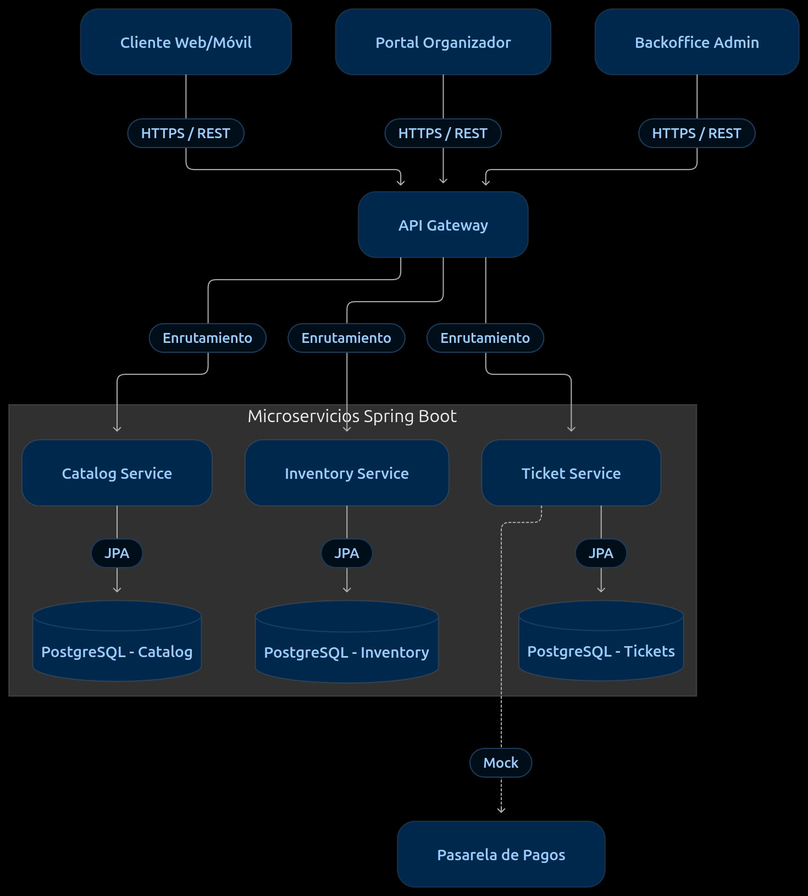
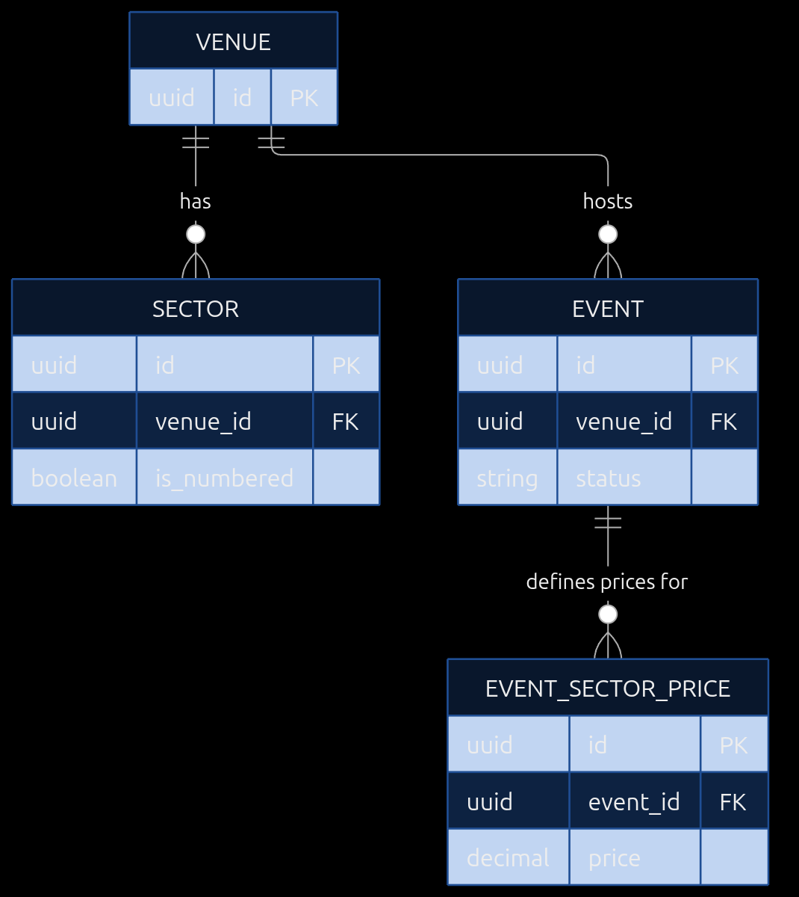
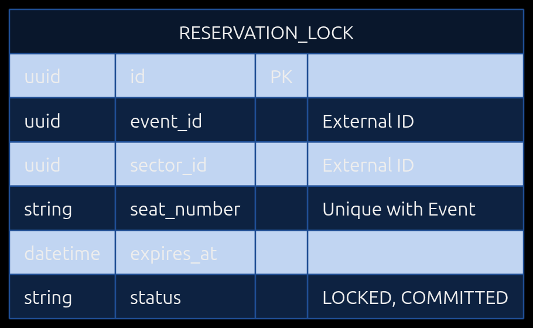
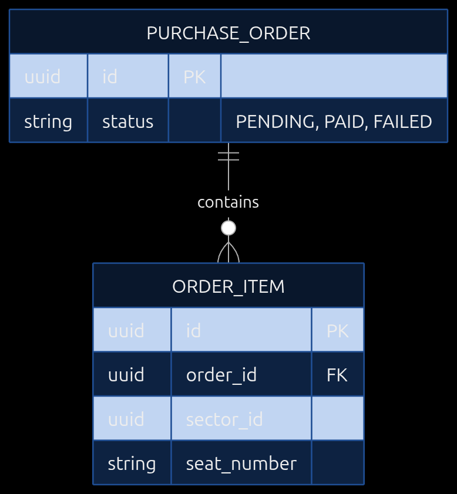
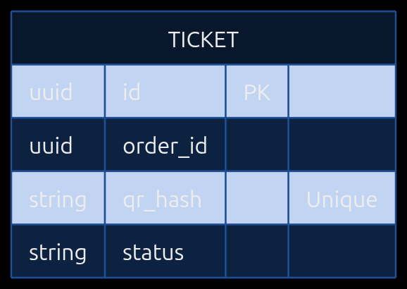
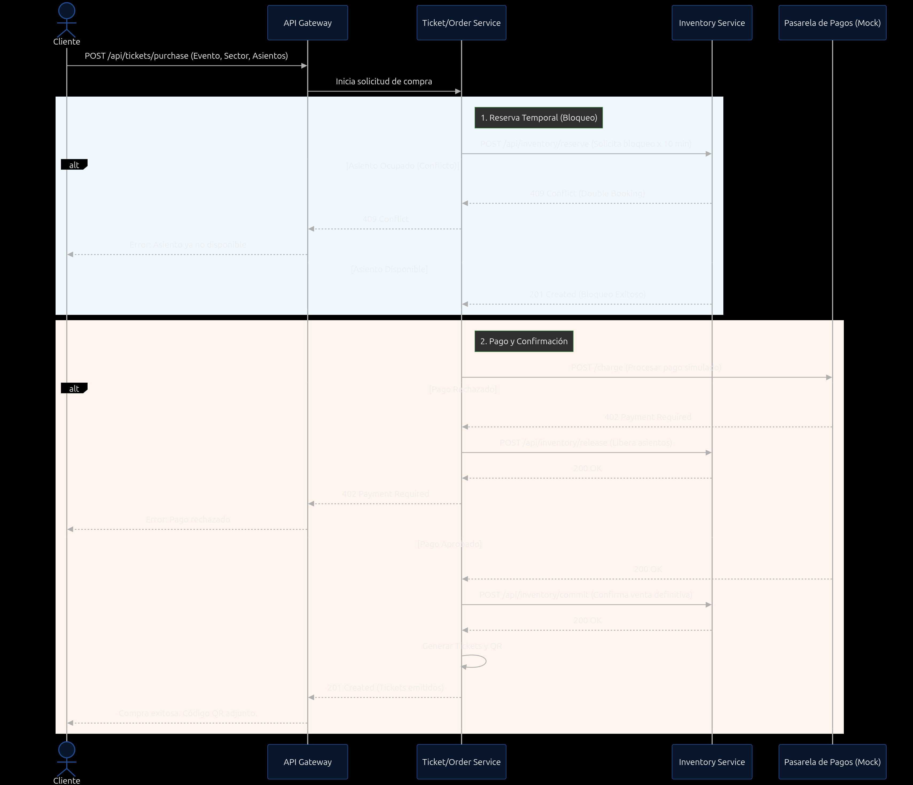
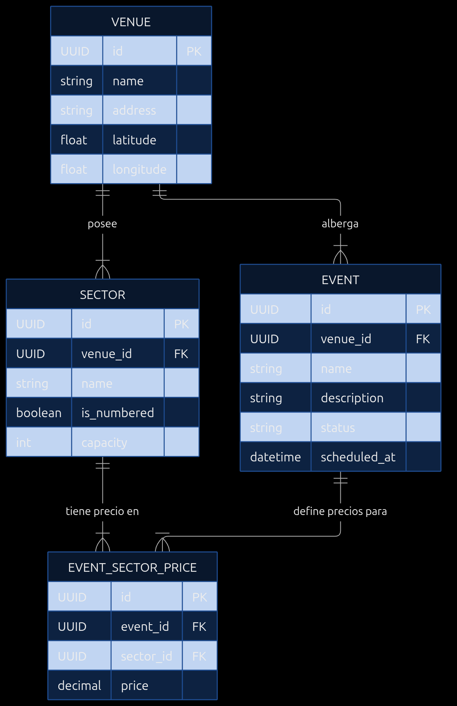
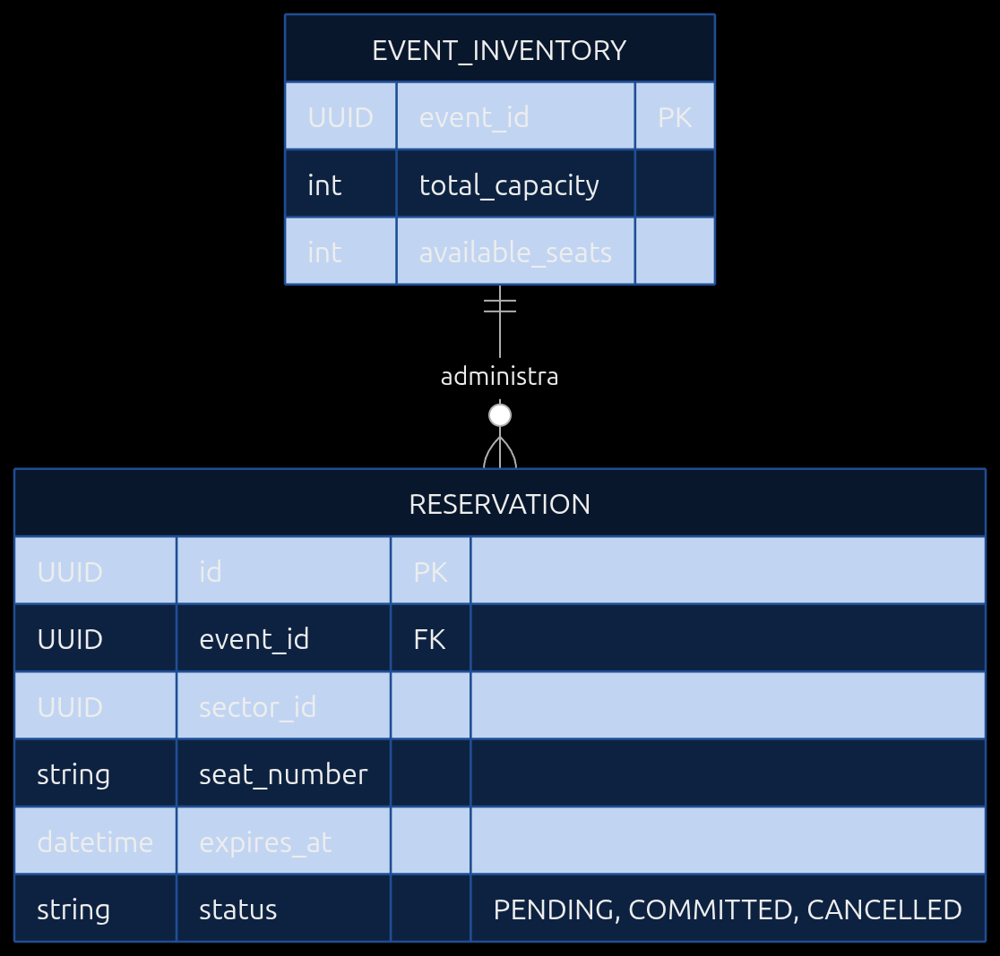
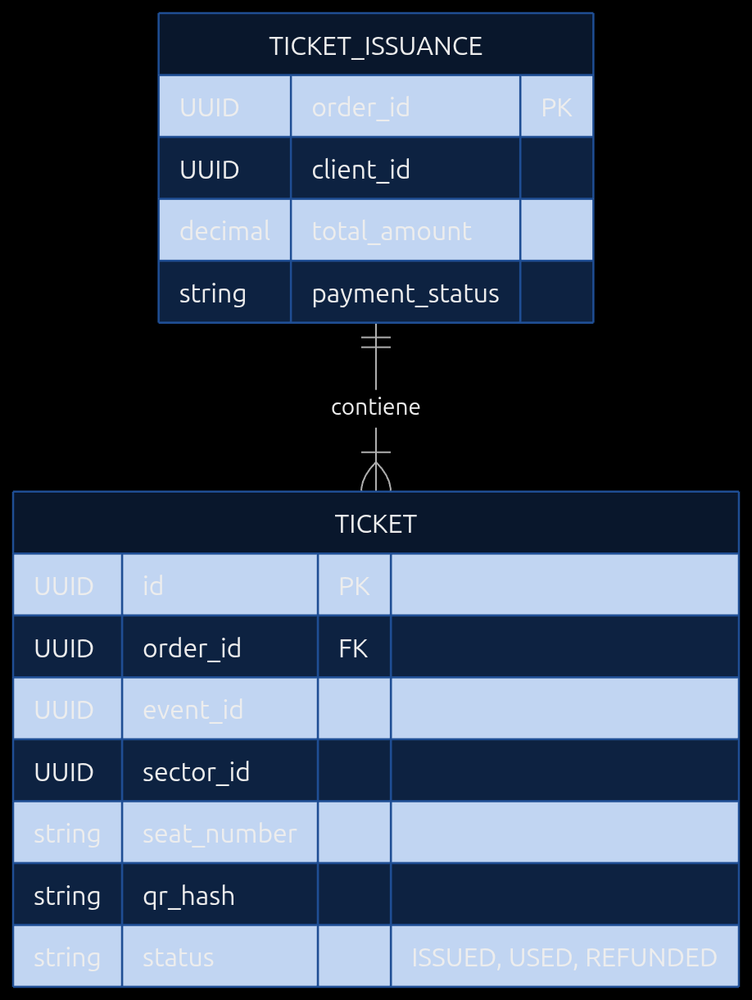

# Documento de Diseño Arquitectónico y Requerimientos - TicketYa (Entrega 1)

> **Estado del documento.** Esta es la propuesta de diseño inicial del equipo: features, user stories, diagramas y una primera versión de los contratos REST. La implementación evolucionó esos contratos. La fuente de verdad de lo implementado es [`docs/openapi.yaml`](openapi.yaml) (16 paths, 17 operaciones) y el resumen de arquitectura está en [`docs/architecture.md`](architecture.md). Diferencias concretas respecto de las secciones 5.1 a 5.3:
>
> - El alta y la consulta de la orden usan `POST /api/orders` y `GET /api/orders/{orderId}` (no `/api/v1/orders`). El comprador se identifica con `X-User-Id` y el reintento se protege con `Idempotency-Key`, en lugar de `clientId` en el cuerpo.
> - No hay endpoint `/pay` separado: la saga es síncrona y el cobro se dispara en el mismo `POST /api/orders`, con `payment.method` y un token de simulación (`tok_approved`, `tok_rejected`, `tok_pending`).
> - Los asientos se identifican por `seatIds` (UUID de Inventory), no por texto libre como `"Fila 3, Asiento 14"`; la admisión general usa `quantity`. Los precios nunca viajan en el request: se toman del snapshot de Catalog.
> - Los estados persistidos son `CONFIRMED`, `REJECTED`, `PAYMENT_PENDING`, `PAID_PENDING_TICKETS` y `COMPENSATED`.
> - Los comandos internos de Inventory viven en `/internal/reservations/**` y los de Payment Mock en `/internal/payments/**`; ninguno se publica por el Gateway.
>
> Los diagramas de las secciones 3 y 4 y las imágenes de la sección 6 se conservan como material de diseño; las versiones vigentes en Mermaid están en `docs/architecture.md`.

## 1. Features y User Stories (con Criterios de Aceptación)

### Feature 1: Gestión de Catálogo (Eventos y Lugares)
**US 1.1: Creación de Eventos**
* **Como** Organizador
* **Quiero** crear y configurar un evento en estado "borrador" definiendo lugares, sectores y precios
* **Para** poder publicarlo y vender entradas cuando esté listo.
* **Criterios de Aceptación:**
  * El evento debe incluir ID, nombre, descripción, tipo, fecha, hora, lugar y participantes.
  * Se deben poder asociar precios a los sectores del lugar seleccionado.
  * El evento debe guardarse inicialmente en estado "borrador".

**US 1.2: Búsqueda de Eventos**
* **Como** Cliente
* **Quiero** buscar eventos por tipo, organizador, ciudad y fechas
* **Para** encontrar opciones de entretenimiento de mi interés.
* **Criterios de Aceptación:**
  * Los resultados deben poder filtrarse por al menos 3 criterios combinados.
  * Los resultados deben poder ordenarse por fecha, precio o relevancia.
  * Solo se muestran eventos en estado "publicado" o "agotado".

### Feature 2: Inventario y Reservas
**US 2.1: Reserva Temporal de Asientos**
* **Como** Cliente
* **Quiero** seleccionar un sector/asiento y que se reserve temporalmente (ej. 10 min)
* **Para** asegurar mi lugar mientras completo el pago.
* **Criterios de Aceptación:**
  * El sistema debe bloquear el asiento seleccionado por exactamente 10 minutos.
  * Ningún otro cliente puede reservar el mismo asiento durante este bloqueo (Prevención de doble venta).
  * Si el pago no se completa en el tiempo, el asiento se libera automáticamente.

### Feature 3: Gestión de Pedidos y Entradas
**US 3.1: Emisión de Entradas**
* **Como** Sistema
* **Quiero** generar entradas únicas con código QR una vez aprobado el pago
* **Para** otorgarle el acceso al cliente.
* **Criterios de Aceptación:**
  * Cada entrada tiene un QR criptográficamente único.
  * Un mismo QR/entrada nunca puede emitirse dos veces.

---

## 2. Definición de Microservicios, Responsabilidades y API Pública

*   **API Gateway:** Punto de entrada único. Enrutamiento de peticiones e inyección de identificadores de trazabilidad.
*   **Catalog Service:** Gestiona lugares, sectores y eventos. Base de datos: PostgreSQL.
*   **Inventory Service:** Mantiene la disponibilidad en tiempo real. Maneja bloqueos temporales concurrentes utilizando transacciones ACID y restricciones de unicidad (Unique Constraints) para evitar la doble venta. Base de datos: PostgreSQL.
*   **Order & Payment Service:** Orquesta la compra. Se integra con la pasarela mockeada. Ejecuta las Sagas/Compensaciones si algo falla. Base de datos: PostgreSQL.
*   **Ticket Service:** Genera el QR y mantiene el estado de la entrada. Base de datos: PostgreSQL.

* DIAGRAMA DE ARQUITECTURA 


---

## 3. Diagramas Entidad-Relación por Microservicio

### DB: Catalog 


### DB: Inventory


### DB: Orders


### DB: Tickets


---

## 4. Diagrama de Secuencia: Flujo de Compra (Entrada Numerada)

Este diagrama modela el flujo síncrono orquestado por el `Order Service`. Contempla la creación de la reserva, el proceso de pago y las compensaciones en caso de rechazo o vencimiento de la reserva temporal (10 minutos).



---

## 5. Diseño de API REST (OpenAPI / Swagger)

A continuación se detallan los contratos principales para satisfacer la Entrega 1.

### 5.1. Iniciar Compra (Order Service)
Crea una orden en estado pendiente e invoca al inventario para bloquear temporalmente el asiento.

```yaml
openapi: 3.0.3
info:
  title: TicketYa Order Service API
  version: 1.0.0
paths:
  /api/v1/orders:
    post:
      summary: Inicia el proceso de compra de entradas
      requestBody:
        required: true
        content:
          application/json:
            schema:
              type: object
              properties:
                clientId:
                  type: string
                  format: uuid
                eventId:
                  type: string
                  format: uuid
                items:
                  type: array
                  items:
                    type: object
                    properties:
                      sectorId:
                        type: string
                        format: uuid
                      seatNumber:
                        type: string
            example:
              clientId: "d290f1ee-6c54-4b01-90e6-d701748f0851"
              eventId: "a143f1ee-6c54-4b01-90e6-d701748f1111"
              items:
                - sectorId: "b222f1ee-6c54-4b01-90e6-d701748f2222"
                  seatNumber: "Fila 3, Asiento 14"
      responses:
        '201':
          description: Orden creada y asientos bloqueados temporalmente.
          content:
            application/json:
              example:
                orderId: "c333f1ee-6c54-4b01-90e6-d701748f3333"
                status: "PENDING"
                expiresAt: "2026-11-10T21:00:00Z"
                totalAmount: 15000.00
        '409':
          description: Conflicto. Uno o más asientos solicitados ya están reservados o vendidos.
          content:
            application/json:
              example:
                error: "SEAT_ALREADY_TAKEN"
                message: "El asiento 'Fila 3, Asiento 14' ya se encuentra reservado."
```

### 5.2. Pagar Orden (Order Service)
Procesa el cobro simulado y emite las entradas si es exitoso.

```yaml
paths:
  /api/v1/orders/{orderId}/pay:
    post:
      summary: Procesa el pago de una orden pendiente
      parameters:
        - name: orderId
          in: path
          required: true
          schema:
            type: string
            format: uuid
      requestBody:
        required: true
        content:
          application/json:
            example:
              paymentMethod: "CREDIT_CARD"
              cardNumberToken: "tok_1J2k3l..."
      responses:
        '200':
          description: Pago exitoso y tickets emitidos.
          content:
            application/json:
              example:
                orderId: "c333f1ee-6c54-4b01-90e6-d701748f3333"
                status: "PAID"
                tickets:
                  - ticketId: "t999f1ee-6c54-4b01-90e6-d701748f9999"
                    qrData: "hash_unico_para_validar_en_puerta"
        '400':
          description: Reserva expirada.
          content:
            application/json:
              example:
                error: "ORDER_EXPIRED"
                message: "El tiempo de reserva de 10 minutos ha expirado. Los asientos fueron liberados."
        '402':
          description: Pago rechazado por la pasarela.
          content:
            application/json:
              example:
                error: "PAYMENT_REJECTED"
                message: "Fondos insuficientes. Se canceló la reserva."
```

### 5.3. Bloquear Inventario (Inventory Service - Comunicación Interna)
Llamado por el `Order Service` para garantizar la consistencia y exclusividad.

*   **Endpoint:** `POST /api/v1/inventory/reservations`
*   **Request JSON:** `{ "eventId": "...", "sectorId": "...", "seatNumber": "...", "ttlMinutes": 10 }`
*   **Response `201 Created`:** Reserva exitosa.
*   **Response `409 Conflict`:** Falla de llave única (Doble venta evitada).

## 6. Services: 


### SERVICE: Catalog


### SERVICE: Inventory


### SERVICE: Tickets

