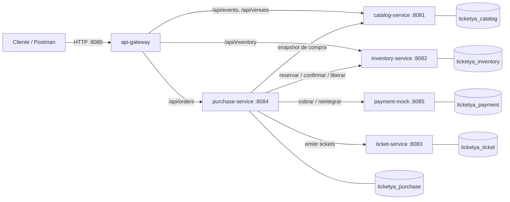
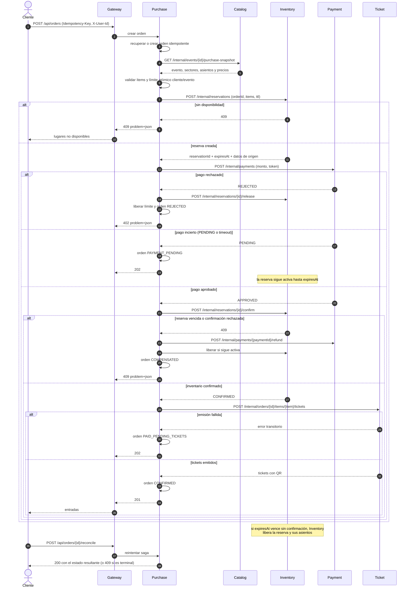
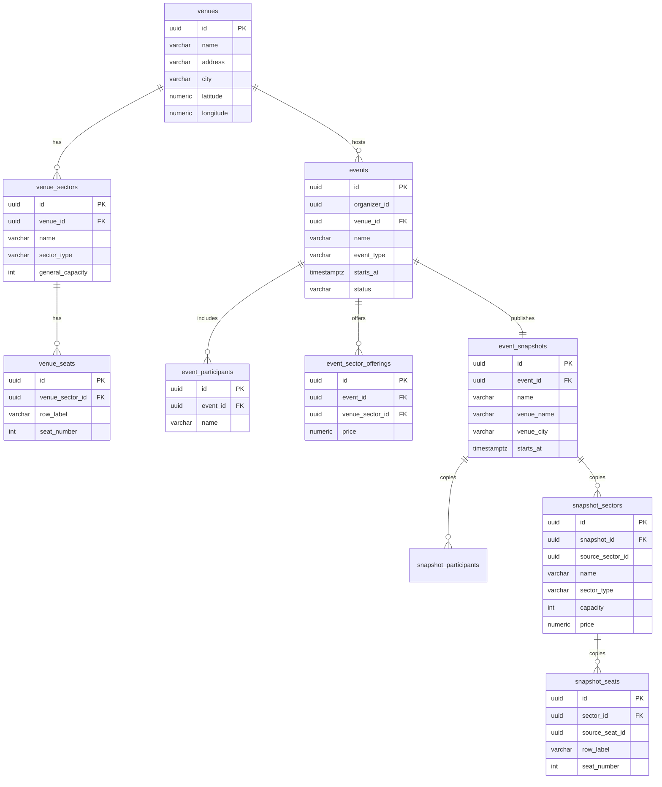
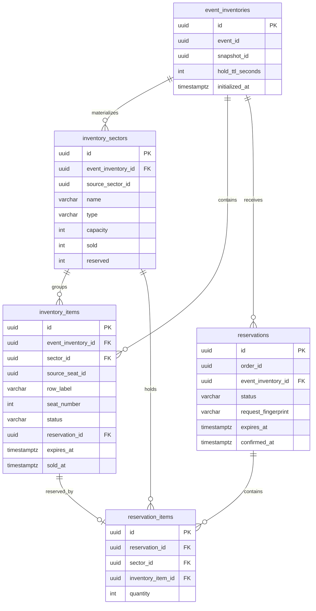
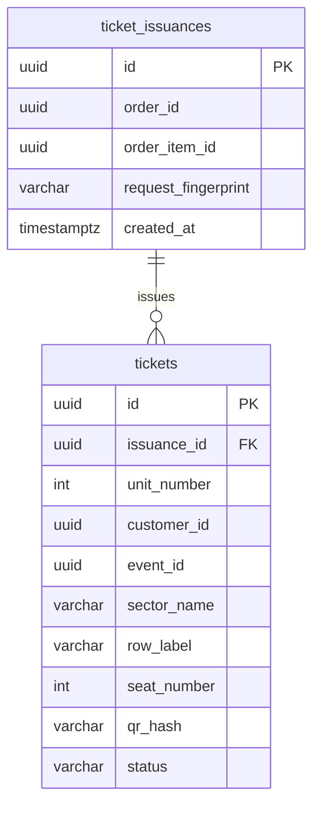
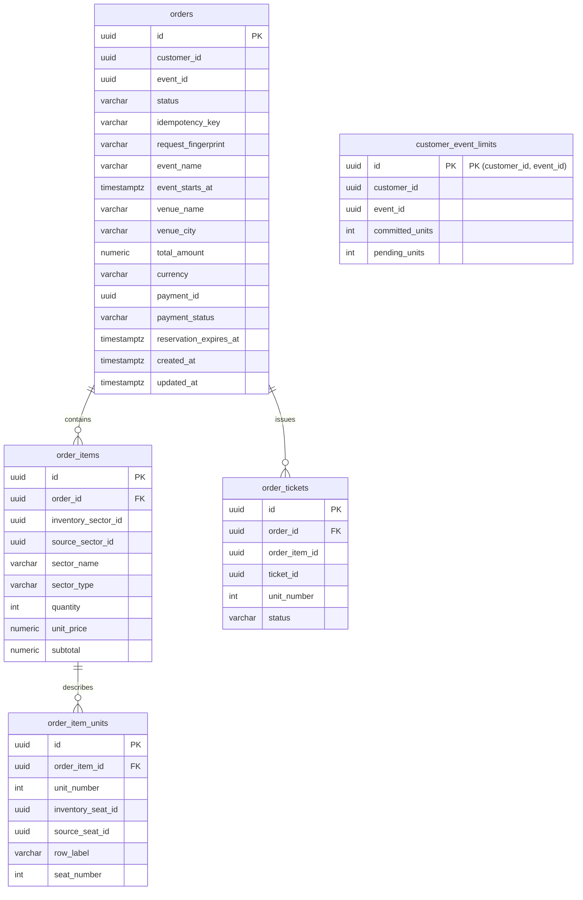
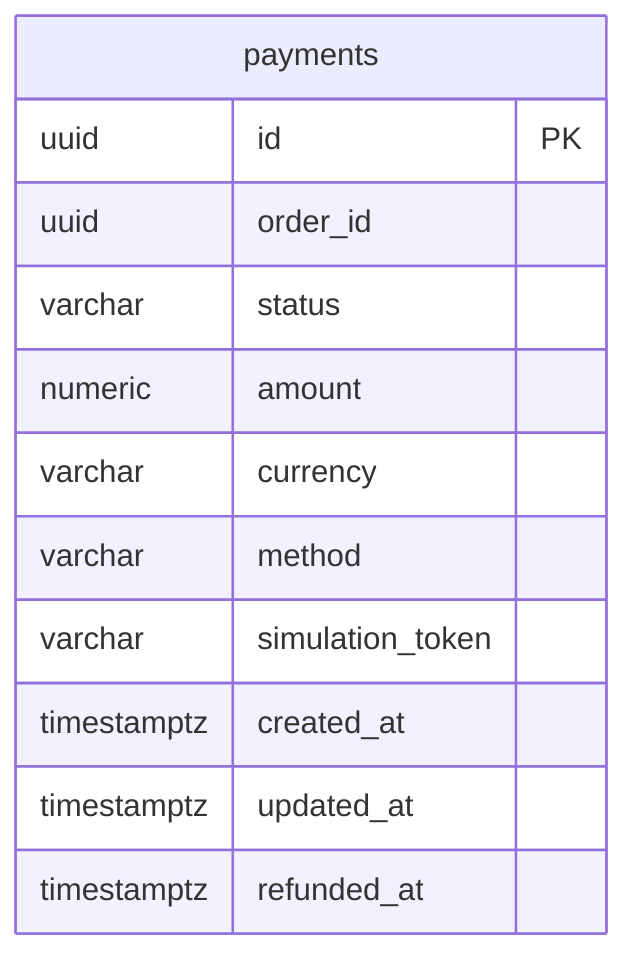

# Arquitectura y diseño — TicketYa

Documento de arquitectura de la Entrega 1. Resume los microservicios, sus
responsabilidades y su API, la comunicación entre ellos, el mecanismo contra la
doble venta y los modelos de datos. El contrato HTTP versionado está en
[`docs/openapi.yaml`](openapi.yaml) y las decisiones de detalle en
[`openspec/changes/establish-purchase-and-ticketing/design.md`](../openspec/changes/establish-purchase-and-ticketing/design.md).

## 1. Microservicios y responsabilidades

| Servicio | Puerto | Base de datos | API pública (vía Gateway) | API interna |
|---|---|---|---|---|
| `api-gateway` | 8080 | — | Punto de entrada único: `/api/events/**`, `/api/venues/**`, `/api/inventory/**`, `/api/orders/**` | — |
| `catalog-service` | 8081 | `ticketya_catalog` | Eventos publicados, detalle con sectores y precios, lugares y organizadores | `GET /internal/events/{eventId}/snapshot`, `GET /internal/events/{eventId}/purchase-snapshot`, `GET /internal/events/{eventId}/hold-ttl` |
| `inventory-service` | 8082 | `ticketya_inventory` | `GET /api/inventory/events/{eventId}/availability` | Reserva, consulta, confirmación y liberación bajo `/internal/reservations/**` |
| `ticket-service` | 8083 | `ticketya_ticket` | — (las entradas se leen desde la orden) | `POST /internal/orders/{orderId}/items/{orderItemId}/tickets` |
| `purchase-service` | 8084 | `ticketya_purchase` | `POST/GET /api/orders`, `GET /api/orders/{orderId}`, `POST /api/orders/{orderId}/reconcile` | — |
| `payment-mock` | 8085 | `ticketya_payment` | — | `POST /internal/payments`, `GET /internal/payments/{paymentId}`, `GET /internal/payments/by-order/{orderId}`, `POST /internal/payments/{paymentId}/refund` |

Sólo el Gateway publica un puerto al host (`8080`). Las rutas `/internal/**` no
tienen ruta en el Gateway: cualquier llamada externa a un comando interno
responde `404`.

Responsabilidades:

- **Catalog** es dueño del catálogo publicado y de los precios. Publica una
  copia inmutable (`event_snapshots`) que es la que consumen el resto de los
  servicios, de modo que editar el lugar no altera un evento ya publicado.
- **Inventory** es dueño de la disponibilidad: materializa sectores y asientos
  desde el snapshot de Catalog **sin copiar precios** y administra reservas con
  TTL.
- **Ticket** es dueño de las entradas emitidas y del hash del QR; la emisión es
  idempotente por orden e ítem.
- **Purchase** es el orquestador de la compra: dueño de la orden, del snapshot
  de precios y del límite por cliente y evento.
- **Payment Mock** simula la pasarela: dueño del pago y del reintegro, sin datos
  del comprador ni referencias a `purchase_db`.

## 2. Diagrama de módulos

Cada servicio es un proyecto Spring Boot independiente, con su propio `pom.xml`,
su `Dockerfile`, su esquema y su proceso. El POM raíz sólo agrega los módulos
para construir todo junto.

## 3. Comunicación

- **REST síncrono** sobre HTTP/JSON en esta entrega; no hay broker ni bus de
  eventos.
- Todas las llamadas propagan `X-Correlation-Id`; si falta, el servicio que
  recibe la solicitud genera un UUID y siempre lo devuelve en el header de
  respuesta, incluidas las respuestas de error.
- Los errores usan `application/problem+json` (`type`, `title`, `status`,
  `detail`, `instance` y `correlationId`).
- Purchase aplica timeouts por dependencia y persiste el estado de la saga
  antes de cada paso, de modo que un reintento con la misma `Idempotency-Key`
  recupera la orden en lugar de volver a cobrar o reservar.
- Los comandos que modifican estado son idempotentes por clave de negocio:
  reserva por `orderId`, pago por `orderId`, emisión por `(orderId, orderItemId)`
  y orden por `(customerId, idempotencyKey)`.

## 4. Secuencia de compra de una entrada numerada

Incluye pago rechazado, pago incierto y vencimiento de la reserva.

Estados persistidos de la orden: `CONFIRMED`, `REJECTED`, `PAYMENT_PENDING`,
`PAID_PENDING_TICKETS` y `COMPENSATED`. Los estados terminales son `CONFIRMED`,
`REJECTED` y `COMPENSATED`; reconciliar una orden terminal responde `409`.

## 5. Doble venta

El mecanismo no depende de una única instancia del servicio:

1. **Un asiento se vende una sola vez.** `inventory_items` tiene una restricción
   única por asiento de origen (`event_inventory_id, source_seat_id`) y la
   retención es un `UPDATE` condicional
   (`SET status='HELD', reservation_id=?, expires_at=? WHERE id=? AND sector_id=? AND status='AVAILABLE'`).
   Si dos instancias compiten, sólo una actualiza la fila; la otra obtiene `0`
   filas y responde `409`.
2. **La capacidad de admisión general se descuenta de forma atómica** con
   `UPDATE inventory_sectors SET reserved = reserved + ? WHERE id=? AND sold + reserved + ? <= capacity`.
3. **Una orden sólo se confirma si Inventory confirma la reserva**, y la
   confirmación vuelve a validar el estado y el vencimiento de la reserva.
4. **La reserva tiene TTL**: al vencer, Inventory la marca `EXPIRED` y libera
   asientos y cupos. Un pago aprobado sobre una reserva vencida se compensa con
   reintegro.
5. **La idempotencia cierra la ventana de reintentos**: la misma orden reutiliza
   la misma reserva y el mismo pago.

Las pruebas de `InventoryConcurrencyContractTest` ejercitan compras simultáneas
del mismo asiento y el último cupo de una zona, verificando exactamente una
confirmación.

## 6. Modelo de datos por microservicio

Cada servicio tiene su propia base; las referencias entre servicios son valores
UUID sin claves foráneas.

### Catalog

### Inventory

Restricciones clave: `UNIQUE (event_inventory_id, source_seat_id)` en
`inventory_items`, `UNIQUE (event_id)` en `event_inventories`,
`UNIQUE (order_id)` en `reservations`, y
`CHECK (sold + reserved <= capacity)` en `inventory_sectors`.

### Ticket

`UNIQUE (order_id, order_item_id)` hace idempotente la emisión y
`UNIQUE (qr_hash)` impide duplicar una entrada. La base guarda el hash del
payload, no el token del QR.

### Purchase

Restricciones: `UNIQUE (customer_id, idempotency_key)`,
`UNIQUE (customer_id, event_id)` en el límite,
`UNIQUE (order_id, order_item_id, unit_number)` en tickets y checks de montos y
cantidades positivas. Purchase guarda el **snapshot de precios** porque
Inventory nunca los persiste.

### Payment

`UNIQUE (order_id)` hace idempotente el cobro. Estados: `APPROVED`, `REJECTED`,
`PENDING` y `REFUNDED`. El token de simulación se persiste para detectar
reintentos con contenido distinto, pero nunca se expone en la respuesta.

## 7. Entidades solapadas entre bases

| Entidad | Dueño | Copias / referencias | Propósito y regla |
|---|---|---|---|
| `event` | Catalog (`events`, `event_snapshots`) | Inventory (`event_inventories.event_id`), Purchase (`orders.event_id`), Ticket (`tickets.event_id`) | Referencia UUID sin FK. Cada servicio guarda sólo los atributos que necesita para operar (Inventory el layout publicado; Purchase y Ticket los datos de presentación del snapshot). |
| `sector` | Catalog (`snapshot_sectors.source_sector_id`) | Inventory (`inventory_sectors.source_sector_id`), Purchase (`order_items.source_sector_id`) | Inventory materializa el sector con su propio `id` interno y conserva `source_sector_id` para trazabilidad; Purchase guarda ambos identificadores. Ningún servicio copia el precio salvo Purchase. |
| `seat` | Catalog (`snapshot_seats.source_seat_id`) | Inventory (`inventory_items.source_seat_id`), Purchase (`order_item_units.source_seat_id`) | Inventory es dueño de la disponibilidad y del estado vendido/retenido; Catalog sólo describe el layout. |
| `customer` | Identidad provisional por header `X-User-Id` | Purchase (`orders.customer_id`), Ticket (`tickets.customer_id`) | No hay servicio de identidad en esta entrega; se propaga el UUID del header. |
| `price` | Catalog (`snapshot_sectors.price`) | Purchase (`order_items.unit_price`, `orders.total_amount`) | Inventory nunca almacena precios. Purchase congela el precio del snapshot al crear la orden. |
| `payment` | Payment (`payments`) | Purchase (`orders.payment_id`, `orders.payment_status`) | Purchase guarda sólo el identificador y el estado del pago para la saga y la reconciliación. |
| `ticket` | Ticket (`tickets`) | Purchase (`order_tickets.ticket_id`) | Ticket es dueño del QR; Purchase guarda el identificador para exponerlo en la orden. |

## 8. Contrato y documentación

- Contrato consolidado: [`docs/openapi.yaml`](openapi.yaml) — 17 operaciones
  sobre 16 paths, con ejemplos, errores `problem+json` y esquemas de Purchase,
  Payment, Catalog e Inventory.
- OpenAPI en runtime: `/v3/api-docs` en los puertos internos de Catalog (8081),
  Inventory (8082), Ticket (8083), Purchase (8084) y Payment (8085).
- Colección de pruebas: `postman/ticketya.postman_collection.json`.
- Evidencia de ejecución: [`docs/verification.md`](verification.md).

## 9. Ejecución local

`docker compose up -d --build` levanta el Gateway en `http://localhost:8080`, los
cinco servicios y las cinco bases. Los puertos `8081`–`8085` no se publican al
host; el `docker-compose.yml` y `.env` documentan las variables de cada
servicio. El detalle paso a paso está en el [README](../README.md).
