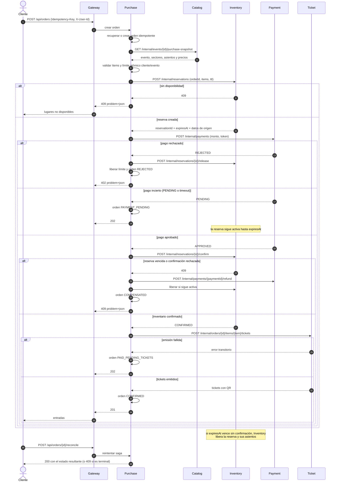
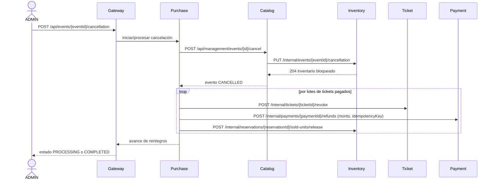
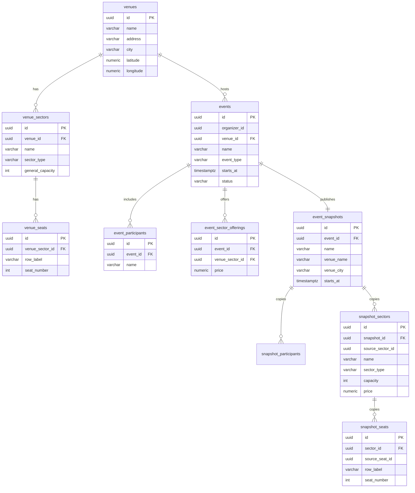
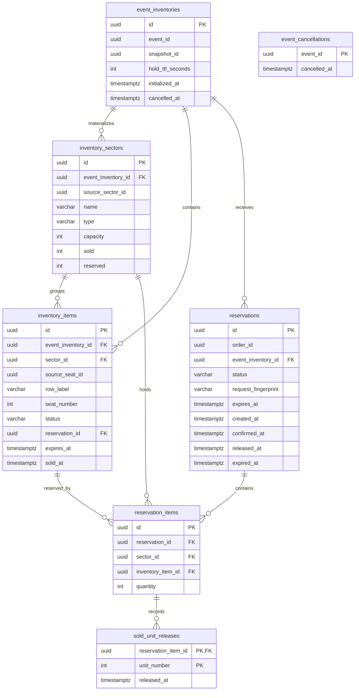
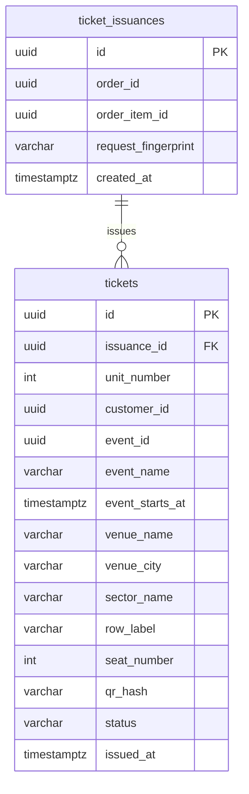
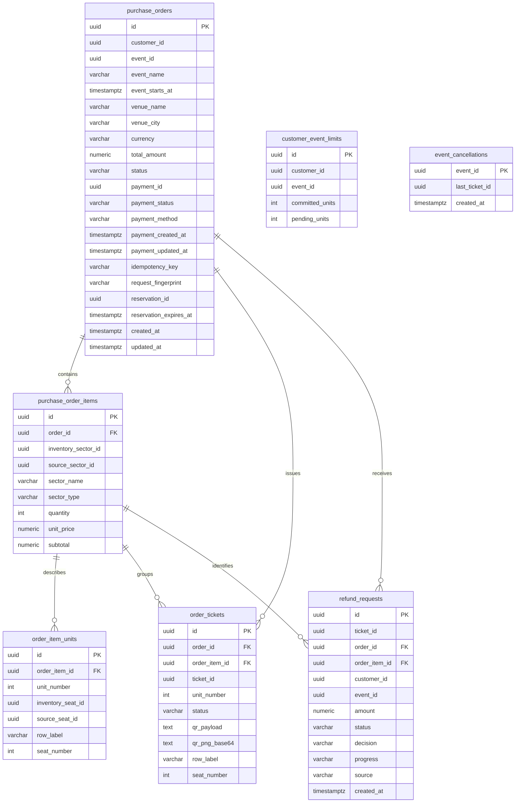
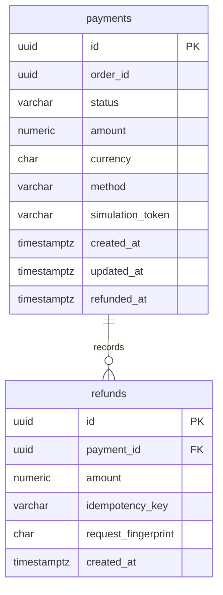

# Arquitectura y diseño — TicketYa

Documento de arquitectura de la Entrega 1. Resume los microservicios, sus
responsabilidades y su API, la comunicación entre ellos, el mecanismo contra la
doble venta y los modelos de datos. El contrato HTTP versionado está en
[`docs/openapi.yaml`](openapi.yaml) y las decisiones de detalle en
[`openspec/changes/archive/2026-11-15-establish-purchase-and-ticketing/design.md`](../openspec/changes/archive/2026-11-15-establish-purchase-and-ticketing/design.md).

## 1. Microservicios y responsabilidades

| Servicio | Puerto | Base de datos | API pública (vía Gateway) | API interna |
|---|---|---|---|---|
| `api-gateway` | 8080 | — | Punto de entrada único. Enruta `/api/inventory/**`, `/api/orders/**`, `/api/refunds/**` y `/api/events/*/cancellation`; el resto de `/api/**` va a Catalog. | — |
| `catalog-service` | 8081 | `ticketya_catalog` | Eventos: `GET /api/events`, `GET /api/events/{id}`; venues: `POST/GET /api/venues`, `PUT /api/venues/{id}`; gestión: `POST/GET /api/management/events`, `GET/PUT /api/management/events/{id}`, `PUT /api/management/events/{id}/offerings`, `POST /api/management/events/{id}/publish`, `/api/management/events/{id}/suspend`, `/api/management/events/{id}/cancel`, `/api/management/events/{id}/resume`. | `GET /internal/events/{eventId}/snapshot`, `GET /internal/events/{eventId}/purchase-snapshot` |
| `inventory-service` | 8082 | `ticketya_inventory` | `GET /api/inventory/events/{eventId}/availability` | `POST/GET /internal/reservations/**`, confirmar/liberar reserva, `POST /internal/reservations/{reservationId}/sold-units/release`, `PUT /internal/events/{eventId}/hold-ttl` y `PUT /internal/events/{eventId}/cancellation` |
| `ticket-service` | 8083 | `ticketya_ticket` | — (las entradas se leen desde la orden) | `POST /internal/orders/{orderId}/items/{orderItemId}/tickets` (emisión), `POST /internal/tickets/{ticketId}/revoke` |
| `purchase-service` | 8084 | `ticketya_purchase` | `POST/GET /api/orders`, `GET /api/orders/{orderId}`, `POST /api/orders/{orderId}/reconcile`; `POST /api/refunds/tickets/{ticketId}`, `GET /api/refunds/{refundId}`, `POST /api/refunds/{refundId}/decision`; `POST/GET /api/events/{eventId}/cancellation` | — |
| `payment-mock` | 8085 | `ticketya_payment` | — | `POST /internal/payments`, `GET /internal/payments/{paymentId}`, `GET /internal/payments/by-order/{orderId}`, `POST /internal/payments/{paymentId}/refund` (total), `POST /internal/payments/{paymentId}/refunds` (parcial) |

Las rutas de cancelación tienen propósitos distintos. Catalog expone
`POST /api/management/events/{id}/cancel`: cambia el estado a `CANCELLED` y
bloquea nuevas ventas en Inventory. Purchase expone
`POST /api/events/{eventId}/cancellation`: procesa los reintegros de entradas
ya vendidas y llama a la ruta de Catalog.

Sólo el Gateway publica un puerto al host (`8080`). Las rutas `/internal/**` no
tienen ruta en el Gateway: cualquier llamada externa a un comando interno
responde `404`.

Responsabilidades:

- **Catalog** es dueño del catálogo publicado y de los precios. Publica una
  copia inmutable (`event_snapshots`) que es la que consumen el resto de los
  servicios, de modo que editar el lugar no altera un evento ya publicado.
- El modelo `EventStatus` incluye `DRAFT`, `PUBLISHED`, `SUSPENDED`, `SOLD_OUT`,
  `CANCELLED` y `FINISHED`. E1 implementa las transiciones editoriales actuales;
  `SOLD_OUT` y `FINISHED` están modelados, pero sus transiciones están reservadas
  para flujos posteriores.
- **Inventory** es dueño de la disponibilidad: materializa sectores y asientos
  desde el snapshot de Catalog **sin copiar precios** y administra reservas con
  TTL.
- **Ticket** es dueño de las entradas emitidas y del hash del QR; la emisión es
  idempotente por orden e ítem y Purchase puede revocarlas ante una devolución.
  La validación del QR en el acceso no forma parte de E1.
- **Purchase** es el orquestador de la compra: dueño de la orden, del snapshot
  de precios, del límite por cliente y evento, y del progreso de devoluciones y
  cancelaciones de eventos.
- **Payment Mock** simula la pasarela: dueño del pago y del reintegro, sin datos
  del comprador ni referencias a `purchase_db`; registra reintegros parciales.

## 2. Diagrama de módulos

```mermaid
flowchart LR
    Client[Cliente / Postman] -->|HTTP :8080| GW[api-gateway]

    GW -->|/api/** excepto rutas dedicadas| CAT[catalog-service :8081]
    GW -->|/api/inventory| INV[inventory-service :8082]
    GW -->|/api/orders, /api/refunds, cancelación de evento| PUR[purchase-service :8084]

    PUR -->|snapshot / fecha / cancelación lógica (F7)| CAT
    CAT -->|bloquear ventas de evento cancelado| INV
    PUR -->|reservar / confirmar / liberar unidad vendida (F7)| INV
    PUR -->|cobrar / reintegrar total o parcialmente (F7)| PAY[payment-mock :8085]
    PUR -->|emitir / revocar tickets (F7)| TKT[ticket-service :8083]

    CAT --- DB1[(ticketya_catalog)]
    INV --- DB2[(ticketya_inventory)]
    TKT --- DB3[(ticketya_ticket)]
    PUR --- DB4[(ticketya_purchase)]
    PAY --- DB5[(ticketya_payment)]
```

Cada servicio es un proyecto Spring Boot independiente, con su propio `pom.xml`,
su `Dockerfile`, su esquema y su proceso. El POM raíz sólo agrega los módulos
para construir todo junto.

## 3. Comunicación

- **REST síncrono** sobre HTTP/JSON en esta entrega; no hay broker ni bus de
  eventos.
- Todas las llamadas propagan `X-Correlation-Id`; si falta, el servicio que
  recibe la solicitud genera un UUID y siempre lo devuelve en el header de
  respuesta, incluidas las respuestas de error.
- Los errores usan `application/problem+json` (`type`, `title`, `status`,
  `detail`, `instance` y `correlationId`).
- Purchase aplica timeouts por dependencia y persiste el estado de la saga
  antes de cada paso, de modo que un reintento con la misma `Idempotency-Key`
  recupera la orden en lugar de volver a cobrar o reservar.
- Los comandos que modifican estado son idempotentes por clave de negocio:
  reserva por `orderId`, pago por `orderId`, emisión por `(orderId, orderItemId)`
  y orden por `(customerId, idempotencyKey)`.

## 4. Secuencia de compra de una entrada numerada

Incluye pago rechazado, pago incierto y vencimiento de la reserva.



Estados persistidos de la orden: `CONFIRMED`, `REJECTED`, `PAYMENT_PENDING`,
`PAID_PENDING_TICKETS` y `COMPENSATED`. Los estados terminales son `CONFIRMED`,
`REJECTED` y `COMPENSATED`; reconciliar una orden terminal responde `409`.

### Devolución individual y cancelación de evento (F7)

Una devolución individual se solicita en `POST /api/refunds/tickets/{ticketId}` y
un ADMIN la aprueba o rechaza en `POST /api/refunds/{refundId}/decision`. La
cancelación masiva comienza en Purchase; Purchase solicita a Catalog la
cancelación lógica del evento y Catalog bloquea el inventario. Por cada ticket
pagado, Purchase persiste y ejecuta los mismos pasos de revocación, reintegro
parcial y liberación de unidad vendida. Cada invocación procesa un lote de forma
síncrona y persiste el avance para reintentar; no agrega broker ni servicio.



La misma secuencia de revocación, reintegro y liberación se usa tras aprobar una
devolución individual. E1 emite y revoca el QR; no implementa su validación en el
acceso.

## 5. Doble venta

El mecanismo no depende de una única instancia del servicio:

1. **Un asiento se vende una sola vez.** `inventory_items` tiene una restricción
   única por asiento de origen (`event_inventory_id, source_seat_id`) y la
   retención es un `UPDATE` condicional
   (`SET status='HELD', reservation_id=?, expires_at=? WHERE id=? AND sector_id=? AND status='AVAILABLE'`).
   Si dos instancias compiten, sólo una actualiza la fila; la otra obtiene `0`
   filas y responde `409`.
2. **La capacidad de admisión general se descuenta de forma atómica** con
   `UPDATE inventory_sectors SET reserved = reserved + ? WHERE id=? AND sold + reserved + ? <= capacity`.
3. **Una orden sólo se confirma si Inventory confirma la reserva**, y la
   confirmación vuelve a validar el estado y el vencimiento de la reserva.
4. **La reserva tiene TTL**: al vencer, Inventory la marca `EXPIRED` y libera
   asientos y cupos. Un pago aprobado sobre una reserva vencida se compensa con
   reintegro.
5. **La idempotencia cierra la ventana de reintentos**: la misma orden reutiliza
   la misma reserva y el mismo pago.

Las pruebas de `InventoryConcurrencyContractTest` ejercitan compras simultáneas
del mismo asiento y el último cupo de una zona, verificando exactamente una
confirmación.

## 6. Modelo de datos por microservicio

Cada servicio tiene su propia base; las referencias entre servicios son valores
UUID sin claves foráneas.

### Catalog



### Inventory



Restricciones clave: `UNIQUE (event_inventory_id, source_seat_id)` en
`inventory_items`, `UNIQUE (event_id)` en `event_inventories`,
`UNIQUE (order_id)` en `reservations`, y
`CHECK (sold + reserved <= capacity)` en `inventory_sectors`. `event_cancellations`
usa `event_id` como UUID sin FK; `sold_unit_releases` referencia localmente
`reservation_items(id)` y tiene clave primaria `(reservation_item_id, unit_number)`.

### Ticket



`UNIQUE (order_id, order_item_id)` hace idempotente la emisión y
`UNIQUE (qr_hash)` impide duplicar una entrada. La base guarda el hash del
payload, no el token del QR. `order_id`, `order_item_id`, `customer_id` y
`event_id` son referencias UUID sin FK a otras bases; el único vínculo relacional
local es `tickets.issuance_id`.

### Purchase



Tablas y columnas de `schema.sql`: las FK de `purchase_order_items`,
`order_item_units`, `order_tickets` y `refund_requests` sólo apuntan a tablas
Purchase. `customer_event_limits` no tiene FK a órdenes; su índice único es
`(customer_id, event_id)`. Restricciones adicionales: único
`(customer_id, idempotency_key)` en `purchase_orders`, `(order_item_id,
unit_number)` en `order_item_units`, `ticket_id` y `(order_id, order_item_id,
unit_number)` en `order_tickets`, y `(ticket_id, source)` en `refund_requests`.
`refund_requests.amount` tiene `CHECK (amount > 0)`.
`ticket_id`, `last_ticket_id`, `event_id`, `payment_id`, `reservation_id` e
`inventory_*` son referencias UUID sin FK entre servicios. Purchase guarda el
**snapshot de precios** porque Inventory nunca los persiste.

### Payment



`payments.order_id` es único y no tiene FK a Purchase. Estados del pago:
`APPROVED`, `REJECTED`, `PENDING` y `REFUNDED`. Cada reintegro total o parcial
queda en `refunds`, con clave de idempotencia única y FK local a `payments`.
El token de simulación se persiste para detectar reintentos con contenido
distinto, pero nunca se expone en la respuesta.

## 7. Entidades solapadas entre bases

| Entidad | Dueño | Copias / referencias | Propósito y regla |
|---|---|---|---|
| `event` | Catalog (`events`, `event_snapshots`) | Inventory (`event_inventories.event_id`, `event_cancellations.event_id`), Purchase (`purchase_orders.event_id`, `refund_requests.event_id`, `event_cancellations.event_id`), Ticket (`tickets.event_id`) | Referencias UUID sin FK. Cada servicio conserva sólo los atributos que necesita. |
| `sector` | Catalog (`snapshot_sectors.source_sector_id`) | Inventory (`inventory_sectors.source_sector_id`), Purchase (`purchase_order_items.source_sector_id`) | Inventory materializa el sector con su propio ID y conserva `source_sector_id`; Purchase guarda ambos identificadores. Ningún servicio copia el precio salvo Purchase. |
| `seat` | Catalog (`snapshot_seats.source_seat_id`) | Inventory (`inventory_items.source_seat_id`), Purchase (`order_item_units.source_seat_id`) | Inventory es dueño de la disponibilidad y estado vendido/retenido; Catalog describe el layout. |
| `customer` | Identidad provisional por header `X-User-Id` | Purchase (`purchase_orders.customer_id`, `customer_event_limits.customer_id`, `refund_requests.customer_id`), Ticket (`tickets.customer_id`) | No hay servicio de identidad en esta entrega; se propaga el UUID del header. |
| `price` | Catalog (`snapshot_sectors.price`) | Purchase (`purchase_order_items.unit_price`, `purchase_orders.total_amount`, `refund_requests.amount`) | Inventory nunca almacena precios. Purchase congela el precio del snapshot al crear la orden. |
| `payment` | Payment (`payments`, `refunds`) | Purchase (`purchase_orders.payment_id`, `purchase_orders.payment_status`) | Purchase guarda el identificador y estado del pago. `payments.order_id` y `refunds.payment_id` no crean FK entre bases. |
| `ticket` | Ticket (`tickets`, hash QR y estado) | Purchase (`order_tickets.ticket_id`, `qr_payload`, `qr_png_base64`; `refund_requests.ticket_id`) | Ticket es dueño del ticket y su revocación. Purchase conserva la copia del payload/PNG que devuelve al titular al consultar su orden; no hay FK hacia `ticket_db`. |
| `reservation` | Inventory (`reservations`) | Purchase (`purchase_orders.reservation_id`) | Referencia UUID entre bases; Purchase no consulta tablas de Inventory. |

## 8. Contrato y documentación

- Contrato consolidado: [`docs/openapi.yaml`](openapi.yaml) — 41 operaciones
  sobre 36 rutas, con ejemplos, errores `problem+json` y esquemas de Purchase,
  Payment, Catalog e Inventory.
- OpenAPI en runtime: `/v3/api-docs` en los puertos internos de Catalog (8081),
  Inventory (8082), Ticket (8083), Purchase (8084) y Payment (8085).
- Colección de pruebas: `postman/ticketya.postman_collection.json`.
- Evidencia de ejecución: [`docs/verification.md`](verification.md).

## 9. Ejecución local

`docker compose up -d --build` levanta el Gateway en `http://localhost:8080`, los
cinco servicios y las cinco bases. Los puertos `8081`–`8085` no se publican al
host; el `docker-compose.yml` y `.env` documentan las variables de cada
servicio. El detalle paso a paso está en el [README](../README.md).
