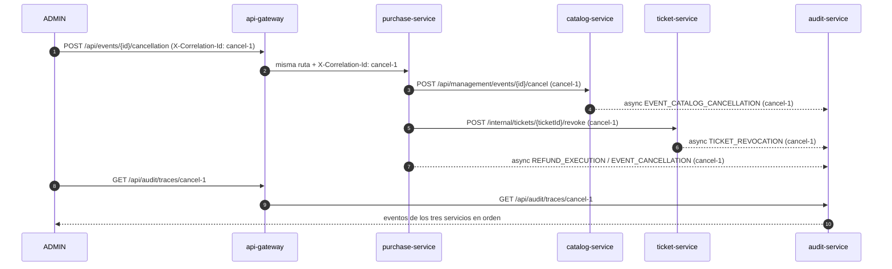
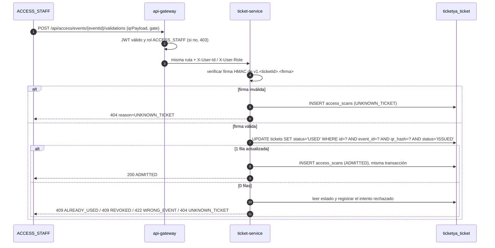
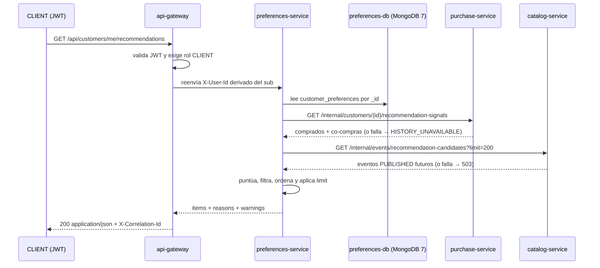

# Arquitectura y diseño — TicketYa

Documento de arquitectura de la Entrega 1 y de las épicas de Entrega 2
E2-01 (JWT y roles), E2-02 (trazabilidad y bitácora centralizada), E2-03
(control de acceso QR), E2-04 (reportes del organizador) y PDF-F10 (preferencias y recomendaciones). Resume los microservicios, sus
responsabilidades y su API, la comunicación entre ellos, el mecanismo contra la
doble venta y los modelos de datos. Incluye el núcleo de la Entrega 1 y las
épicas de Entrega 2 ya implementadas: seguridad JWT (`add-jwt-and-role-security`)
y fila virtual (`add-virtual-queue`). El contrato HTTP versionado está en
[`docs/openapi.yaml`](openapi.yaml) y las decisiones de detalle en
[`openspec/changes/archive/2026-11-15-establish-purchase-and-ticketing/design.md`](../openspec/changes/archive/2026-11-15-establish-purchase-and-ticketing/design.md)
y [`openspec/changes/add-virtual-queue/design.md`](../openspec/changes/add-virtual-queue/design.md).

## 1. Microservicios y responsabilidades

| Servicio | Puerto | Base de datos | API pública (vía Gateway) | API interna |
|---|---|---|---|---|
| `api-gateway` | 8080 | — | Punto de entrada único. Valida el JWT (Bearer), exige rol en `/api/access/**`, `/api/reports/**` y `/api/audit/**`, registra cada solicitud y enruta `/api/inventory/**`, `/api/orders/**`, `/api/refunds/**`, `/api/events/*/cancellation`, `/api/reports/**` (Purchase), `/api/access/**` (Ticket) y `/api/audit/**` (Audit); el resto de `/api/**` va a Catalog. | — |
| `catalog-service` | 8081 | `ticketya_catalog` | Eventos: `GET /api/events`, `GET /api/events/{id}`; venues: `POST/GET /api/venues`, `PUT /api/venues/{id}`; gestión: `POST/GET /api/management/events`, `GET/PUT /api/management/events/{id}`, `PUT /api/management/events/{id}/offerings`, `POST /api/management/events/{id}/publish`, `/api/management/events/{id}/suspend`, `/api/management/events/{id}/cancel`, `/api/management/events/{id}/resume`. | `GET /internal/events/{eventId}/snapshot`, `GET /internal/events/{eventId}/purchase-snapshot` |
| `inventory-service` | 8082 | `ticketya_inventory` | `GET /api/inventory/events/{eventId}/availability` | `POST/GET /internal/reservations/**`, confirmar/liberar reserva, `POST /internal/reservations/{reservationId}/sold-units/release`, `PUT /internal/events/{eventId}/hold-ttl` y `PUT /internal/events/{eventId}/cancellation` |
| `ticket-service` | 8083 | `ticketya_ticket` | Control de acceso (E2-03): `POST /api/access/events/{eventId}/validations`, `GET /api/access/events/{eventId}/scans`. Las entradas del comprador se leen desde la orden. | `POST /internal/orders/{orderId}/items/{orderItemId}/tickets` (emisión), `POST /internal/tickets/{ticketId}/revoke` |
| `purchase-service` | 8084 | `ticketya_purchase` | `POST/GET /api/orders`, `GET /api/orders/{orderId}`, `POST /api/orders/{orderId}/reconcile`; `POST /api/refunds/tickets/{ticketId}`, `GET /api/refunds/{refundId}`, `POST /api/refunds/{refundId}/decision`; `POST/GET /api/events/{eventId}/cancellation`; reportes (E2-04): `GET /api/reports/events/{eventId}` | — |
| `payment-mock` | 8085 | `ticketya_payment` | — | `POST /internal/payments`, `GET /internal/payments/{paymentId}`, `GET /internal/payments/by-order/{orderId}`, `POST /internal/payments/{paymentId}/refund` (total), `POST /internal/payments/{paymentId}/refunds` (parcial) |
| `audit-service` (E2-02) | 8086 | `ticketya_audit` | `GET /api/audit/events`, `GET /api/audit/traces/{correlationId}` (sólo ADMIN) | `POST /internal/audit-events` (ingesta idempotente) |
| `queue-service` (E2-02) | 8086 | `ticketya_queue` | `POST /api/queue/events/{eventId}/entries`, `GET/DELETE /api/queue/events/{eventId}/entries/me` | `POST /internal/admissions/validate` |
| `preferences-service` (PDF-F10) | 8087 | `ticketya_preferences` (**MongoDB 7**) | `PUT/GET /api/customers/me/preferences`, `GET /api/customers/me/recommendations?limit=10` (sólo `CLIENT`) | Consume `GET /internal/customers/{customerId}/recommendation-signals` (Purchase) y `GET /internal/events/recommendation-candidates?limit=200` (Catalog) |

Las rutas de cancelación tienen propósitos distintos. Catalog expone
`POST /api/management/events/{id}/cancel`: cambia el estado a `CANCELLED` y
Bloquea nuevas reservas en Inventory; luego procesa los tickets pagados por lotes.
Cada ticket se revoca, se reintegra por su importe y libera su unidad vendida.

## 2. Diagrama de módulos

```mermaid
flowchart LR
    GW -->|/api/** excepto rutas dedicadas| CAT[catalog-service :8081]
    GW -->|/api/inventory| INV[inventory-service :8082]
    GW -->|/api/orders, /api/refunds, cancelación, /api/reports| PUR[purchase-service :8084]
    GW -->|/api/access| TKT[ticket-service :8083]
    GW -->|/api/audit| AUD[audit-service :8086]
    GW -->|/api/customers (sólo CLIENT)| PREF[preferences-service :8087]
    PREF -->|señales de historial| PUR
    PREF -->|candidatos publicados| CAT
    PREF --- DB7[(ticketya_preferences · MongoDB 7)]
    PUR -->|snapshot / fecha / cancelación lógica (F7)| CAT
    PUR -->|validar y consumir admisión (F6)| QUE[queue-service :8086]
    QUE -->|snapshot publicado: highDemand| CAT
    CAT -->|bloquear ventas de evento cancelado| INV
    PUR -->|reservar / confirmar / liberar unidad vendida (F7)| INV
    PUR -->|cobrar / reintegrar total o parcialmente (F7)| PAY[payment-mock :8085]
    TKT --- DB3[(ticketya_ticket)]
    PUR --- DB4[(ticketya_purchase)]
    PAY --- DB5[(ticketya_payment)]
    AUD --- DB6[(ticketya_audit)]
    QUE --- DB6[(ticketya_queue)]

Las flechas punteadas son envíos asíncronos *fire-and-forget* (E2-02): la
operación de negocio nunca espera a Audit Service.

Cada servicio es un proyecto Spring Boot independiente, con su propio `pom.xml`,
su `Dockerfile`, su esquema y su proceso. El POM raíz sólo agrega los módulos
para construir todo junto.

## 3. Responsabilidades por épica

### E2-01: Seguridad JWT y roles

El Gateway valida el JWT Bearer antes de enrutar cualquier petición. Rutas protegidas
exigen un claim `roles` con exactamente uno de `CLIENT`, `ORGANIZER`, `ADMIN` o
`ACCESS_STAFF`. El Gateway deriva los encabezados internos `X-User-Id` y
`X-User-Role` de los claims del JWT y los descarta enviados por el cliente. No se
registran ni versionan tokens.

### E2-02: Bitácora centralizada

`audit-service` es el dueño de la bitácora append-only `ticketya_audit`. Cada
servicio productor (Catalog, Ticket, Purchase) envía eventos críticos mediante
`POST /internal/audit-events` de forma asíncrona y fire-and-forget. El Gateway
también registra cada solicitud HTTP (`AccessLogWebFilter`) y los logs de cada
servicio incluyen `X-Correlation-Id` en el patrón MDC. `GET /api/audit/traces/{correlationId}`
devuelve todos los eventos asociados a una operación en orden cronológico.

### E2-03: Control de acceso con QR

Ticket Service valida las entradas en el acceso mediante `UPDATE condicional`
sobre la fila del ticket. El primer escaneo cambia `ISSUED → USED`; los
demás reciben `409 ALREADY_USED`. Se registra cada intento en `access_scans`
con `X-Correlation-Id`. Se lanzan 25 escaneos concurrentes del mismo QR y se
verifica un solo `200`, 24 `409` y un único registro `ADMITTED`. Una entrada de
otro evento no se consume (`422`). Una revocada por devolución o cancelación se
rechaza (`409 REVOKED`).

### E2-04: Reportes del organizador

`GET /api/reports/events/{eventId}` en Purchase combina tres fuentes:
1. Catalog (`GET /api/management/events/{id}`): ownership check (`ORGANIZER` sólo
   sus eventos, `403` si es ajeno; `ADMIN` cualquiera) + nombre, estado y precio
   vigente por sector.
2. Purchase (base propia): unidades de órdenes pagadas (`CONFIRMED` o
   `PAID_PENDING_TICKETS`) e importe por sector, devoluciones `COMPLETED`.
   `DISTINCT ON (ticket_id)` para que una entrada con solicitud y cancelación cuente
   una sola vez.
3. Inventory (disponibilidad pública): capacidad de cada sector.

Fórmulas: `activeTickets = sold - refunded`, `occupancyPercent = active / capacity * 100`
con 2 decimales, `netRevenue = gross - refunded`. Si Inventory no responde, se
entrega el reporte con capacidad y ocupación nulas y `capacityAvailable: false`; si
Catalog no responde, `503`.

## 4. Entidades solapadas entre bases

| Entidad | Dueño | Observación |
|---|---|---|
| `payment` | Payment (`payments`, `refunds`) / Purchase (`purchase_orders.payment_id`, `purchase_orders.payment_status`) | Purchase guarda el identificador y estado del pago. `payments.order_id` y `refunds.payment_id` no crean FK entre bases. |
| `ticket` | Ticket (`tickets`, hash QR y estado) / Purchase (`order_tickets.ticket_id`, `qr_payload`, `qr_png_base64`; `refund_requests.ticket_id`) | Ticket es dueño del ticket y su revocación. Purchase conserva la copia del payload/PNG. No hay FK hacia `ticket_db`. |
| `reservation` | Inventory (`reservations`) / Purchase (`purchase_orders.reservation_id`) | Referencia UUID entre bases; Purchase no consulta tablas de Inventory. |
| `correlation` / operación | Audit (`audit_events.correlation_id`) / Ticket (`access_scans.correlation_id`) y log de cada servicio | El `X-Correlation-Id` es el identificador común de una operación; no es una entidad con dueño sino la clave para unir registros de varios servicios. |
| `queue entry` | Queue (`queue_entries`, `queue_counters`) / Purchase (no la copia) | Queue es dueño del turno, la posición y el consumo del token. Ni Catalog ni Purchase almacenan turnos; `queue_entries.idempotency_key` referencia la `Idempotency-Key` de la orden sólo como traza. |

## 5. Flujo de cancelación

La cancelación de un evento produce, con un único `X-Correlation-Id`, eventos de
Purchase (`EVENT_CANCELLATION`, `REFUND_EXECUTION`), Catalog
(`EVENT_CATALOG_CANCELLATION`) y Ticket (`TICKET_REVOCATION`). `GET /api/audit/traces/{correlationId}`
los devuelve en orden cronológico.

```mermaid
sequenceDiagram
    autonumber
    participant A as ADMIN
    participant G as api-gateway
    participant P as purchase-service
    participant C as catalog-service
    participant T as ticket-service
    participant AU as audit-service
    A->>G: POST /api/events/{id}/cancellation (X-Correlation-Id: cancel-1)
    G->>P: misma ruta + X-Correlation-Id: cancel-1
    P->>C: POST /api/management/events/{id}/cancel (cancel-1)
    C-->>AU: async EVENT_CATALOG_CANCELLATION (cancel-1)
    P->>T: POST /internal/tickets/{ticketId}/revoke (cancel-1)
    T-->>AU: async TICKET_REVOCATION (cancel-1)
    P-->>AU: async REFUND_EXECUTION / EVENT_CANCELLATION (cancel-1)
    A->>G: GET /api/audit/traces/cancel-1
    G->>AU: GET /api/audit/traces/cancel-1
    AU-->>A: eventos de los tres servicios en orden
```

## 6. Trazabilidad y bitácora centralizada (E2-02)

El PDF pide dos niveles de registro; cada uno tiene un mecanismo propio.

**Registro de cada solicitud HTTP.** El Gateway (`AccessLogWebFilter`) y cada
servicio (`RequestLoggingFilter`) escribe una línea en el logger
`ticketya.http`:

```
http method=POST path=/api/orders status=201 durationMs=281 userId=4bd7…6c1 role=CLIENT correlationId=17e9…211
```

- En el Gateway el filtro se ejecuta antes de la seguridad, por lo que también
  registra los `401` y `403` que no llegan a los servicios. El usuario y el rol
  los copia del JWT ya validado un filtro dentro de la cadena de seguridad
  (`AuthenticatedIdentityCaptureFilter`), antes de la autorización.
- En los servicios, `userId` y `role` son la identidad derivada que propaga el
  Gateway (`X-User-Id`/`X-User-Role`).
- Todas las líneas de log de los servicios llevan el servicio y el
  `X-Correlation-Id` en el patrón (MDC):
  `INFO [purchase-service,17e9…211]`.
- Los healthchecks (`/actuator/**`) se registran en DEBUG para no inundar el log.
- `docker compose logs -f` reúne los logs de todos los contenedores en un solo
  flujo.

**Bitácora centralizada de operaciones críticas.** `audit-service` guarda en
`ticketya_audit` un evento por operación crítica, con el mismo
`X-Correlation-Id` que recorre la operación entre servicios:

| Servicio | Operación (`operation`) | Resultados (`outcome`) |
|---|---|---|
| Purchase | `PURCHASE_ORDER`, `PURCHASE_RECONCILE` | `CONFIRMED`, `PAYMENT_PENDING`, `PAID_PENDING_TICKETS`, `REJECTED`, `COMPENSATED`, `FAILED`, `ERROR` |
| Purchase | `REFUND_REQUEST`, `REFUND_DECISION`, `REFUND_EXECUTION` | `PENDING`, `FAILED`, `APPROVED`, `REJECTED`, `COMPLETED`, `PAUSED` |
| Purchase | `EVENT_CANCELLATION` | `PROCESSING`, `COMPLETED`, `FAILED` |
| Catalog | `EVENT_PUBLICATION`, `EVENT_SUSPENSION`, `EVENT_RESUMPTION`, `EVENT_CATALOG_CANCELLATION` | estado resultante del evento |
| Ticket | `TICKETS_ISSUED`, `TICKET_REVOCATION` | `ISSUED`, `REPLAYED`, `REVOKED`, `REJECTED_USED` |
| Ticket | `ACCESS_VALIDATION` | `ADMITTED`, `ALREADY_USED`, `REVOKED`, `WRONG_EVENT`, `UNKNOWN_TICKET` |

Una cancelación de evento produce, con un único `X-Correlation-Id`, eventos de
Purchase (`EVENT_CANCELLATION`, `REFUND_EXECUTION`), Catalog
(`EVENT_CATALOG_CANCELLATION`) y Ticket (`TICKET_REVOCATION`).
`GET /api/audit/traces/cancel-1` los devuelve en orden cronológico.



## 7. Control de acceso con QR (E2-03)



**Mecanismo contra el doble ingreso.** Es un `UPDATE` condicional sobre la
fila del ticket. PostgreSQL serializa las escrituras sobre la misma fila: con
varios escaneos simultáneos, incluso desde varias instancias de Ticket Service,
el primero cambia `ISSUED → USED` y los demás reevalúan el `WHERE` tras su
commit y no afectan filas. El índice único parcial de `access_scans` es una
segunda barrera. `AccessControlContractTest` lanza 25 escaneos concurrentes del
mismo QR y verifica un solo `200`, 24 `409` y un único registro `ADMITTED`.

**Reglas.** Una entrada de otro evento no se consume (`422`). Una revocada por
devolución o cancelación se rechaza (`409 REVOKED`). Una ya usada no puede
revocarse: la revocación responde `409`, regla que ya existía en E1. La
respuesta no expone datos del comprador.

## 8. Reportes del organizador (E2-04)

`GET /api/reports/events/{eventId}` en Purchase combina tres fuentes:

1. **Catalog** (`GET /api/management/events/{id}` con la identidad del
   solicitante): aplica el ownership existente (`ORGANIZER` sólo sus eventos,
   `403` si es ajeno; `ADMIN` cualquiera) y aporta nombre, estado y precio
   vigente por sector.
2. **Purchase** (base propia): unidades de órdenes pagadas (`CONFIRMED` o
   `PAID_PENDING_TICKETS`) e importe por sector, y devoluciones con reintegro
   `COMPLETED`. Una entrada con solicitud del cliente y de cancelación cuenta
   una sola vez (`DISTINCT ON (ticket_id)`).
3. **Inventory** (disponibilidad pública): capacidad de cada sector.

Fórmulas: `activeTickets = sold - refunded`, `occupancyPercent = active / capacity * 100`
con 2 decimales y `netRevenue = gross - refunded`. Si Inventory no responde, el
reporte se entrega igual (ventas y recaudación no dependen de ese servicio) con
capacidad y ocupación nulas, `capacityAvailable: false` y una advertencia. Es una
degradación controlada en lugar de un `503`. Si Catalog no responde, en cambio,
responde `503`: sin Catalog no se puede autorizar.

El reporte se calcula en cada consulta, sin cache ni tabla de agregados. El
volumen por evento es acotado y así refleja al instante devoluciones y
cancelaciones. Si hiciera falta, una vista materializada por evento es la
evolución natural.

## PDF-F10: preferencias y recomendaciones

`preferences-service` es el único servicio con base NoSQL: MongoDB 7 cumple `PDF-NF-PERSISTENCE`. Las preferencias son un documento con identidad natural (`customerId`) y listas de tamaño variable; el patrón de acceso es "leer o reemplazar por clave". Se descartó PostgreSQL `JSONB` porque no satisface el requisito explícito de NoSQL. La justificación completa está en `openspec/changes/archive/2026-11-20-add-preferences-and-recommendations/design.md` (D1–D17).

```json
{
  "_id": "8f14e45f-ceea-467f-a8a4-0f1b2f0f9c11",
  "city": "Buenos Aires",
  "eventTypes": ["CONCIERTO", "TEATRO"],
  "favoriteArtists": ["Artista A", "Artista B"],
  "updatedAt": "2026-11-20T12:00:00Z",
  "version": 3
}
```

El `PUT` hace un `findAndModify` con `upsert=true` y `$inc` de `version` sobre `_id`: un solo documento, sin transacciones multi-documento. No hay cache de recomendaciones: cada consulta recalcula con preferencias, señales de compra y candidatos, para no recomendar un evento ya comprado ni uno cancelado.



La ruta `/api/customers/**` se declara antes del comodín de catálogo y exige `CLIENT` tanto en el Gateway como en el servicio. Los contratos `/internal/**` no se publican: Preferences es el único consumidor y Purchase/Catalog conservan la propiedad de sus datos.

## Resiliencia: circuit breaker y fallback

`PurchaseService` conserva los timeouts y los reintentos idempotentes de la saga y agrega un `CircuitBreaker` de tres estados para sus dependencias externas. La decisión de alcance y los umbrales están en `openspec/changes/archive/2026-11-20-add-circuit-breaker-and-fallback/design.md` (D1–D7).

- **Estados:** `CLOSED` pasa llamadas; al alcanzar el umbral de fallas consecutivas pasa a `OPEN` y rechaza sin invocar a la dependencia; vencida la duración de apertura permite una sola llamada de prueba en `HALF_OPEN`. Éxito cierra y falla reabre.
- **Payment:** cuentan como falla los errores de transporte y los `5xx`; un `402` o cualquier `4xx` es una respuesta de negocio que no abre el circuito. Con el circuito abierto, `charge` lanza `503` antes de construir la request: Purchase libera la reserva y no registra un pago.
- **Notificaciones:** `NotificationDispatcher` escribe primero en el log local `ticketya.notification` y, si `NOTIFICATION_SERVICE_URL` está configurada, envía fuera del hilo de la solicitud protegido por el mismo circuito. Ante fallo o circuito abierto, el evento queda en el log y la compra no se ve afectada. No se publican montos ni payloads QR.
- **Configuración:** `PURCHASE_CIRCUIT_FAILURE_THRESHOLD` (5) y `PURCHASE_CIRCUIT_OPEN_SECONDS` (30). No hay persistencia del estado del circuito ni coordinación entre réplicas: el Compose didáctico ejecuta una sola instancia de Purchase.

## 8. Contrato y documentación

- Contrato consolidado: [`docs/openapi.yaml`](openapi.yaml) — 47 operaciones
  sobre 42 rutas, con ejemplos, errores `problem+json` y esquemas de Purchase,
  Payment, Catalog, Inventory, Ticket (acceso) y Audit.
- OpenAPI en runtime: `/v3/api-docs` en los puertos internos de Catalog (8081),
  Inventory (8082), Ticket (8083), Purchase (8084), Payment (8085) y Audit (8086).
- Colección de pruebas: `postman/ticketya.postman_collection.json`.
- Evidencia de ejecución: [`docs/verification.md`](verification.md).

## 9. Ejecución local

docker compose up -d --build levanta el Gateway en `http://localhost:8080`, los
seis servicios (Catalog, Inventory, Ticket, Purchase, Payment Mock y Audit) y
sus seis bases: 13 contenedores. Los puertos `8081`–`8086` no se publican al
host; el `docker-compose.yml` y `.env` documentan las variables de cada servicio.
El detalle paso a paso está en el [README](../README.md).

## 10. Trazabilidad y bitácora centralizada (E2-02)

(Ver sección 9 para el registro HTTP y la bitácora audit-service).

## 11. Control de acceso con QR (E2-03)

(Ver sección 7 para el flujo de validación QR).

## 12. Reportes del organizador (E2-04)

(Ver sección 8 para el cálculo de reportes).