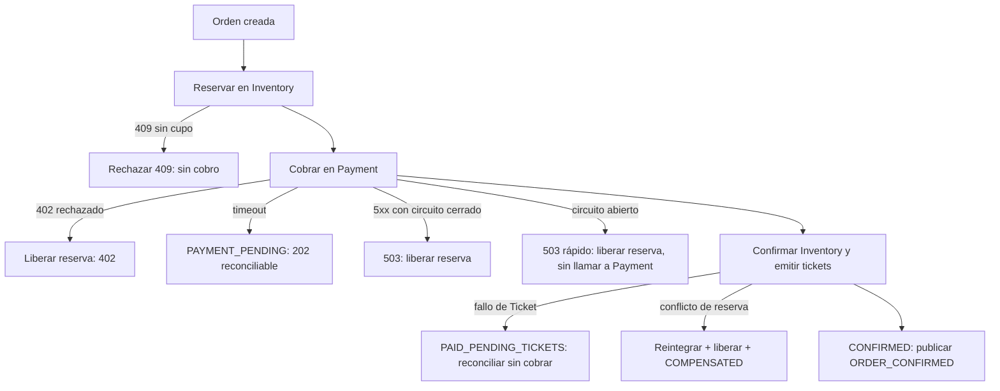

# Patrones arquitectónicos y consistencia

Documento único de decisiones de arquitectura de TicketYa. Es la fuente de verdad para justificar los patrones usados, las alternativas descartadas y las estrategias de consistencia. Los detalles de implementación siguen en [`architecture.md`](architecture.md); las decisiones por época están en `openspec/changes/archive/`; la verificación medida está en [`verification.md`](verification.md) y el informe de carga en [`load-test-report.md`](load-test-report.md).

## 1. Patrones aplicados

| Patrón | Referencia PDF | Problema que resuelve | Alternativa descartada y costo asumido | Evidencia |
|---|---|---|---|---|
| **API Gateway** | PDF-NF-GATEWAY, PDF-NF-SECURITY | Punto de entrada único; valida JWT, exige roles, propaga identidad derivada y correlation ID | Exponer cada microservicio: multiplicaría superficie y reglas de seguridad. Costo: el Gateway es un componente crítico | `services/api-gateway`, `GatewayPreferencesRoutingTest`, `GatewayJwtSecurityIntegrationTest` |
| **Database per service** | PDF-NF-PERSISTENCE | Cada servicio es dueño de su dato; ningún FK cruza bases | Una base compartida: acoplaría despliegues y transacciones. Costo: consistencia entre servicios debe resolverse con contratos | `schema.sql` por servicio, `preferences-db` (MongoDB 7) |
| **Saga orquestada (compra)** | PDF-F4, PDF-F5, PDF-NF-CONSISTENCY | Compra temporal: reservar → cobrar → confirmar → emitir, con compensaciones observables | Transacción distribuida 2PC: no apta para microservicios y bloquea recursos. Costo: estados intermedios y reintentos idempotentes | `PurchaseService`, `purchase-orders/spec.md`, `PurchaseOrderCompensationContractTest` |
| **Lock pesimista / actualización atómica** | PDF-NF-CONCURRENCY | Evitar doble venta del mismo asiento con varias instancias | Validar en memoria: no protege entre procesos. Costo: conflicto `409` esperado | `Inventory` + `ConcurrentPurchases` (`postman/concurrent-purchases.py`) |
| **Idempotencia** | PDF-F4, PDF-F5 | Reintentos de red sin cobros ni reservas duplicados | Sin clave: cada reintento crearía una orden. Costo: clave por solicitud y limpieza de claves antiguas | `Idempotency-Key`, `Idempotency-Key` en Payment, `Idempotency-Key` en reservas |
| **Circuit Breaker y fallback** | PDF-NF-RESILIENCE | Fallo rápido ante dependencias caídas y degradación sin romper la saga | Sólo timeouts: sigue llamando a un servicio caído. Costo: estado en memoria por instancia | `CircuitBreaker`, `PaymentClient`, `NotificationDispatcher`, `resilience-circuit-breaker/spec.md` |
| **Caché en memoria con TTL** | PDF-NF-CACHE | Reducir lecturas del catálogo publicado sin cachear disponibilidad | Redis: componente nuevo para una sola instancia didáctica. Costo: entradas obsoletas hasta TTL e invalidación local | `EventDiscoveryCache`, `caching-strategy/spec.md`, `docs/load-test-report.md` |
| **Service Discovery por DNS de Compose** | PDF-NF-DEPLOYMENT | Los servicios se encuentran por nombre lógico (`catalog-service:8081`) | Registro externo (Eureka/Consul): infraestructura adicional sin beneficio en el entorno local. Costo: nombres fijos por entorno | `docker-compose.yml`, `${*_SERVICE_URL}` |
| **Correlation ID y bitácora centralizada** | PDF-NF-TRACE | Seguir una solicitud entre servicios y auditar operaciones críticas | Logs aislados por servicio: imposible reconstruir el flujo. Costo: header en cada salto y publicación asíncrona | `CorrelationIdFilter`, `audit-service`, `AuditPublisher` |

### Patrones deliberadamente no aplicados

- **BFF (Backend For Frontend):** no hay clientes heterogéneos ni una UI propia que justifique una capa adicional. El Gateway más los contratos REST directos cubren el requisito didáctico; agregar un BFF sería una abstracción sin responsabilidad verificable.
- **Mensajería externa (Kafka/RabbitMQ):** la comunicación asíncrona se resuelve con publicación fire-and-forget hacia Audit y con un executor acotado para notificaciones. No hay requisito de durabilidad de cola en la entrega; introducir un broker agregaría infraestructura sin escenario verificable.
- **Redis:** se documenta como arquitectura objetivo del blueprint, pero el Compose ejecuta una instancia de Catalog y la caché en proceso cumple PDF-NF-CACHE. La decisión queda registrada en `caching-strategy/spec.md`.

## 2. Estrategias de consistencia

| Operación | Consistencia | Motivo |
|---|---|---|
| Creación de orden y reserva de asiento | **Fuerte** dentro de Inventory y Purchase | La exclusión mutua no admite dos dueños del mismo asiento; se usa actualización atómica y conflicto `409` |
| Cobro y confirmación de tickets | **Fuerte en la saga** con estados explícitos | `PAYMENT_PENDING`, `PAID_PENDING_TICKETS` y `COMPENSATED` permiten reanudar sin cobrar dos veces |
| Publicación del catálogo | **Eventual acotada** | Catalog publica un snapshot inmutable que Inventory y Purchase leen por contrato; la caché puede servirlo hasta el TTL sin afectar la venta |
| Bitácora y trazas | **Eventual, fire-and-forget** | La operación de negocio nunca espera a Audit; el evento queda en el log local y se reintenta con `eventId` idempotente |
| Notificaciones | **Eventual con fallback local** | El evento se escribe siempre en `ticketya.notification`; si el adaptador falla, la compra continúa. F11 (entrega real) sigue pendiente y delegada |
| Disponibilidad de inventario | **Siempre fresca** | Nunca se cachea como verdad autoritativa: la recomendación no afirma disponibilidad y la compra la recalcula |
| Recomendaciones | **Bajo demanda** | Sin caché: una compra nueva o un evento cancelado se refleja en la siguiente consulta |

### Compensaciones de la saga de compra

Cada transición es idempotente: repetir un reintegro, una liberación o una emisión devuelve el mismo resultado. El detalle verificable está en `openspec/specs/purchase-orders/spec.md` y en las pruebas de contrato de Purchase.

## 3. Trazabilidad y alcance

Los requisitos no funcionales de resiliencia, caché, seguridad, trazabilidad y despliegue están presentes en `openspec/specs/`. F11 no forma parte de este documento como implementación: el despacho con fallback existe, pero la entrega de notificaciones por email o push está pendiente y se delega a otro compañero.
