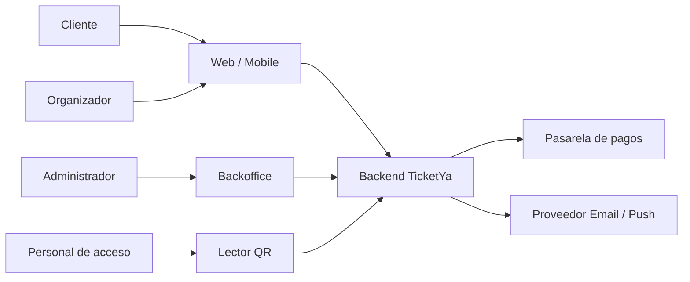
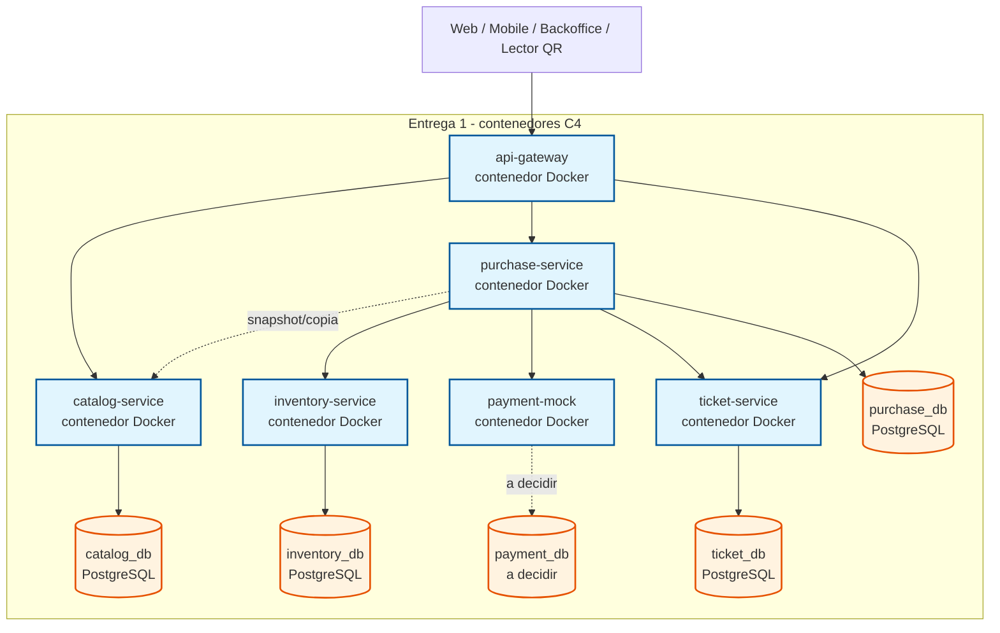
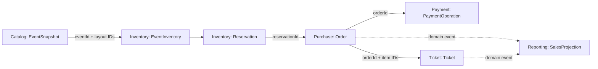
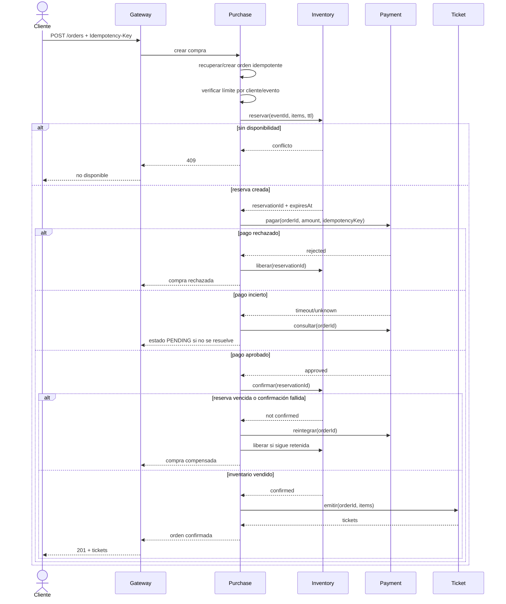
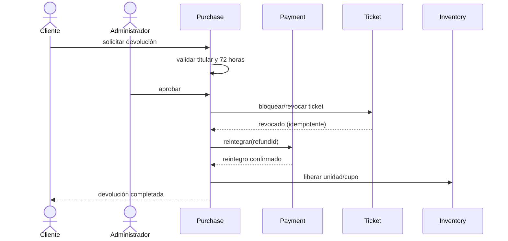
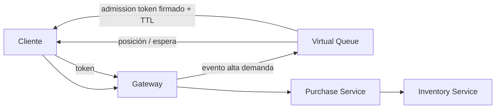
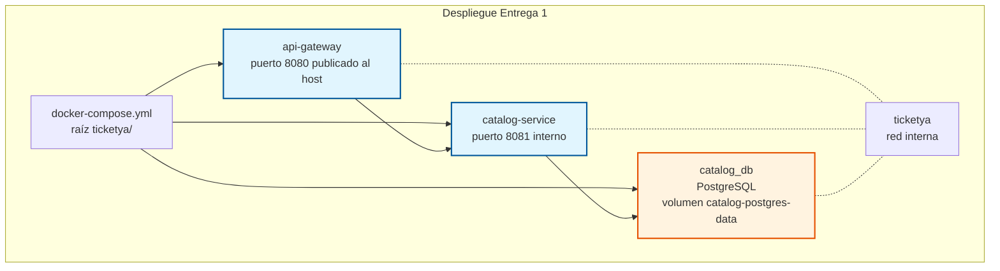
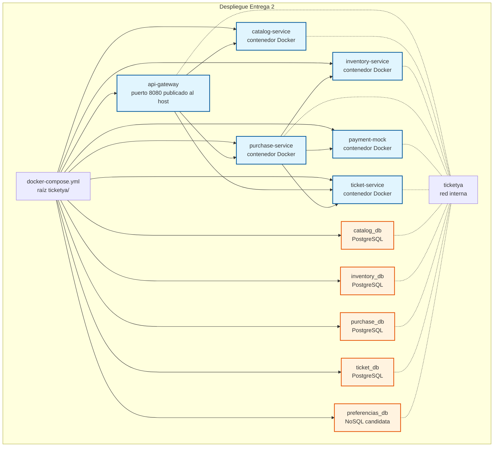

# Design

## Context

TicketYa parte de un repositorio sin implementación y debe evolucionar en dos entregas incrementales. El backend debe usar microservicios Spring Boot independientes, un API Gateway, persistencia por servicio y mecanismos explícitos para concurrencia, consistencia, resiliencia, seguridad y trazabilidad. Véase `proposal.md` para la motivación de este blueprint.

Este documento es un mock arquitectónico general: fija límites, responsabilidades y flujos de referencia, pero cada épica funcional deberá convertirlos en requisitos, contratos y tareas verificables. La primera épica detallada es `establish-event-catalog`; su diseño especializado prevalece para Catalog Service mientras no contradiga este blueprint.

Java 19 y Maven son restricciones del proyecto. Ningún artefacto versionado debe contener rutas personales de JDK o configuración local.

El proyecto es didáctico. El PDF define el piso obligatorio y la arquitectura debe privilegiar comprensión, correctitud y facilidad de prueba. La performance de un entorno productivo, la escala extrema y la sofisticación operativa no son drivers salvo en la prueba de carga y los casos de concurrencia exigidos.

## Goals / Non-Goals

**Goals:**

- Dar al equipo una vista compartida del sistema completo antes de implementar microservicios aislados.
- Establecer una fuente de verdad por dominio y evitar bases o tablas compartidas.
- Resolver desde el diseño los riesgos de doble venta, reintentos de pago, expiración, devolución y uso duplicado de QR.
- Mostrar con claridad qué se construye en Entrega 1 y qué se agrega en Entrega 2.
- Servir como mapa de dependencias para refinar épicas verticales con OpenSpec.
- Llegar a una solución que el equipo pueda explicar, ejecutar y mantener sin infraestructura innecesaria.

**Non-Goals:**

- Definir todos los campos, endpoints o escenarios de cada capacidad.
- Reemplazar las specs funcionales, OpenAPI o diagramas ER detallados de cada épica.
- Crear proyectos Spring Boot, contenedores, bases o infraestructura ejecutable.
- Fijar prematuramente detalles de algoritmos de recomendación o política de fila virtual que no afecten los límites de servicios.
- Diseñar para tráfico, disponibilidad o operación de escala productiva no requeridos por la evaluación.
- Adoptar herramientas sólo porque son habituales en arquitecturas empresariales.

## Decisions

### 1. Principios arquitectónicos

1. Implementar primero la solución más simple que cumpla el PDF.
2. Todo cliente externo entra por API Gateway.
3. Cada microservicio implementado es dueño exclusivo de sus datos y se construye por separado.
4. No crear un microservicio sin responsabilidad, datos y necesidad de evolución claramente separados.
5. Las decisiones críticas se confirman en la base autoritativa, nunca sólo en memoria o cache.
6. Preferir REST síncrono; introducir comunicación asíncrona sólo cuando una historia demuestre el beneficio.
7. Toda operación crítica es idempotente y trazable mediante `correlationId`.
8. Los eventos publicados, órdenes y tickets conservan snapshots históricos; no dependen de datos maestros mutables.
9. Los datos copiados entre servicios se relacionan por IDs, nunca por foreign keys entre bases.
10. No agregar cache, broker, service discovery, migrador de esquema o tracing distribuido sin una justificación revisada por el equipo.
11. Todo componente ejecutable desarrollado por el equipo se distribuye con un `Dockerfile` propio y se integra al `docker-compose.yml` central de la raíz en la misma épica que lo introduce.

**Guidelines de simplicidad acordadas:**

| Decisión | Alcance | Consecuencia |
|---|---|---|
| Java 19 y Maven 3.9+ | Estándar del proyecto; el PDF no fija una versión de Java | Toolchain, CI e imágenes usan la misma versión; no se versionan rutas locales. |
| El PDF es el piso | Todo requisito funcional y no funcional del enunciado debe tener dueño o decisión | Ninguna épica puede reducir alcance; agregar funcionalidad fuera del PDF requiere justificación. |
| Performance productiva | No es driver; sólo se exigen la prueba de concurrencia y la prueba de carga del TPE | No se agregan caches, brokers o infraestructura preventiva por escala. |
| Tecnología o patrón adicional | Requiere las cuatro preguntas de esta sección | Si no hay requisito, alternativa simple, costo y validación, queda fuera de la baseline. |

Antes de incorporar una tecnología o patrón, la épica debe responder:

- ¿Qué requisito obligatorio satisface o qué problema observado resuelve?
- ¿Cuál es la alternativa más simple?
- ¿Qué costo agrega al desarrollo, testing y ejecución local?
- ¿Cómo se verificará que aporta valor?

Si estas preguntas no tienen una respuesta concreta, la tecnología queda fuera del alcance.

### 2. Contexto del sistema (D1 - transversal)



**Nota (D1):** Web / Mobile, Backoffice y Lector QR son canales externos; PSP y Mail son sistemas externos. Ninguno es un contenedor a construir por el equipo. El contexto es el mismo en Entrega 1 y Entrega 2; no distingue entregas.

Actores y roles:

| Actor | Responsabilidad principal |
|---|---|
| `CLIENT` | Buscar eventos, reservar, comprar, consultar entradas y pedir devoluciones |
| `ORGANIZER` | Diseñar, publicar y consultar resultados de sus eventos |
| `ADMIN` | Gestión completa, lugares, suspensión, cancelación y aprobación de devoluciones |
| `ACCESS_STAFF` | Validar entradas del evento para el que fue autorizado |

Entrega 1 usa encabezados de identidad. Entrega 2 reemplaza ese mecanismo por JWT; los servicios mantienen sus reglas de autorización de dominio.

### 3. Contenedores C4 - Entrega 1 (D2)



**Nota (D2):** Cada microservicio Spring Boot es un contenedor C4 (unidad ejecutable/desplegable) y se mapea 1:1 a una imagen Docker con su propio `Dockerfile`. Las bases de datos son contenedores C4 de infraestructura. `payment_db` está "a decidir" (ver tabla de ownership). La relación Purchase → Catalog es una copia de snapshot, no una llamada runtime.

Los servicios de dominio no quedan expuestos directamente a clientes. El Gateway enruta y aplica controles transversales, pero no contiene reglas de negocio. Las capacidades de Entrega 2 se separarán en nuevos servicios sólo si su refinamiento demuestra ownership o despliegue independiente; el diagrama no obliga a crear un servicio por capacidad.

### 4. Alcance incremental

#### Entrega 1 - núcleo síncrono

La vista de contenedores C4 de Entrega 1 es D2 (§3). No se repite aquí para evitar dos diagramas con el mismo alcance; D2 es la referencia para los límites y D4 (§20) para el despliegue.

El primer incremento `establish-event-catalog` materializa sólo Gateway, Catalog Service y `catalog_db`. Los demás componentes aparecen en épicas posteriores de Entrega 1.

La integración entre publicación e inventario evoluciona en dos pasos:

1. La primera épica crea el snapshot publicado dentro de Catalog Service.
2. Al incorporarse Inventory Service, se agrega inicialización idempotente desde ese snapshot; esa épica modifica el flujo de publicación o agrega reconciliación sin reescribir el catálogo histórico.

#### Entrega 2 - plataforma completa (D3 - contenedores C4)

```mermaid
flowchart TB
    subgraph E2[Entrega 2 - contenedores C4]
        subgraph E1_confirmados[Con E1 confirmados]
            Gateway[api-gateway<br/>contenedor Docker]
            Catalog[catalog-service<br/>contenedor Docker]
            Inventory[inventory-service<br/>contenedor Docker]
            Purchase[purchase-service<br/>contenedor Docker]
            Payment[payment-mock<br/>contenedor Docker]
            Ticket[ticket-service<br/>contenedor Docker]

            CatalogDB[(catalog_db<br/>PostgreSQL)]
            InventoryDB[(inventory_db<br/>PostgreSQL)]
            PurchaseDB[(purchase_db<br/>PostgreSQL)]
            TicketDB[(ticket_db<br/>PostgreSQL)]
            PaymentDB[(payment_db<br/>a decidir)]
        end

        NoSqlDB[(preferencias_db<br/>NoSQL candidata)]
    end

    subgraph CapacidadesE2["Capacidades E2 a refinar<br/>(a decidir si servicio propio o módulo)"]
        JWT[Identidad / JWT]
        Cola[Fila virtual]
        Prefs[Preferencias / recomendaciones]
        Notif[Notificaciones]
        Reportes[Reportes]
    end

    Gateway -.-> CapacidadesE2
    NoSqlDB -.-> Prefs

    classDef servicio fill:#e1f5fe,stroke:#01579b,stroke-width:2px;
    classDef base fill:#fff3e0,stroke:#e65100,stroke-width:2px;
    classDef punt fill:#f3e5f5,stroke:#4a148c,stroke-width:2px,stroke-dasharray: 5 5;
    class Gateway,Catalog,Inventory,Purchase,Payment,Ticket servicio;
    class CatalogDB,InventoryDB,PurchaseDB,TicketDB,PaymentDB,NoSqlDB base;
    class JWT,Cola,Prefs,Notif,Reportes punt;
```



**Nota (D3):** Los contenedores de E1 se confirman en E2. Se añade una base NoSQL candidata (preferencias/recomendaciones). `payment_db` se mantiene como "a decidir", igual que en D2. Las cinco capacidades de E2 (JWT, fila virtual, preferencias/recomendaciones, notificaciones, reportes) aparecen como un grupo punteado "a refinar": todavía no se decide si cada una es un servicio independiente o un módulo de un servicio existente; eso se resuelve al refinar su épica.

### Estado actual de contenedores (tabla aparte, no en los diagramas)

| Contenedor | E1 | E2 | Estado repo |
|---|---|---|---|
| `api-gateway` | Sí | Sí | Implementado |
| `catalog-service` | Sí | Sí | Implementado |
| `catalog_db` | Sí | Sí | Implementado |
| `inventory-service` + `inventory_db` | Sí | Sí | Planificado |
| `purchase-service` + `purchase_db` | Sí | Sí | Planificado |
| `payment-mock` + `payment_db` | Sí | Sí | Planificado / almacenamiento a decidir |
| `ticket-service` + `ticket_db` | Sí | Sí | Planificado |
| `preferencias_db` (NoSQL) | No | Sí | A decidir |
| JWT, fila virtual, notificaciones, reportes | No | Sí | A refinar |

**Nota:** El mínimo del PDF para E1 permite ejecución local con bases en Docker. TicketYa adelanta Docker también en E1 como decisión del proyecto (adelanto voluntario, ya implementado en `establish-event-catalog`). El estado actual del repo tiene implementados Gateway, Catalog y catalog_db.

### Tabla operativa por contenedor

| Contenedor | Build context | Puerto | Red | Volumen | Healthcheck |
|---|---|---|---|---|---|
| `api-gateway` | `./services/api-gateway` | 8080 (host) | ticketya | - | actuator/health |
| `catalog-service` | `./services/catalog-service` | 8081 (interno) | ticketya | - | actuator/health |
| `catalog_db` | `postgres:16.4-alpine` | 5432 (interno) | ticketya | catalog-postgres-data | pg_isready |
| `inventory-service` | `./services/inventory-service` | 808x (interno) | ticketya | - | actuator/health |
| `inventory_db` | `postgres:16.4-alpine` | 5432 (interno) | ticketya | inventory-postgres-data | pg_isready |
| `purchase-service` | `./services/purchase-service` | 808x (interno) | ticketya | - | actuator/health |
| `purchase_db` | `postgres:16.4-alpine` | 5432 (interno) | ticketya | purchase-postgres-data | pg_isready |
| `ticket-service` | `./services/ticket-service` | 808x (interno) | ticketya | - | actuator/health |
| `ticket_db` | `postgres:16.4-alpine` | 5432 (interno) | ticketya | ticket-postgres-data | pg_isready |
| `payment-mock` | `./services/payment-mock` | 808x (interno) | ticketya | - | actuator/health |
| `preferencias_db` (NoSQL) | imagen oficial NoSQL | 27017 (interno) | ticketya | preferencias-data | ping |

Solo `api-gateway` publica un puerto al host en el despliegue Compose (8080). Los demás servicios y bases quedan en la red interna. La ejecución local como procesos Java 19 puede usar puertos locales para desarrollo, pero no reemplaza la verificación con Compose.

**Nota de nombres:** el `docker-compose.yml` implementado llama `postgres` al contenedor y `ticketya_catalog` a la base, mientras que el blueprint usa `catalog_db` como nombre lógico. Este cambio es documental y no renombra infraestructura; la próxima épica que agregue una base debe unificar el criterio de nombres (por ejemplo, `catalog-db`) o documentar el alias en el Compose.

Se incorporan JWT, fila virtual, preferencias/recomendaciones, notificaciones, reportes, resiliencia, cache justificada, logs centralizados y despliegue completo con Docker Compose. La cantidad final de servicios y las tecnologías concretas se deciden al refinar cada épica.

### 5. Responsabilidades y límites

| Servicio | Responsabilidad | Fuera de su responsabilidad |
|---|---|---|
| API Gateway | Entrada única, routing, rate limiting, correlation ID y validación JWT | Reglas de compra o inventario |
| Catalog | Lugares, sectores plantilla, eventos, participantes, estados editoriales, precios publicados y búsqueda | Disponibilidad, compras y tickets |
| Inventory | Inventario por evento, holds temporales, expiración y confirmación de venta | Cobro, precio maestro, estado editorial y QR |
| Purchase | Órdenes, detalle de compra, medio de pago simulado, límite por cliente, saga de compra, devoluciones y proceso de cancelación | Modificar inventario o capturar QR directamente |
| Payment Mock | Simular aprobación, rechazo, consulta y reintegro | Decidir reglas de devolución o transformarse necesariamente en microservicio productivo |
| Ticket & Access | Emisión, QR, vigencia, revocación y uso único en acceso | Cobro y selección de asientos |

**Estados del evento y dueños únicos:** Catalog es dueño de los estados editoriales (`DRAFT`, `PUBLISHED`, `SUSPENDED`, `CANCELLED`, `FINISHED`). `SOLD_OUT` es un estado comercial derivado de la disponibilidad que posee Inventory: Catalog puede proyectarlo para consulta, pero ninguna venta se decide por él. `FINISHED` se deriva de la fecha o se actualiza de forma perezosa. La cancelación masiva es un proceso de Purchase: el administrador invoca el comando de cancelación (ruteado a Purchase), Purchase solicita a Catalog el cambio idempotente a `CANCELLED`, y luego bloquea/revoca tickets, reintegra y libera inventario. Catalog no llama a Purchase. Ninguna capacidad tiene dos dueños transaccionales.

Capacidades de Entrega 2 todavía no fijadas como servicios independientes:

| Capacidad | Responsabilidad mínima |
|---|---|
| Identidad/JWT | Autenticar y representar roles; puede resolverse con servicio propio o componente existente |
| Fila virtual | Preservar orden y habilitar tandas sin garantizar inventario |
| Preferencias/recomendaciones | Guardar preferencias en NoSQL y producir sugerencias simples |
| Notificaciones | Entregar email/push sin bloquear una compra confirmada |
| Reportes | Calcular ventas, devoluciones, ocupación y recaudación desde datos disponibles |

**Alternativas consideradas:**

- Un servicio por entidad: descartado por fragmentar transacciones sin aportar autonomía.
- Un único Sales Service con inventario, órdenes y tickets: puede simplificar demasiado las responsabilidades exigidas por el PDF; se mantienen límites lógicos, sin sumar servicios de soporte innecesarios.
- Separar Ticket y Access: se mantienen juntos para que la validación de uso único sea una operación atómica sobre la base dueña del ticket.

### 6. Ownership y persistencia

| Servicio | Datos autoritativos | Persistencia objetivo | Copias permitidas |
|---|---|---|---|
| Catalog | Venue, sector plantilla, asiento plantilla, evento, participante, estado editorial, snapshot publicado y precio | PostgreSQL | Inventory copia IDs/layout; Purchase copia IDs, descripción y precio como snapshot histórico |
| Inventory | Inventario por evento, unidad/asiento, stock de zona, reserva y expiración | Base relacional | Layout inicial copiado desde snapshot de Catalog, sin precios |
| Purchase | Orden, ítem, intento de saga, límite por cliente, detalle de compra, medio de pago simulado y solicitud de devolución | PostgreSQL | Snapshot de descripción y precio al comprar |
| Payment Mock | Resultado simulado, idempotencia mínima y operación de reintegro | A decidir; puede ser almacenamiento simple | Referencia `orderId`, nunca datos completos de la orden |
| Ticket & Access | Ticket, QR hash, estado, propietario y uso | PostgreSQL | Snapshot mínimo del evento (nombre, fecha, lugar, sector/asiento) para validación y visualización; sin precio autoritativo |
| Preferencias/recomendaciones | Preferencias, favoritos y señales simples | Base NoSQL a seleccionar | Historial derivado de compras |

**Propósito de cada copia o snapshot:**

| Copia | Dueño | Origen | Propósito histórico u operativo | Qué no decide |
|---|---|---|---|---|
| `EventSnapshot` | Catalog | Publicación | Configuración inmutable del evento publicado; fuente para inicializar otros servicios | Disponibilidad, compras o uso de tickets |
| `EventInventory` / layout | Inventory | Snapshot de Catalog | Asignar asientos y stock sin depender de Catalog en cada operación | Metadatos del evento, estado editorial o precio |
| `OrderItem` snapshot | Purchase | Catálogo al crear la orden | Precio y descripción históricos para recibo, devolución y auditoría | Disponibilidad actual ni estado del evento |
| `Ticket` event snapshot | Ticket & Access | Orden confirmada | Validar y mostrar la entrada sin consultar Catalog | Estado del evento, precio o disponibilidad |
| `orderId` en Payment | Payment Mock | Purchase | Correlacionar pago, reintegro e idempotencia | Datos completos de la orden o inventario |

Ninguna copia crea una foreign key entre bases ni convierte al servicio copiante en dueño del dato original. Inventory no copia precios. La base NoSQL obligatoria se selecciona y justifica en la épica de preferencias/recomendaciones; MongoDB es una candidata, no una decisión de este blueprint.

La capacidad de preferencias/recomendaciones es la candidata inicial para satisfacer el requisito NoSQL, porque sus documentos varían por usuario y no requieren joins transaccionales con ventas. MongoDB es una opción, no una decisión tomada. Catálogo permanece relacional por sus invariantes y relaciones estructuradas.

Si una épica propone Redis u otro cache, nunca será la autoridad para impedir doble venta. Una pérdida de cache no puede liberar ni vender un asiento.

### 7. Relaciones de datos entre servicios



No existe foreign key entre estas bases. Cada referencia remota se valida por contrato y se guarda como valor. Los snapshots preservan la semántica histórica aun si el dato maestro cambia.

### 8. Comunicación síncrona por defecto

REST síncrono:

- Consultas públicas y de gestión iniciadas por el usuario.
- Reserva de inventario y confirmación dentro de la saga de compra.
- Autorización/captura o consulta inmediata de pago.
- Emisión idempotente de tickets cuando la respuesta debe volver al comprador.
- Validación QR en el acceso.

**Integraciones de Entrega 1 y modo por defecto:**

| Integración | Modo | Datos | Idempotencia |
|---|---|---|---|
| Gateway → servicios | REST síncrono | Routing, identidad provisional y correlation ID | No aplica; el Gateway no decide negocio |
| Purchase → Catalog | REST síncrono | Snapshot publicado al crear la orden | `orderId`; la copia se guarda una vez |
| Purchase → Inventory | REST síncrono | hold, confirm, release | `orderId` / `reservationId` |
| Purchase → Payment Mock | REST síncrono | pay, query, refund | `orderId + attempt` / `refundId` |
| Purchase → Ticket | REST síncrono | emit, revoke | `orderId + orderItemId` / `refundId` |
| Catalog → Inventory | Inicialización batch/REST al incorporar Inventory | Snapshot publicado | `eventId`; no se reescribe el snapshot |
| Catalog/Purchase/Ticket → Notification | Asíncrono candidato E2 | Compra, cambio/cancelación y artista favorito | Clave del evento + consumidor idempotente |
| Purchase/Ticket → Reporting | Asíncrono candidato E2 | Proyecciones de ventas, devoluciones y uso | Clave del evento + consumidor idempotente |

**Regla para propuestas asíncronas:** toda épica que proponga broker, cola, Outbox/Inbox o eventos debe agregar una sección `Decisión asíncrona` con: (1) requisito o problema que lo exige, (2) alternativa simple con REST o job persistido, (3) costo de desarrollo, testing y operación, y (4) forma de validación. Sin esos cuatro puntos, la propuesta queda fuera de alcance. Outbox/Inbox no son baseline; se evalúan sólo si se adopta un broker.

Interacciones que podrían volverse asíncronas en Entrega 2:

| Evento | Productor | Consumidores típicos |
|---|---|---|
| `EventPublished` | Catalog | Inventory, Engagement, Notification |
| `EventChanged` | Catalog | Notification, Reporting |
| `EventCancelled` | Catalog | Purchase, Ticket, Notification, Reporting |
| `PurchaseConfirmed` | Purchase | Ticket, Engagement, Notification, Reporting |
| `RefundCompleted` | Purchase | Inventory, Ticket, Notification, Reporting |
| `TicketIssued` | Ticket | Notification, Reporting |
| `TicketUsed` | Ticket | Reporting |

La primera opción sigue siendo REST o un proceso batch persistido. Un broker se incorpora sólo si existen múltiples consumidores, desacople temporal o reintentos durables que justifiquen operarlo. Si se elige mensajería, productores y consumidores deberán tolerar duplicados; Outbox/Inbox son patrones candidatos, no requisitos automáticos.

RabbitMQ y Kafka quedan fuera de la baseline. Si una épica demuestra que necesita un broker, deberá comparar al menos esa opción con REST, tareas programadas y una tabla de trabajo simple.

### 9. Orquestación persistida de compra

Purchase Service orquesta la operación porque posee el estado de negocio de la orden y puede decidir compensaciones. Este flujo puede describirse como Saga, pero no requiere un framework ni un motor especializado: estados persistidos y llamadas REST idempotentes son suficientes para la versión didáctica.

La reserva usa un TTL inicial de 10 minutos, configurable por evento. El límite de entradas por cliente y evento se valida dentro de la transacción de Purchase con una fila de contador y una actualización condicional (`quantity + requested <= limit`) o `SELECT ... FOR UPDATE`; una lectura previa no es suficiente bajo concurrencia. Una restricción única por `(customerId, eventId, orderItem)` evita duplicados por reintento.



Estados sugeridos de orden:

```text
PENDING -> RESERVED -> PAYMENT_PENDING -> PAID -> CONFIRMED
   |          |              |             |
   +----------+--------------+-------------+--> REJECTED
                                             -> COMPENSATING -> REFUNDED
```

**Ramas de la saga y recuperación:**

| Rama | Detección | Estado de la orden | Compensación / recuperación |
|---|---|---|---|
| Pago aprobado, inventario confirmado y tickets emitidos | Respuestas exitosas | `CONFIRMED` | Ninguna; operación completa |
| Pago rechazado | Payment responde `rejected` | `REJECTED` | Liberar el hold con `reservationId`; reintento idempotente |
| Pago incierto | Timeout o `unknown` | `PAYMENT_PENDING` | Consultar Payment; no asumir fracaso. Si luego se aprueba, continuar; si se rechaza, liberar |
| Reserva vencida o confirmación fallida | Inventory responde `not confirmed` | `COMPENSATING` → `REFUNDED` | Reintegrar con `refundId` y liberar si sigue retenida; ambos idempotentes |
| Emisión fallida | Ticket falla después de confirmar inventario | `PAID_PENDING_TICKETS` | Reintentar emisión idempotente; si la falla es permanente, `COMPENSATING` → reintegro y liberación |
| Compra duplicada | Misma `Idempotency-Key` | Mismo estado de la orden original | Devolver la orden existente; no reservar, cobrar ni emitir de nuevo |

Los estados terminales son `CONFIRMED`, `REJECTED` y `REFUNDED`; los intermedios tienen job de reintento o reconciliación y nunca se interpretan como éxito o fracaso definitivo por un timeout.

Si la emisión de tickets falla después de confirmar inventario, la orden queda `PAID_PENDING_TICKETS` y se reintenta idempotentemente. Sólo una falla permanente dispara compensación de pago e inventario; un timeout no se interpreta automáticamente como fracaso.

### 10. Mecanismo contra doble venta

Inventory Service y PostgreSQL son la autoridad incluso con múltiples instancias.

Asiento numerado:

```sql
UPDATE inventory_item
SET status = 'HELD', reservation_id = :reservationId, expires_at = :expiresAt
WHERE event_id = :eventId
  AND seat_id = :seatId
  AND (status = 'AVAILABLE' OR (status = 'HELD' AND expires_at < CURRENT_TIMESTAMP));
```

La reserva de varios asientos ocurre en una sola transacción. Si la cantidad actualizada no coincide con la solicitada, se revierte todo.

Sector no numerado:

```sql
UPDATE sector_inventory
SET reserved = reserved + :quantity
WHERE event_id = :eventId
  AND capacity - sold - reserved >= :quantity;
```

Confirmación de asiento numerado:

```sql
UPDATE inventory_item
SET status = 'SOLD', sold_at = CURRENT_TIMESTAMP
WHERE event_id = :eventId
  AND seat_id = :seatId
  AND status = 'HELD'
  AND reservation_id = :reservationId
  AND expires_at > CURRENT_TIMESTAMP;
```

Confirmación de sector no numerado:

```sql
UPDATE sector_inventory
SET sold = sold + :quantity, reserved = reserved - :quantity
WHERE event_id = :eventId
  AND sector_id = :sectorId
  AND reserved >= :quantity;
```

Liberación idempotente:

```sql
UPDATE inventory_item
SET status = 'AVAILABLE', reservation_id = NULL, expires_at = NULL
WHERE event_id = :eventId
  AND seat_id = :seatId
  AND status = 'HELD'
  AND reservation_id = :reservationId;
```

Expiración (programada o lazy):

```sql
UPDATE inventory_item
SET status = 'AVAILABLE', reservation_id = NULL, expires_at = NULL
WHERE status = 'HELD'
  AND expires_at < CURRENT_TIMESTAMP;
```

Restricciones mínimas: unicidad de `(event_id, seat_id)`, unicidad de `(event_id, sector_id)` y unicidad de `reservation_id`. PostgreSQL serializa las filas afectadas y reevalúa la condición después del lock; por eso dos instancias no pueden confirmar el mismo asiento. La expiración sólo toca `HELD` y nunca `SOLD`.

Confirmar exige estado `HELD`, mismo `reservationId` y `expires_at > now`. La expiración puede resolverse mediante una tarea programada y también de forma lazy al intentar reservar. No se agrega Redis mientras esta solución sea suficiente.

La prueba obligatoria ejecuta muchas solicitudes simultáneas contra el mismo asiento o último cupo, incluyendo más de una instancia de Inventory Service, y verifica exactamente un éxito.

### 11. Idempotencia

| Operación | Clave | Resultado repetido |
|---|---|---|
| Crear compra | `customerId + Idempotency-Key` | Devuelve la misma orden |
| Reservar | `orderId` | Devuelve la misma reserva activa o resultado final |
| Pagar | `orderId + attempt` | Consulta/reutiliza operación del proveedor |
| Confirmar inventario | `reservationId` | Conserva `SOLD` sin duplicar decrementos |
| Emitir tickets | `orderId + orderItemId` | Devuelve tickets ya emitidos |
| Reintegrar | `refundId` | Devuelve el reintegro existente |
| Validar QR | `ticketId` | Primer uso exitoso; siguientes usos rechazados |
| Aplicar límite por cliente | `customerId + eventId` | El contador transaccional no incrementa dos veces por reintento |

Cada servicio persiste la clave y el resultado dentro de su propia transacción. Los reintentos automáticos sólo se habilitan para operaciones idempotentes. El `qr_hash` tiene índice único y la emisión es única por `(orderId, orderItemId)`.

### 12. Devoluciones y cancelaciones

Devolución individual:



El orden es deliberado: primero se bloquea/revoca el ticket, después se reintegra y sólo al final se libera inventario. Así un reintegro confirmado no deja una entrada utilizable. Estados: `REFUND_REQUESTED → REFUND_APPROVED → TICKET_REVOKED → REFUNDING → REFUNDED → INVENTORY_RELEASED → COMPLETED`. Un reintegro incierto queda en `REFUND_PENDING` y se reconcilia con Payment; no se libera inventario. Si falla la revocación, no se reintegra todavía: se reintenta la revocación idempotente. Si la revocación es irreversible y el reintegro se rechaza definitivamente, un administrador resuelve el caso; el ticket no se restaura automáticamente.

La ventana de 72 horas se calcula con la fecha vigente del evento. En E1 no hay reprogramación; si una épica posterior permite cambios post-publicación, debe definir la regla y notificarlos.

Cancelación de evento:

1. El administrador invoca el comando de cancelación, ruteado a Purchase (proceso dueño). Purchase solicita a Catalog el cambio idempotente a `CANCELLED`; Catalog es dueño del estado editorial y no llama a Purchase.
2. Purchase bloquea/revoca las entradas de las órdenes afectadas, por lotes y de forma idempotente.
3. Purchase crea y ejecuta reintegros idempotentes; los inciertos quedan `REFUND_PENDING` y se reconcilian.
4. Purchase indica a Inventory cerrar o liberar inventario según política; el evento cancelado no vuelve a venderse.
5. Notification informa a los compradores cuando E2-03 esté disponible. En E1 la cancelación y el estado del reintegro son consultables; la notificación no bloquea el cierre.
6. Reporting actualiza sus proyecciones en E2-06.

El proceso es eventual, observable y reanudable; no intenta una transacción distribuida única. Puede comenzar con REST y jobs persistidos; mensajería queda como evolución justificada. La notificación al comprador pertenece a E2 según la tabla de entregas del PDF (funcionalidad 11), aunque la cancelación y el reintegro sean E1 (funcionalidad 7).

### 13. Fila virtual

La fila virtual puede implementarse como servicio o módulo separado según lo que se defina en su épica. Su almacenamiento inicial puede ser relacional; Redis se evaluará sólo si simplifica claramente la cola o si las pruebas muestran una necesidad.



La cola habilita tandas y emite un token de admisión de corta duración ligado a cliente y evento. El token permite intentar comprar, pero no reserva ni garantiza inventario: Inventory revalida y puede rechazar por falta de stock. La cola nunca es autoridad de disponibilidad. La versión didáctica puede usar una tabla ordenada y polling de posición; Redis no es baseline.

### 14. Tickets y control de acceso

El QR contiene un token opaco o firmado; la base almacena su hash, no un payload que permita reconstruir credenciales sensibles. La validación comprueba ticket, evento, vigencia, revocación y uso. El `qr_hash` tiene índice único y la emisión es única por `(order_id, order_item_id)`; la base guarda el hash, no el token completo ni datos sensibles.

Uso único entre instancias:

```sql
UPDATE ticket
SET status = 'USED', used_at = CURRENT_TIMESTAMP, access_point = :accessPoint
WHERE qr_hash = :qrHash
  AND event_id = :eventId
  AND status = 'VALID';
```

Sólo una operación obtiene una fila actualizada. Reintentos posteriores responden “ya utilizada”. `ACCESS_STAFF` debe estar autorizado para el evento solicitado.

### 15. Preferencias, recomendaciones, notificaciones y reportes

La capacidad de preferencias/recomendaciones guarda en una base NoSQL a seleccionar preferencias explícitas —tipos, artistas, ciudad— y señales derivadas de compras. La épica E2-04 selecciona y justifica la base NoSQL (MongoDB es candidata), define la fórmula inicial de recomendación por afinidad simple y co-compra y no requiere machine learning ni un servicio separado si un módulo con ownership claro resulta suficiente.

La capacidad de notificaciones entrega email/push en tres disparadores del PDF: compra confirmada, cancelación o cambio de evento, y publicación de un artista favorito en la ciudad del cliente. Sus fallas nunca revierten una compra confirmada. Puede comenzar con un adaptador simple y reintentos controlados; un servicio independiente, broker o dead-letter queue requieren justificación adicional. Los cambios post-publicación de eventos se difieren a E2-03/E2-04; E1 mantiene snapshots inmutables y sólo cancela.

Los reportes permiten consultar por evento y sector entradas vendidas, entradas devueltas, porcentaje de ocupación y recaudación. Pueden calcularse consultando los servicios dueños o mediante una proyección simple. Un Reporting Service y read models separados sólo se incorporarán si reducen complejidad frente a la consulta síncrona requerida por el TPE.

### 16. Cache

| Dato | Cache | Política |
|---|---|---|
| Catálogo y detalle publicado | Sin cache por defecto | Agregar cache sólo con medición o requisito demostrado |
| Resultados de búsqueda | Sin cache por defecto | Priorizar índices y consultas simples |
| Preferencias/recomendaciones | Sin cache por defecto | Evaluar únicamente si la implementación lo necesita |
| Disponibilidad de asientos | No como respuesta autoritativa | Consultar Inventory Service |
| Estado de orden, pago o ticket | No para decisiones | Consultar servicio dueño |

**Autoridad de decisión (independiente de cache, resiliencia y logs):**

| Decisión | Autoridad | ¿Puede un cache o dato derivado decidirla? |
|---|---|---|
| Vender o retener un asiento/cupo | Inventory + PostgreSQL | No |
| Aprobar, rechazar o reintegrar un pago | Payment Mock + su almacenamiento | No |
| Confirmar el uso de un QR | Ticket & Access + actualización atómica | No |
| Estado de una orden o devolución | Purchase + PostgreSQL | No |
| Estado editorial de un evento | Catalog + PostgreSQL | No |
| Resultados de búsqueda o detalle | Catalog + PostgreSQL | Sólo lectura; un miss afecta latencia, no correctitud |
| Preferencias/recomendaciones | Base NoSQL de la épica E2-04 | Sólo lectura; un miss afecta sugerencias, no ventas |

Ninguna estrategia de cache, resiliencia, seguridad o trazabilidad puede decidir una venta, un pago o un acceso desde datos no autoritativos. Un fallback de pago no aprueba; un fallback de notificación no bloquea una compra; un log no es fuente de verdad.

El TPE pide definir la estrategia de cache; “no cachear” es una decisión válida cuando se justifica por escala didáctica y simplicidad. Si se incorpora cache, un miss sólo afecta rendimiento y un dato stale nunca debe permitir vender, devolver o validar incorrectamente.

### 17. Resiliencia

- Timeouts explícitos en toda llamada REST.
- Reintentos acotados sólo para operaciones idempotentes.
- Fallback explícito para pagos o notificaciones, tal como exige el PDF.
- Pago incierto produce estado `PENDING`, seguido de consulta/reconciliación; nunca cobro duplicado.
- Un fallback de pago sólo devuelve un estado seguro (`PENDING`/consulta), nunca una aprobación simulada.
- Un fallback de notificación no revierte ni bloquea la compra.
- La notificación no revierte una compra; su mecanismo de reintento se mantiene simple salvo evidencia contraria.

Timeout, retry y fallback son comportamientos obligatorios. Circuit breakers, bulkheads, jitter, DLQ y librerías como Resilience4j son alternativas posibles, no decisiones preestablecidas.

### 18. Seguridad

Entrega 1 identifica al usuario por encabezado para facilitar pruebas, sin considerarlo seguridad real. Entrega 2 incorpora JWT firmado con `sub`, roles y expiración. Los roles son `CLIENT`, `ORGANIZER`, `ADMIN` y `ACCESS_STAFF`.

El Gateway valida firma y expiración; cada servicio valida autorización y ownership; el Gateway no reemplaza esas reglas. Los endpoints internos no se publican fuera de la red de servicios. Secretos y claves no se guardan en Git. Logs no incluyen contraseñas, tokens, QR completos ni datos de pago sensibles.

### 19. Trazabilidad y observabilidad

El Gateway acepta o genera `X-Correlation-Id`; todos los servicios lo propagan en REST, mensajes y logs. Cada request registra endpoint, usuario, estado HTTP y duración. Compra, devolución, cancelación y acceso generan logs de auditoría estructurados.

La implementación mínima debe centralizar o reunir logs de forma consultable y conservar el `correlationId`. Puede resolverse con salida JSON y herramientas simples del entorno de ejecución. Loki, Prometheus, Grafana u OpenTelemetry sólo se agregarán si el equipo puede justificar y operar ese stack; no son parte de la baseline.

### 20. Despliegue

**Diferencia mínimo del PDF vs decisión del proyecto:**

| | Mínimo del PDF | Decisión del proyecto (TicketYa) |
|---|---|---|
| Entrega 1 | Ejecución local de los microservicios; las bases de datos pueden levantarse con Docker | Docker desde E1 para los servicios también (adelanto voluntario, ya implementado en `establish-event-catalog`) |
| Entrega 2 | Cada microservicio en un contenedor Docker separado; todo el sistema con un `docker-compose.yml` | Igual que el mínimo del PDF |

**Regla común:**

- Cada microservicio, Gateway, Payment Mock u otro componente de aplicación desarrollado por el equipo tiene un `Dockerfile` en su propio directorio.
- La raíz de `ticketya` contiene un único `docker-compose.yml` que declara todos los componentes disponibles en el incremento actual y sus dependencias.
- PostgreSQL, la base NoSQL y otras dependencias estándar usan imágenes oficiales en Compose; no se crean Dockerfiles custom salvo que una personalización sea necesaria y justificada.
- Cada servicio crea su esquema con un bootstrap SQL idempotente (`schema.sql`) mientras no existan datos durables que exijan migraciones versionadas; Flyway/Liquibase no son baseline.
- `docker compose up --build` construye y levanta el sistema completo disponible.
- Configuración, URLs y credenciales de desarrollo se inyectan mediante variables de entorno; no se versionan rutas personales ni secretos reales.
- Gateway es la única API usada por clientes y por la colección Postman; solo el Gateway publica un puerto al host.
- La ejecución local como procesos Java 19 sigue permitida para desarrollo, pero no reemplaza la verificación con Compose.

**Estructura esperada:**

```text
ticketya/
+-- docker-compose.yml
+-- services/
|   +-- api-gateway/Dockerfile
|   +-- catalog-service/Dockerfile
|   +-- <future-service>/Dockerfile
+-- <other-app-component>/Dockerfile
```

**D4 - Despliegue Entrega 1 - incremento actual:**



**Nota (D4):** D4 refleja el incremento ya implementado (Gateway, Catalog y `catalog_db`). Cada épica de E1 agrega sus contenedores al mismo Compose; D2 y la tabla operativa muestran el objetivo completo de E1. D4 no debe interpretarse como el alcance final de E1.

**D5 - Despliegue Entrega 2:**



Docker DNS resuelve servicios dentro de la red; no se agrega Eureka mientras Docker Compose sea el único orquestador. Cada imagen debe poder construirse por separado, aunque Compose provea el arranque integrado y el repositorio use un POM agregador.

### 21. Mapa de épicas

```text
ARCH-00 establish-ticketya-architecture
   |
   +-- E1-01 establish-event-catalog
   |      lugares -> borradores -> snapshot -> búsqueda
   |
   +-- E1-02 establish-inventory-and-reservations
   |      inventario -> holds -> expiración -> doble venta
   |
   +-- E1-03 establish-purchase-and-ticketing
   |      orden -> payment mock -> saga -> emisión QR
   |
   +-- E1-04 establish-refunds-and-cancellation
   |      solicitud -> aprobación -> reintegro -> liberación
   |
   +-- E1-05 integrate-core-delivery
          Gateway -> OpenAPI -> Postman -> concurrencia -> README

   +-- E2-01 add-jwt-and-role-security
   +-- E2-02 add-virtual-queue
   +-- E2-03 add-notifications-and-evaluate-async
   +-- E2-04 add-preferences-and-recommendations
   +-- E2-05 add-qr-access-control
   +-- E2-06 add-organizer-reporting
   +-- E2-07 add-resilience-logging-and-compose
   +-- E2-08 execute-security-integration-and-load-tests
```

**Nota de reconciliación:** `integrate-gateway-routing-and-tracing` es un sub-cambio de E1-01 (routing y correlation ID del Gateway), no una épica nueva. `establish-event-catalog` ya referencia este blueprint en su propuesta.

**Cobertura funcional del PDF por épica primaria:**

| Referencia PDF | Funcionalidad | Épica primaria | Servicio dueño | Entrega |
|---|---|---|---|---|
| PDF-F1 | Eventos: datos, organizador, participantes, fecha, lugar y estados | E1-01 | Catalog | E1 |
| PDF-F2 | Lugares, sectores numerados/generales y precios por evento | E1-01 | Catalog | E1 |
| PDF-F3 | Borrador, publicación, suspensión y cancelación editorial | E1-01 | Catalog | E1 |
| PDF-F4 | Reserva temporal, pago, detalle de compra, límite por cliente y emisión de QR | E1-03 | Purchase/Payment/Ticket, con Inventory en la reserva | E1 |
| PDF-F5 | No doble venta e idempotencia | E1-02 | Inventory, con Purchase idempotente | E1 |
| PDF-F6 | Fila virtual | E2-02 | Capacidad E2 a definir | E2 |
| PDF-F7 | Devoluciones y cancelación masiva | E1-04 | Purchase, con Payment/Ticket/Inventory | E1 |
| PDF-F8 | Control de acceso con QR | E2-05 | Ticket & Access | E2 |
| PDF-F9 | Búsqueda, filtros y ordenamiento | E1-01 | Catalog | E1 |
| PDF-F10 | Preferencias y recomendaciones | E2-04 | Capacidad E2 con NoSQL | E2 |
| PDF-F11 | Notificaciones | E2-03 | Capacidad E2 | E2 |
| PDF-F12 | Reportes para organizadores | E2-06 | Capacidad E2 | E2 |

**Cobertura de no funcionales:**

| Referencia PDF | Requisito | Dueño/decisión | Dónde se verifica |
|---|---|---|---|
| PDF-NF-SERVICES | Microservicios Spring Boot independientes | E1-01 y cada épica | Estructura `services/`, builds individuales y §20 |
| PDF-NF-GATEWAY | Punto de entrada único | API Gateway | §5, §18 y spec `api-gateway` |
| PDF-NF-COMM | REST síncrono; asíncrono justificado | §8 | Tabla de integraciones y regla de decisión asíncrona |
| PDF-NF-PERSISTENCE | Base por servicio y al menos una NoSQL | §6; E2-04 selecciona NoSQL | Ownership y épica E2-04 |
| PDF-NF-CONCURRENCY | No doble venta multi-instancia e idempotencia | Inventory y Purchase | §10, §11, prueba E1-02/E1-03 |
| PDF-NF-CONSISTENCY | Consistencia y compensaciones | Purchase | §9 y §12 |
| PDF-NF-RESILIENCE | Reintentos, timeouts y fallback | §17; E1-03 y E2-07 | Pruebas de fallo de Payment/Notification |
| PDF-NF-CACHE | Estrategia de cache y datos no cacheables | §16; E2-07 | Tabla de autoridad y justificación |
| PDF-NF-TRACEABILITY | Log por request y operación crítica con correlation ID | Gateway y cada servicio; E2-07 | §19 y pruebas de correlación |
| PDF-NF-SECURITY | JWT y roles | E2-01 | §18 y E2-08 |
| PDF-NF-DEPLOYMENT | Docker por componente y Compose único | Cada épica; E1-01/E2-07 | §20 y DoD de épica |
| PDF-NF-PERFORMANCE | Prueba de carga del flujo de compra | E2-08 | Informe de carga |

**Entregables de diseño del PDF y dónde se cubren:**

| Entregable | Dónde se cubre | Decisión |
|---|---|---|
| Features y user stories | Cada épica en `proposal.md` y `specs/` | El blueprint sólo fija el mapa; cada épica detalla criterios |
| Diagrama de módulos | D2 y D3 | Cubierto por contenedores C4 |
| Diagrama de secuencia de compra | §9 | Incluye pago rechazado, incierto, reserva vencida y emisión fallida en la tabla de ramas |
| ER por microservicio | `design.md` de cada épica | Diferido por Non-Goals; §7 sólo fija relaciones entre servicios |
| API REST/OpenAPI | OpenAPI de cada épica | El Gateway expone todo; no se publican puertos internos |
| Implementación y README | Cada épica y README raíz | DoD general de `OpenSpec.md` |
| Pruebas unitarias y no doble venta | Cada épica; E1-02/E1-03 | DoD de testing |

**Definition of Done de una épica que agrega un componente ejecutable** (checklist que se completa en cada épica):

- El componente tiene `Dockerfile` propio y su imagen se construye individualmente.
- El `docker-compose.yml` raíz declara el componente y sus dependencias.
- `docker compose up --build` levanta el incremento actual y los healthchecks quedan sanos.
- La configuración usa variables de entorno, sin rutas personales ni secretos.
- El README documenta build, ejecución y pruebas.
- OpenAPI y Postman están actualizados y se ejecutan a través del Gateway.
- Los tests unitarios, de integración y de concurrencia aplicables pasan.
- Cada request propaga `correlationId` y no expone datos sensibles en logs.

Cada épica puede ajustar detalles internos, pero un cambio de ownership, servicio dueño o protocolo crítico debe actualizar primero este blueprint.

### 22. Tecnologías y patrones opcionales

| Tecnología o patrón | Estado en la baseline | Requisito que lo justificaría | Alternativa simple | Cómo se validaría |
|---|---|---|---|---|
| API Gateway (Spring Cloud Gateway) | Incluido | Punto de entrada único del PDF | Ninguna; es obligatorio | Routing y correlation ID en tests |
| PostgreSQL por servicio | Incluido | Persistencia relacional y ownership | Ninguna para los datos transaccionales | Tests de persistencia |
| Docker + Compose raíz | Incluido | Despliegue del PDF y decisión del proyecto | Ejecución local sólo para desarrollo | `docker compose up --build` y healthchecks |
| Base NoSQL | Obligatoria en E2 | Requisito del PDF | PostgreSQL no cumple la consigna | Selección justificada en E2-04 |
| Cache (Caffeine, Redis u otro) | Fuera | Medición o requisito de latencia demostrado | Consultas directas e índices | Prueba de carga; nunca autoridad |
| Redis para reservas o fila | Fuera | Necesidad demostrada de coordinación/velocidad | PostgreSQL con UPDATE atómico y tabla ordenada | Pruebas de concurrencia |
| Broker (RabbitMQ, Kafka) | Fuera | Múltiples consumidores, desacople o reintentos durables | REST o jobs persistidos | Tests de integración; Outbox/Inbox si se adopta |
| Flyway/Liquibase | Fuera | Datos durables y migraciones versionadas | `schema.sql` idempotente | Inicialización desde base vacía |
| OpenTelemetry, Loki, Prometheus, Grafana | Fuera | Operación multi-servicio justificada | Logs JSON consultables + correlation ID | Revisión de logs y trazabilidad |
| Eureka u otro service discovery | Fuera | Múltiples orquestadores | Docker DNS de Compose | `docker compose up` |
| Resilience4j, circuit breaker, bulkhead | Fuera | Fallos externos demostrados que timeouts/retries no cubren | Timeouts, retries acotados y fallback | Pruebas de fallo |
| Framework de saga | Fuera | Complejidad de estados que el código simple no pueda mantener | Estados persistidos + REST idempotente | Pruebas de ramas y compensaciones |
| BFF | Fuera | Necesidad de cliente no cubierta por el Gateway | Gateway + API REST | No aplica en el alcance actual |

Cualquier incorporación futura debe actualizar esta tabla y responder las cuatro preguntas de §1 antes de implementarse.

### 23. Registro de aprobación

El blueprint fue revisado contra `TPE-ArqWeb-TicketYa-2026.pdf` y aprobado por el equipo el 2026-11-07 mediante el cambio archivado `2026-11-07-architecture-review-remaining-tasks`. Las correcciones aceptadas se incorporaron en §1, §4, §5, §6, §8, §9, §10, §11, §12, §13, §14, §15, §16, §17, §18, §20, §21 y §22. Cualquier objeción posterior requiere un cambio OpenSpec que actualice este blueprint antes de modificar la implementación.

La próxima épica `establish-inventory-and-reservations` debe citar este blueprint y usar especialmente §6 (ownership), §8 (REST), §9 (saga), §10 (doble venta), §11 (idempotencia) y §21 (DoD). A la fecha de esta revisión no existe un proposal de esa épica; la verificación de que el blueprint fue utilizado se hará al abrirlo.

## Risks / Trade-offs

- **[Demasiados servicios para el tamaño del equipo]** -> Mantener sólo los límites core y decidir en cada épica si una capacidad de soporte merece servicio propio.
- **[Sobreingeniería por patrones y herramientas]** -> Exigir problema, alternativa simple, costo y verificación antes de incorporar cualquier tecnología no obligatoria.
- **[La saga aumenta estados y reconciliación]** -> Centralizar la orquestación en Purchase, persistir cada transición y diseñar compensaciones idempotentes.
- **[Mensajería futura produce duplicados o desorden]** -> Si se adopta, exigir idempotencia y orden suficiente; no incorporar broker de forma preventiva.
- **[Un cache se interpreta como autoridad]** -> Documentar y probar que Inventory y su base relacional deciden toda venta y confirmación.
- **[Reporting queda temporalmente desactualizado]** -> Exponer fecha de última actualización y mantenerlo fuera de decisiones transaccionales.
- **[El blueprint se vuelve rígido]** -> Tratarlo como baseline revisable; las épicas aportan evidencia y deben actualizar decisiones globales cuando corresponda.
- **[Java 19 no es LTS]** -> Fijar versiones de toolchain y dependencias compatibles, usar la misma versión en CI y contenedores y no registrar rutas locales.
- **[Compose central se desactualiza]** -> La Definition of Done de cada épica que agrega un componente exige actualizar Compose y verificar `docker compose up --build` desde la raíz.

## Migration Plan

1. Revisar este blueprint con el equipo y registrar decisiones objetadas.
2. Validar que `establish-event-catalog` sea compatible y agregar una referencia a este documento en una actualización separada si el equipo la aprueba.
3. Refinar `establish-inventory-and-reservations` usando ownership y mecanismo de concurrencia aquí definidos.
4. Refinar compra, pagos y tickets con la saga y contratos idempotentes.
5. Al final de cada épica, revisar si cambió algún límite global y actualizar este cambio antes de continuar.
6. Usar los diagramas actualizados como base de la documentación exigida en cada entrega.

Este cambio no tiene despliegue ni rollback técnico porque sólo agrega planificación. Si el equipo rechaza una decisión, se actualiza el blueprint y se reconcilian las épicas afectadas antes de implementar.

## Open Questions

- Elegir en la épica correspondiente la solución mínima para centralizar logs y correlation IDs.
- Definir en la épica de fila virtual el almacenamiento, tamaño de tanda, frecuencia de admisión y política ante abandono.
- Seleccionar y justificar la base NoSQL y la fórmula inicial de recomendaciones.
- Evaluar comunicación asíncrona únicamente cuando se refine cancelación masiva o notificaciones.
