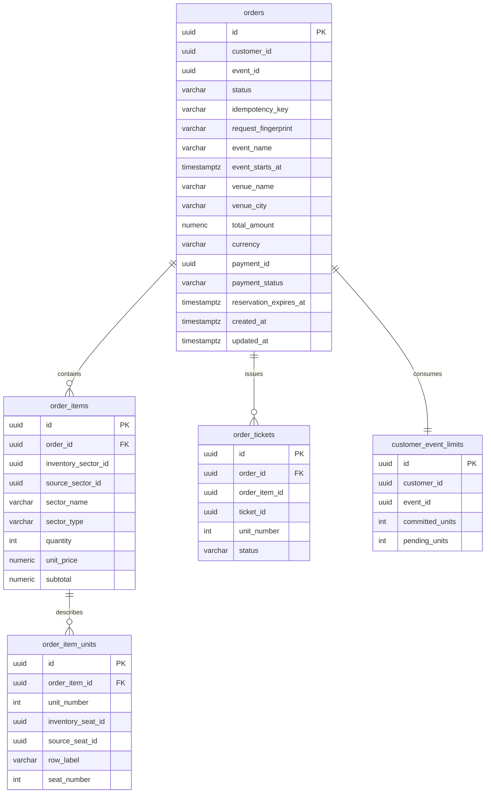
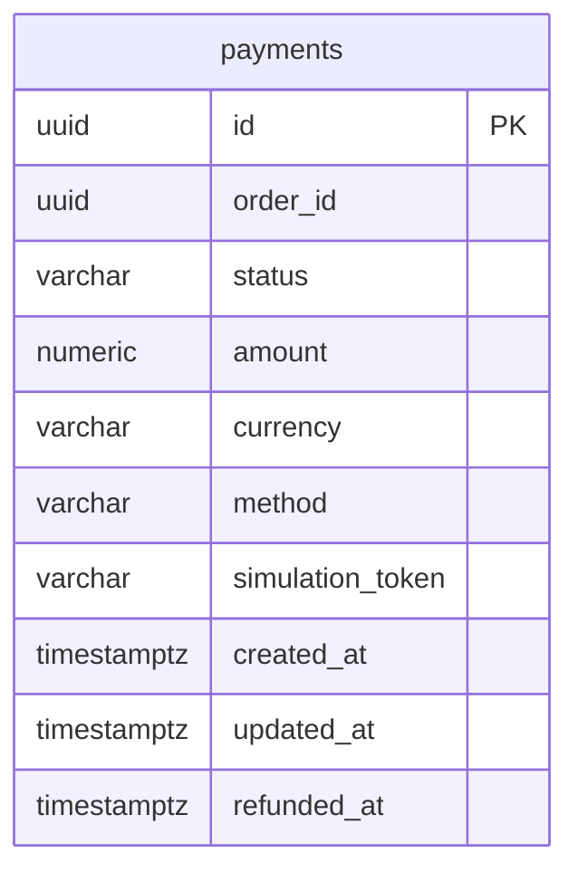
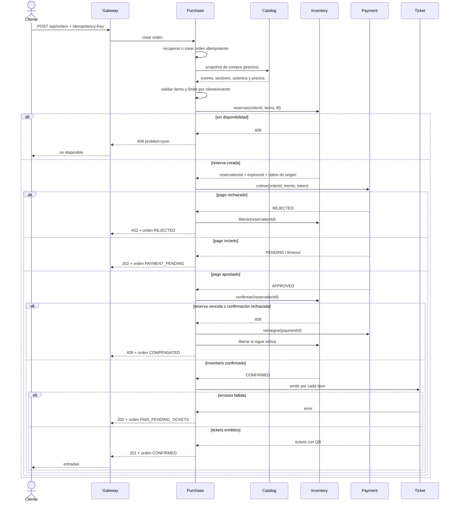

# Design

## Context

TicketYa ya implementa Gateway, Catalog, Inventory y Ticket Service. Catalog es dueño del snapshot publicado y de los precios; Inventory materializa ese layout y decide la disponibilidad; Ticket emite QR de forma idempotente por `orderId + orderItemId`. El blueprint `establish-ticketya-architecture` fija los límites, la saga, la idempotencia y el mecanismo contra doble venta. Ver `proposal.md` para la motivación.

El cambio agrega los dos componentes que faltaban para demostrar la arquitectura de Entrega 1: Purchase Service y Payment Mock. También materializa los entregables de diseño del PDF en `docs/architecture.md` y consolida los contratos en `docs/openapi.yaml`.

Restricciones vigentes:

- Java 19 y Spring Boot 3.2.5, un proyecto Maven independiente por servicio.
- PostgreSQL por servicio, `schema.sql` idempotente y `ddl-auto: validate`.
- REST síncrono; sin broker, cache, service discovery ni framework de saga.
- Entrega 1 identifica al usuario con `X-User-Id` y `X-User-Role`; no hay JWT.
- El Gateway es la única superficie externa y sólo publica el puerto 8080.

## Goals / Non-Goals

**Goals:**

- Completar el flujo de compra de una entrada numerada y de admisión general de punta a punta.
- Demostrar las ramas de pago rechazado, pago incierto y reserva vencida con compensaciones idempotentes.
- Garantizar el límite por cliente y evento bajo concurrencia.
- Mantener una única autoridad de venta: Inventory y PostgreSQL.
- Producir los diagramas de módulos, secuencia y ER por microservicio exigidos por el TPE.

**Non-Goals:**

- Devoluciones solicitadas por el cliente, cancelación masiva y notificaciones (E1-04 y E2).
- Control de acceso con QR y autenticación JWT.
- Reintentos automáticos de pagos inciertos mediante un job; la reconciliación es explícita en esta entrega.
- Mensajería asíncrona, Outbox/Inbox, cache o un motor de saga.
- Cambiar el mecanismo de exclusión mutua de Inventory.

## Decisions

### 1. Purchase como orquestador persistido

Purchase posee la orden y decide cada transición. La saga se implementa con estados persistidos y llamadas REST idempotentes; no se agrega framework. Alternativa descartada: coreografía con eventos, porque introduce un broker y consumidores idempotentes sin un requisito que lo justifique en E1.

Estados de orden:

```text
CREATING -> RESERVED -> PAYMENT_PENDING -> PAID -> CONFIRMED
    |           |              |            |
    +-----------+--------------+------------+--> REJECTED
                                              -> COMPENSATING -> COMPENSATED
                                              -> PAID_PENDING_TICKETS -> CONFIRMED
```

`CONFIRMED`, `REJECTED` y `COMPENSATED` son terminales. `PAYMENT_PENDING` y `PAID_PENDING_TICKETS` son reconciliables mediante `POST /api/orders/{orderId}/reconcile`.

### 2. Separar Payment Mock de Purchase

Payment Mock es un servicio independiente con `payment_db`. Simula la pasarela y permite demostrar timeout, fallback y reintegro sin mezclar la autoridad de pago con la orden. Alternativa descartada: un módulo interno de Purchase; no permitiría demostrar un servicio externo simulado ni el aislamiento de datos.

El resultado se decide por un token documentado: `tok_approved`, `tok_rejected` o `tok_pending`. Es determinista y testeable. Un token desconocido devuelve `400`.

### 3. Snapshot de compra separado del snapshot de inventario

Catalog expone `GET /internal/events/{eventId}/purchase-snapshot` con precios por sector. El contrato existente `GET /internal/events/{eventId}/snapshot` sigue sin precios para Inventory. Alternativa descartada: agregar precios al snapshot existente; rompería la regla de que Inventory no copia precios y obligaría a cambiar su contrato y sus pruebas.

Purchase guarda en `purchase_db` el snapshot histórico de nombre, fecha, lugar, sector, fila, asiento y precio. No hay foreign keys hacia `catalog_db`.

### 4. Enriquecer la respuesta de reserva sin cambiar sus claves

Inventory agrega a cada ítem de reserva `sourceSectorId`, `sourceSeatId`, `sectorName`, `sectorType`, `rowLabel` y `seatNumber`. Los campos `sectorId`, `seatId` y `quantity` conservan su significado actual, por lo que la solicitud sigue siendo compatible.

Con esos datos Purchase puede mapear el sector de Inventory al sector del snapshot de Catalog y armar los tickets sin consultar `inventory_db`. Alternativa descartada: mapear sectores por nombre entre dos llamadas públicas; frágil ante nombres repetidos o cambios.

### 5. Idempotencia de la compra

`orders` tiene una restricción única por `(customer_id, idempotency_key)` y guarda un fingerprint canónico del request. Repetir la clave con el mismo fingerprint devuelve la orden existente; con otro fingerprint devuelve `409`.

Cada llamada externa usa la clave que su dueño ya implementa:

| Llamada | Clave | Resultado repetido |
|---|---|---|
| Crear orden | `customerId + Idempotency-Key` | Misma orden |
| Reservar | `orderId` | Misma reserva |
| Cobrar | `orderId` | Mismo pago |
| Confirmar inventario | `reservationId` | Misma venta |
| Emitir tickets | `orderId + orderItemId` | Mismos tickets |
| Reintegrar | `paymentId` | Mismo reintegro |

### 6. Límite atómico por cliente y evento

`customer_event_limits` mantiene `customer_id`, `event_id`, `committed_units` y `pending_units`. Al crear la orden se ejecuta un `INSERT ... ON CONFLICT DO UPDATE` condicionado a `committed_units + pending_units + :units <= :limit`; si no actualiza una fila, la compra se rechaza con `409`. Al confirmar se mueven unidades de `pending` a `committed`; al rechazar o compensar se descuentan de `pending`.

Alternativa descartada: contar órdenes con un `SELECT` previo; no es seguro bajo concurrencia.

### 7. Compensaciones

| Rama | Detección | Acción | Estado final |
|---|---|---|---|
| Pago rechazado | Payment `REJECTED` | Liberar reserva y unidades pendientes | `REJECTED` |
| Pago incierto | Payment `PENDING` o timeout | Conservar reserva; reconciliar luego | `PAYMENT_PENDING` |
| Reserva vencida al confirmar | Inventory `409` | Reintegrar pago, liberar si sigue activa, liberar límite | `COMPENSATED` |
| Emisión fallida | Ticket no responde | Reintentar emisión idempotente | `PAID_PENDING_TICKETS` |
| Duplicado | Misma clave | Devolver orden existente | Sin cambios |

El orden de la compensación es: reintegrar pago, liberar inventario y liberar límite. Los reintentos son seguros porque las tres operaciones son idempotentes.

### 8. Resiliencia

Cada cliente REST usa timeouts de conexión y lectura configurables. Sólo se reintentan operaciones idempotentes y con un máximo acotado. Un timeout de Payment nunca se interpreta como rechazo: produce `PAYMENT_PENDING`. Un fallback de pago sólo devuelve un estado seguro; nunca aprueba.

### 9. Seguridad provisional y trazabilidad

Purchase exige `X-User-Id` válido y usa `X-User-Role` sólo si está presente; un cliente sólo opera sobre sus órdenes. Todos los clientes propagan `X-Correlation-Id`; los errores usan `application/problem+json` con `correlationId`. Los logs no contienen tokens de pago, payloads QR ni credenciales.

### 10. Documentación de arquitectura como entregable

`docs/architecture.md` será la fuente de los entregables del PDF:

- tabla de microservicios, responsabilidades y API pública;
- diagrama de módulos (contenedores);
- diagrama de secuencia de compra numerada con pago rechazado y reserva vencida;
- ER por microservicio;
- entidades solapadas y su propósito.

Los diagramas usan Mermaid y se referencian desde el README. El `design.md` de cada épica sigue siendo la fuente de decisiones; `docs/architecture.md` resume la implementación real.

## Data model

### Purchase Service



Restricciones: única `(customer_id, idempotency_key)`, única `(customer_id, event_id)` en límites, única `(order_id, order_item_id, unit_number)` en tickets, y checks de cantidades y montos positivos. No existen foreign keys hacia otras bases.

### Payment Mock



Restricción única por `order_id`. No guarda datos completos de la orden ni referencias a `purchase_db`.

### ER de los servicios existentes

`docs/architecture.md` incluye el ER de Catalog, Inventory y Ticket, con sus claves y relaciones internas. Las referencias entre servicios se documentan como valores UUID sin foreign keys.

## API surface

| Servicio | Método y ruta | Exposición | Propósito |
|---|---|---|---|
| Purchase | `POST /api/orders` | Gateway | Crear orden y ejecutar la saga |
| Purchase | `GET /api/orders/{orderId}` | Gateway | Consultar una orden propia |
| Purchase | `GET /api/orders` | Gateway | Listar órdenes propias |
| Purchase | `POST /api/orders/{orderId}/reconcile` | Gateway | Reconciliar pago o emisión pendiente |
| Payment | `POST /internal/payments` | Interna | Cobro idempotente |
| Payment | `GET /internal/payments/{paymentId}` | Interna | Consultar pago |
| Payment | `GET /internal/payments/by-order/{orderId}` | Interna | Consultar pago por orden |
| Payment | `POST /internal/payments/{paymentId}/refund` | Interna | Reintegro idempotente |
| Catalog | `GET /internal/events/{eventId}/purchase-snapshot` | Interna | Snapshot con precios |
| Inventory | `POST /internal/reservations` | Interna | Reserva (contrato existente, respuesta enriquecida) |
| Ticket | `POST /internal/orders/{orderId}/items/{orderItemId}/tickets` | Interna | Emisión (contrato existente) |

Códigos públicos de `POST /api/orders`: `201` confirmada, `200` repetición idempotente, `202` pago pendiente, `402` pago rechazado, `400` request inválido, `403` identidad inválida, `404` evento no comprable, `409` sin disponibilidad, límite o conflicto de idempotencia, `503` dependencia no disponible.

## Purchase sequence



La rama de reserva vencida se prueba en unitarios de Purchase y en un contrato de Inventory que confirma una reserva expirada. La prueba de concurrencia ejecuta compras simultáneas del mismo asiento y verifica exactamente una confirmación.

## Risks / Trade-offs

- **Compensación parcial si Payment reintegra y Purchase cae antes de liberar inventario** → La reconciliación y la liberación idempotente permiten reintentar; el estado persistido evita repetir el cobro.
- **El límite por cliente agrega una fila caliente por evento** → Sólo afecta al mismo cliente y evento; se resuelve con un `UPDATE` condicional en PostgreSQL.
- **La respuesta de reserva enriquecida acopla Purchase a Inventory** → Se agregan campos aditivos y Purchase sólo usa identificadores y datos de presentación, no tablas.
- **La simulación por token es artificial** → Es determinista, documentada y suficiente para demostrar aprobación, rechazo y pendiente sin un proveedor real.
- **La reconciliación es manual en E1** → Un job puede agregarse en una épica posterior si el TPE lo exige; no cambia el contrato.

## Migration Plan

1. Agregar el snapshot de compra en Catalog y la respuesta enriquecida en Inventory, con sus pruebas de contrato.
2. Crear `payment-mock` y `payment_db`; verificar cobro, consulta y reintegro.
3. Crear `purchase-service` y `purchase_db`; implementar la saga con dobles de prueba.
4. Integrar los servicios reales, enrutar `/api/orders/**` por el Gateway y actualizar Compose.
5. Publicar `docs/openapi.yaml`, `docs/architecture.md`, README y Postman.
6. Ejecutar `mvn verify`, `docker compose up --build`, la colección Postman y la prueba de concurrencia.
7. Rollback: retirar las rutas y los servicios del Compose; las bases nuevas se eliminan con `docker compose down -v`. Los contratos de Catalog e Inventory son aditivos y no requieren migración destructiva.

## Open Questions

Ninguna pendiente para implementar. La política de reintentos automáticos de pagos inciertos y la cancelación masiva se resolverán en sus propias épicas.
