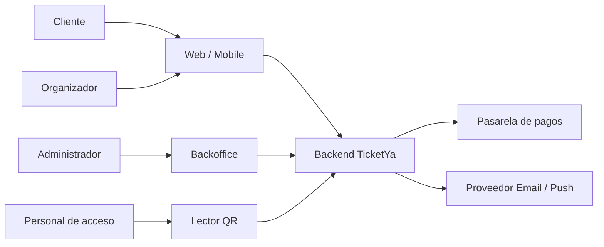
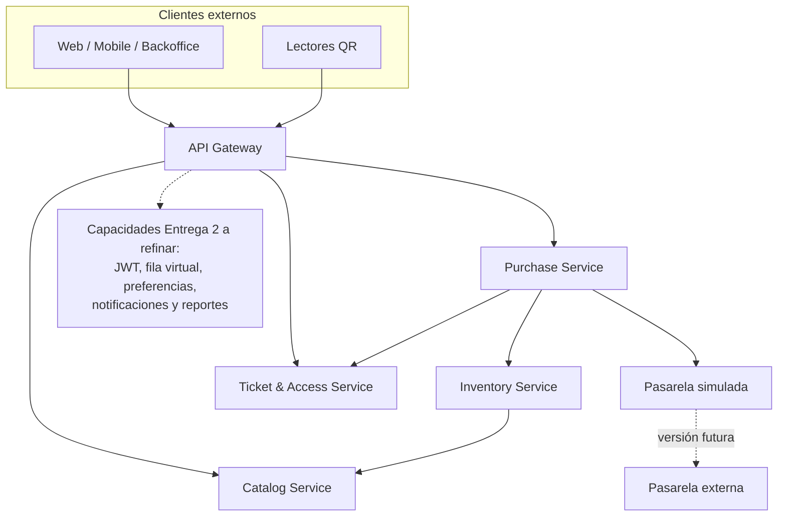
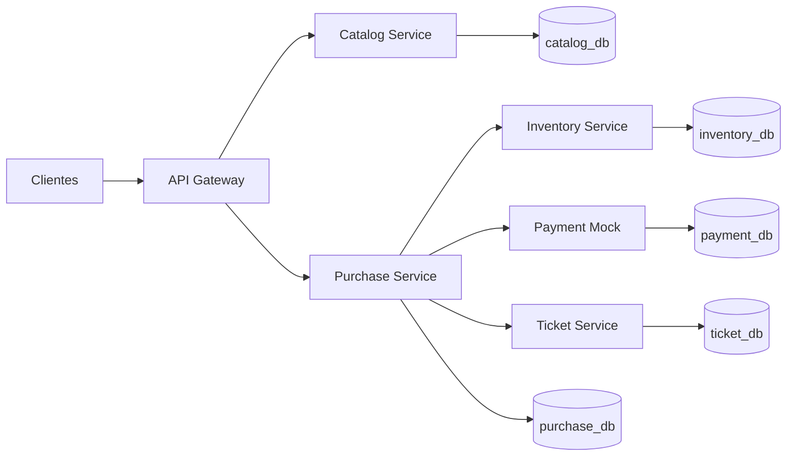
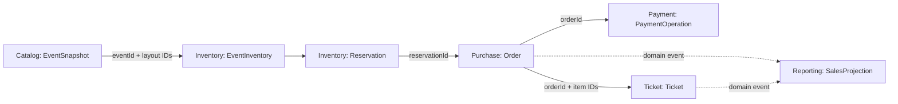
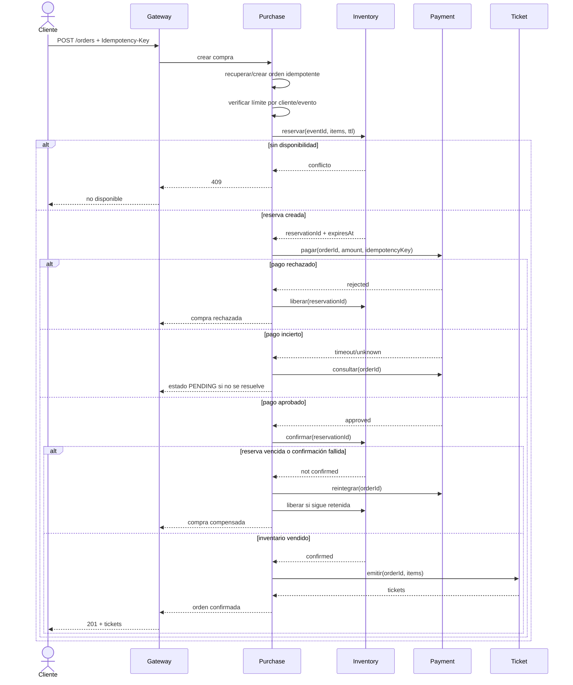
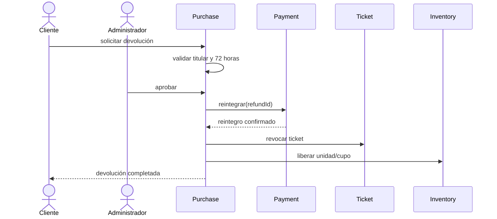
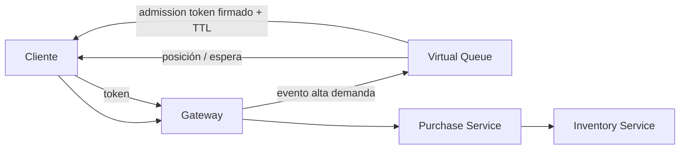
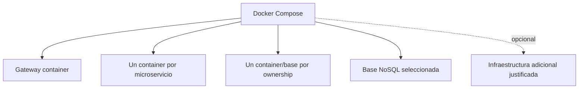

# Design

## Context

TicketYa parte de un repositorio sin implementación y debe evolucionar en dos entregas incrementales. El backend debe usar microservicios Spring Boot independientes, un API Gateway, persistencia por servicio y mecanismos explícitos para concurrencia, consistencia, resiliencia, seguridad y trazabilidad. Véase `proposal.md` para la motivación de este blueprint.

Este documento es un mock arquitectónico general: fija límites, responsabilidades y flujos de referencia, pero cada épica funcional deberá convertirlos en requisitos, contratos y tareas verificables. La primera épica detallada es `establish-event-catalog`; su diseño especializado prevalece para Catalog Service mientras no contradiga este blueprint.

Java 19 y Maven son restricciones del proyecto. Ningún artefacto versionado debe contener rutas personales de JDK o configuración local.

El proyecto es didáctico. El PDF define el piso obligatorio y la arquitectura debe privilegiar comprensión, correctitud y facilidad de prueba. La performance de un entorno productivo, la escala extrema y la sofisticación operativa no son drivers salvo en la prueba de carga y los casos de concurrencia exigidos.

## Goals / Non-Goals

**Goals:**

- Dar al equipo una vista compartida del sistema completo antes de implementar microservicios aislados.
- Establecer una fuente de verdad por dominio y evitar bases o tablas compartidas.
- Resolver desde el diseño los riesgos de doble venta, reintentos de pago, expiración, devolución y uso duplicado de QR.
- Mostrar con claridad qué se construye en Entrega 1 y qué se agrega en Entrega 2.
- Servir como mapa de dependencias para refinar épicas verticales con OpenSpec.
- Llegar a una solución que el equipo pueda explicar, ejecutar y mantener sin infraestructura innecesaria.

**Non-Goals:**

- Definir todos los campos, endpoints o escenarios de cada capacidad.
- Reemplazar las specs funcionales, OpenAPI o diagramas ER detallados de cada épica.
- Crear proyectos Spring Boot, contenedores, bases o infraestructura ejecutable.
- Fijar prematuramente detalles de algoritmos de recomendación o política de fila virtual que no afecten los límites de servicios.
- Diseñar para tráfico, disponibilidad o operación de escala productiva no requeridos por la evaluación.
- Adoptar herramientas sólo porque son habituales en arquitecturas empresariales.

## Decisions

### 1. Principios arquitectónicos

1. Implementar primero la solución más simple que cumpla el PDF.
2. Todo cliente externo entra por API Gateway.
3. Cada microservicio implementado es dueño exclusivo de sus datos y se construye por separado.
4. No crear un microservicio sin responsabilidad, datos y necesidad de evolución claramente separados.
5. Las decisiones críticas se confirman en la base autoritativa, nunca sólo en memoria o cache.
6. Preferir REST síncrono; introducir comunicación asíncrona sólo cuando una historia demuestre el beneficio.
7. Toda operación crítica es idempotente y trazable mediante `correlationId`.
8. Los eventos publicados, órdenes y tickets conservan snapshots históricos; no dependen de datos maestros mutables.
9. Los datos copiados entre servicios se relacionan por IDs, nunca por foreign keys entre bases.
10. No agregar cache, broker, service discovery, migrador de esquema o tracing distribuido sin una justificación revisada por el equipo.
11. Todo componente ejecutable desarrollado por el equipo se distribuye con un `Dockerfile` propio y se integra al `docker-compose.yml` central de la raíz en la misma épica que lo introduce.

Antes de incorporar una tecnología o patrón, la épica debe responder:

- ¿Qué requisito obligatorio satisface o qué problema observado resuelve?
- ¿Cuál es la alternativa más simple?
- ¿Qué costo agrega al desarrollo, testing y ejecución local?
- ¿Cómo se verificará que aporta valor?

Si estas preguntas no tienen una respuesta concreta, la tecnología queda fuera del alcance.

### 2. Contexto del sistema



Actores y roles:

| Actor | Responsabilidad principal |
|---|---|
| `CLIENT` | Buscar eventos, reservar, comprar, consultar entradas y pedir devoluciones |
| `ORGANIZER` | Diseñar, publicar y consultar resultados de sus eventos |
| `ADMIN` | Gestión completa, lugares, suspensión, cancelación y aprobación de devoluciones |
| `ACCESS_STAFF` | Validar entradas del evento para el que fue autorizado |

Entrega 1 usa encabezados de identidad. Entrega 2 reemplaza ese mecanismo por JWT; los servicios mantienen sus reglas de autorización de dominio.

### 3. Arquitectura lógica general



Los servicios de dominio no quedan expuestos directamente a clientes. El Gateway enruta y aplica controles transversales, pero no contiene reglas de negocio. Las capacidades de Entrega 2 se separarán en nuevos servicios sólo si su refinamiento demuestra ownership o despliegue independiente; el diagrama no obliga a crear un servicio por capacidad.

### 4. Alcance incremental

#### Entrega 1 - núcleo síncrono



El primer incremento `establish-event-catalog` materializa sólo Gateway, Catalog Service y `catalog_db`. Los demás componentes aparecen en épicas posteriores de Entrega 1.

La integración entre publicación e inventario evoluciona en dos pasos:

1. La primera épica crea el snapshot publicado dentro de Catalog Service.
2. Al incorporarse Inventory Service, se agrega inicialización idempotente desde ese snapshot; esa épica modifica el flujo de publicación o agrega reconciliación sin reescribir el catálogo histórico.

#### Entrega 2 - plataforma completa

Se incorporan JWT, una base NoSQL en al menos una capacidad, fila virtual, preferencias/recomendaciones, notificaciones, reportes, resiliencia, cache justificada, logs centralizados y despliegue completo con Docker Compose. La cantidad final de servicios y las tecnologías concretas se deciden al refinar cada épica.

### 5. Responsabilidades y límites

| Servicio | Responsabilidad | Fuera de su responsabilidad |
|---|---|---|
| API Gateway | Entrada única, routing, rate limiting, correlation ID y validación JWT | Reglas de compra o inventario |
| Catalog | Lugares, sectores plantilla, eventos, participantes, precios publicados y búsqueda | Disponibilidad, compras y tickets |
| Inventory | Inventario por evento, holds temporales, expiración y confirmación de venta | Cobro, precio maestro y QR |
| Purchase | Órdenes, límite por cliente, saga de compra, devoluciones y cancelación comercial | Modificar inventario o capturar QR directamente |
| Payment Mock | Simular aprobación, rechazo, consulta y reintegro | Decidir reglas de devolución o transformarse necesariamente en microservicio productivo |
| Ticket & Access | Emisión, QR, vigencia, revocación y uso único en acceso | Cobro y selección de asientos |

Capacidades de Entrega 2 todavía no fijadas como servicios independientes:

| Capacidad | Responsabilidad mínima |
|---|---|
| Identidad/JWT | Autenticar y representar roles; puede resolverse con servicio propio o componente existente |
| Fila virtual | Preservar orden y habilitar tandas sin garantizar inventario |
| Preferencias/recomendaciones | Guardar preferencias en NoSQL y producir sugerencias simples |
| Notificaciones | Entregar email/push sin bloquear una compra confirmada |
| Reportes | Calcular ventas, devoluciones, ocupación y recaudación desde datos disponibles |

**Alternativas consideradas:**

- Un servicio por entidad: descartado por fragmentar transacciones sin aportar autonomía.
- Un único Sales Service con inventario, órdenes y tickets: puede simplificar demasiado las responsabilidades exigidas por el PDF; se mantienen límites lógicos, sin sumar servicios de soporte innecesarios.
- Separar Ticket y Access: se mantienen juntos para que la validación de uso único sea una operación atómica sobre la base dueña del ticket.

### 6. Ownership y persistencia

| Servicio | Datos autoritativos | Persistencia objetivo | Copias permitidas |
|---|---|---|---|
| Catalog | Venue, sector plantilla, asiento plantilla, evento, participante, snapshot publicado y precio | PostgreSQL | Inventory y Purchase copian IDs/layout/precio necesarios para operar |
| Inventory | Inventario por evento, unidad/asiento, stock de zona, reserva y expiración | Base relacional | Layout inicial copiado desde snapshot de Catalog |
| Purchase | Orden, ítem, intento de saga, límite por cliente y solicitud de devolución | PostgreSQL | Snapshot de descripción y precio al comprar |
| Payment Mock | Resultado simulado e idempotencia mínima | A decidir; puede ser almacenamiento simple | Referencia `orderId`, nunca datos completos de la orden |
| Ticket & Access | Ticket, QR hash, estado, propietario y uso | PostgreSQL | Snapshot mínimo del evento para validación y visualización |
| Preferencias/recomendaciones | Preferencias, favoritos y señales simples | Base NoSQL a seleccionar | Historial derivado de compras |

La capacidad de preferencias/recomendaciones es la candidata inicial para satisfacer el requisito NoSQL, porque sus documentos varían por usuario y no requieren joins transaccionales con ventas. MongoDB es una opción, no una decisión tomada. Catálogo permanece relacional por sus invariantes y relaciones estructuradas.

Si una épica propone Redis u otro cache, nunca será la autoridad para impedir doble venta. Una pérdida de cache no puede liberar ni vender un asiento.

### 7. Relaciones de datos entre servicios



No existe foreign key entre estas bases. Cada referencia remota se valida por contrato y se guarda como valor. Los snapshots preservan la semántica histórica aun si el dato maestro cambia.

### 8. Comunicación síncrona por defecto

REST síncrono:

- Consultas públicas y de gestión iniciadas por el usuario.
- Reserva de inventario y confirmación dentro de la saga de compra.
- Autorización/captura o consulta inmediata de pago.
- Emisión idempotente de tickets cuando la respuesta debe volver al comprador.
- Validación QR en el acceso.

Interacciones que podrían volverse asíncronas en Entrega 2:

| Evento | Productor | Consumidores típicos |
|---|---|---|
| `EventPublished` | Catalog | Inventory, Engagement, Notification |
| `EventChanged` | Catalog | Notification, Reporting |
| `EventCancelled` | Catalog | Purchase, Ticket, Notification, Reporting |
| `PurchaseConfirmed` | Purchase | Ticket, Engagement, Notification, Reporting |
| `RefundCompleted` | Purchase | Inventory, Ticket, Notification, Reporting |
| `TicketIssued` | Ticket | Notification, Reporting |
| `TicketUsed` | Ticket | Reporting |

La primera opción sigue siendo REST o un proceso batch persistido. Un broker se incorpora sólo si existen múltiples consumidores, desacople temporal o reintentos durables que justifiquen operarlo. Si se elige mensajería, productores y consumidores deberán tolerar duplicados; Outbox/Inbox son patrones candidatos, no requisitos automáticos.

RabbitMQ y Kafka quedan fuera de la baseline. Si una épica demuestra que necesita un broker, deberá comparar al menos esa opción con REST, tareas programadas y una tabla de trabajo simple.

### 9. Orquestación persistida de compra

Purchase Service orquesta la operación porque posee el estado de negocio de la orden y puede decidir compensaciones. Este flujo puede describirse como Saga, pero no requiere un framework ni un motor especializado: estados persistidos y llamadas REST idempotentes son suficientes para la versión didáctica.



Estados sugeridos de orden:

```text
PENDING -> RESERVED -> PAYMENT_PENDING -> PAID -> CONFIRMED
   |          |              |             |
   +----------+--------------+-------------+--> REJECTED
                                             -> COMPENSATING -> REFUNDED
```

Si la emisión de tickets falla después de confirmar inventario, la orden queda `PAID_PENDING_TICKETS` y se reintenta idempotentemente. Sólo una falla permanente dispara compensación de pago e inventario; un timeout no se interpreta automáticamente como fracaso.

### 10. Mecanismo contra doble venta

Inventory Service y PostgreSQL son la autoridad incluso con múltiples instancias.

Asiento numerado:

```sql
UPDATE inventory_item
SET status = 'HELD', reservation_id = :reservationId, expires_at = :expiresAt
WHERE event_id = :eventId
  AND seat_id = :seatId
  AND (status = 'AVAILABLE' OR (status = 'HELD' AND expires_at < CURRENT_TIMESTAMP));
```

La reserva de varios asientos ocurre en una sola transacción. Si la cantidad actualizada no coincide con la solicitada, se revierte todo.

Sector no numerado:

```sql
UPDATE sector_inventory
SET reserved = reserved + :quantity
WHERE event_id = :eventId
  AND capacity - sold - reserved >= :quantity;
```

Confirmar exige estado `HELD`, mismo `reservationId` y `expires_at > now`. La expiración puede resolverse mediante una tarea programada y también de forma lazy al intentar reservar. No se agrega Redis mientras esta solución sea suficiente.

La prueba obligatoria ejecuta muchas solicitudes simultáneas contra el mismo asiento o último cupo, incluyendo más de una instancia de Inventory Service, y verifica exactamente un éxito.

### 11. Idempotencia

| Operación | Clave | Resultado repetido |
|---|---|---|
| Crear compra | `customerId + Idempotency-Key` | Devuelve la misma orden |
| Reservar | `orderId` | Devuelve la misma reserva activa o resultado final |
| Pagar | `orderId + attempt` | Consulta/reutiliza operación del proveedor |
| Confirmar inventario | `reservationId` | Conserva `SOLD` sin duplicar decrementos |
| Emitir tickets | `orderId + orderItemId` | Devuelve tickets ya emitidos |
| Reintegrar | `refundId` | Devuelve el reintegro existente |
| Validar QR | `ticketId` | Primer uso exitoso; siguientes usos rechazados |

Cada servicio persiste la clave y el resultado dentro de su propia transacción. Los reintentos automáticos sólo se habilitan para operaciones idempotentes.

### 12. Devoluciones y cancelaciones

Devolución individual:



No se libera inventario para reventa hasta confirmar el reintegro y revocar el ticket. Un reintegro incierto queda pendiente y se reconcilia con Payment Service.

Cancelación de evento:

1. Catalog cambia el estado a `CANCELLED`.
2. Purchase recibe una solicitud idempotente y crea reintegros para órdenes afectadas, procesados por lotes simples.
3. Ticket revoca entradas.
4. Inventory cierra o libera inventario según política; no vuelve a vender un evento cancelado.
5. Notification informa a compradores.
6. Reporting actualiza sus proyecciones.

El proceso es eventual, observable y reanudable; no intenta una transacción distribuida única. Puede comenzar con REST y jobs persistidos; mensajería queda como evolución justificada.

### 13. Fila virtual

La fila virtual puede implementarse como servicio o módulo separado según lo que se defina en su épica. Su almacenamiento inicial puede ser relacional; Redis se evaluará sólo si simplifica claramente la cola o si las pruebas muestran una necesidad.



La cola habilita tandas y emite un token de admisión de corta duración ligado a cliente y evento. El token permite intentar comprar, pero no garantiza inventario. Inventory sigue siendo la autoridad. La versión didáctica puede usar una tabla ordenada y polling de posición.

### 14. Tickets y control de acceso

El QR contiene un token opaco o firmado; la base almacena su hash, no un payload que permita reconstruir credenciales sensibles. La validación comprueba ticket, evento, vigencia, revocación y uso.

Uso único entre instancias:

```sql
UPDATE ticket
SET status = 'USED', used_at = CURRENT_TIMESTAMP, access_point = :accessPoint
WHERE qr_hash = :qrHash
  AND event_id = :eventId
  AND status = 'VALID';
```

Sólo una operación obtiene una fila actualizada. Reintentos posteriores responden “ya utilizada”. `ACCESS_STAFF` debe estar autorizado para el evento solicitado.

### 15. Preferencias, recomendaciones, notificaciones y reportes

La capacidad de preferencias/recomendaciones guarda en una base NoSQL a seleccionar preferencias explícitas —tipos, artistas, ciudad— y señales derivadas de compras. La primera versión recomienda por afinidad simple y co-compra; no requiere machine learning ni un servicio separado si un módulo con ownership claro resulta suficiente.

La capacidad de notificaciones entrega email/push y sus fallas nunca revierten una compra confirmada. Puede comenzar con un adaptador simple y reintentos controlados; un servicio independiente, broker o dead-letter queue requieren justificación adicional.

Los reportes pueden calcularse consultando los servicios dueños o mediante una proyección simple. Un Reporting Service y read models separados sólo se incorporarán si reducen complejidad frente a la consulta síncrona requerida por el TPE.

### 16. Cache

| Dato | Cache | Política |
|---|---|---|
| Catálogo y detalle publicado | Sin cache por defecto | Agregar cache sólo con medición o requisito demostrado |
| Resultados de búsqueda | Sin cache por defecto | Priorizar índices y consultas simples |
| Preferencias/recomendaciones | Sin cache por defecto | Evaluar únicamente si la implementación lo necesita |
| Disponibilidad de asientos | No como respuesta autoritativa | Consultar Inventory Service |
| Estado de orden, pago o ticket | No para decisiones | Consultar servicio dueño |

El TPE pide definir la estrategia de cache; “no cachear” es una decisión válida cuando se justifica por escala didáctica y simplicidad. Si se incorpora cache, un miss sólo afecta rendimiento y un dato stale nunca debe permitir vender, devolver o validar incorrectamente.

### 17. Resiliencia

- Timeouts explícitos en toda llamada REST.
- Reintentos acotados sólo para operaciones idempotentes.
- Fallback explícito para pagos o notificaciones, tal como exige el PDF.
- Pago incierto produce estado `PENDING`, seguido de consulta/reconciliación; nunca cobro duplicado.
- La notificación no revierte una compra; su mecanismo de reintento se mantiene simple salvo evidencia contraria.

Timeout, retry y fallback son comportamientos obligatorios. Circuit breakers, bulkheads, jitter, DLQ y librerías como Resilience4j son alternativas posibles, no decisiones preestablecidas.

### 18. Seguridad

Entrega 1 identifica al usuario por encabezado para facilitar pruebas, sin considerarlo seguridad real. Entrega 2 incorpora JWT firmado con `sub`, roles y expiración.

El Gateway valida firma y expiración; cada servicio valida autorización y ownership. Los endpoints internos no se publican fuera de la red de servicios. Secretos y claves no se guardan en Git. Logs no incluyen contraseñas, tokens, QR completos ni datos de pago sensibles.

### 19. Trazabilidad y observabilidad

El Gateway acepta o genera `X-Correlation-Id`; todos los servicios lo propagan en REST, mensajes y logs. Cada request registra endpoint, usuario, estado HTTP y duración. Compra, devolución, cancelación y acceso generan logs de auditoría estructurados.

La implementación mínima debe centralizar o reunir logs de forma consultable y conservar el `correlationId`. Puede resolverse con salida JSON y herramientas simples del entorno de ejecución. Loki, Prometheus, Grafana u OpenTelemetry sólo se agregarán si el equipo puede justificar y operar ese stack; no son parte de la baseline.

### 20. Despliegue

Regla común desde Entrega 1:

- Cada microservicio, Gateway, Payment Mock u otro componente de aplicación desarrollado por el equipo tiene un `Dockerfile` en su propio directorio.
- La raíz de `ticketya` contiene un único `docker-compose.yml` que declara todos los componentes disponibles en el incremento actual y sus dependencias.
- PostgreSQL, la base NoSQL y otras dependencias estándar usan imágenes oficiales en Compose; no se crean Dockerfiles custom salvo que una personalización sea necesaria y justificada.
- `docker compose up --build` construye y levanta el sistema completo disponible.
- Configuración, URLs y credenciales de desarrollo se inyectan mediante variables de entorno; no se versionan rutas personales ni secretos reales.
- Gateway es la única API usada por clientes y por la colección Postman.
- La ejecución local como procesos Java 19 sigue permitida para desarrollo, pero no reemplaza la verificación con Compose.

Estructura esperada:

```text
ticketya/
+-- docker-compose.yml
+-- services/
|   +-- api-gateway/Dockerfile
|   +-- catalog-service/Dockerfile
|   +-- <future-service>/Dockerfile
+-- <other-app-component>/Dockerfile
```

El Compose crece incrementalmente hasta Entrega 2:



Docker DNS resuelve servicios dentro de la red; no se agrega Eureka mientras Docker Compose sea el único orquestador. Cada imagen debe poder construirse por separado, aunque Compose provea el arranque integrado y el repositorio use un POM agregador.

### 21. Mapa de épicas

```text
ARCH-00 establish-ticketya-architecture
   |
   +-- E1-01 establish-event-catalog
   |      lugares -> borradores -> snapshot -> búsqueda
   |
   +-- E1-02 establish-inventory-and-reservations
   |      inventario -> holds -> expiración -> doble venta
   |
   +-- E1-03 establish-purchase-and-ticketing
   |      orden -> payment mock -> saga -> emisión QR
   |
   +-- E1-04 establish-refunds-and-cancellation
   |      solicitud -> aprobación -> reintegro -> liberación
   |
   +-- E1-05 integrate-core-delivery
          Gateway -> OpenAPI -> Postman -> concurrencia -> README

   +-- E2-01 add-jwt-and-role-security
   +-- E2-02 add-virtual-queue
   +-- E2-03 add-notifications-and-evaluate-async
   +-- E2-04 add-preferences-and-recommendations
   +-- E2-05 add-qr-access-control
   +-- E2-06 add-organizer-reporting
   +-- E2-07 add-resilience-logging-and-compose
   +-- E2-08 execute-security-integration-and-load-tests
```

Cada épica puede ajustar detalles internos, pero un cambio de ownership, servicio dueño o protocolo crítico debe actualizar primero este blueprint.

## Risks / Trade-offs

- **[Demasiados servicios para el tamaño del equipo]** -> Mantener sólo los límites core y decidir en cada épica si una capacidad de soporte merece servicio propio.
- **[Sobreingeniería por patrones y herramientas]** -> Exigir problema, alternativa simple, costo y verificación antes de incorporar cualquier tecnología no obligatoria.
- **[La saga aumenta estados y reconciliación]** -> Centralizar la orquestación en Purchase, persistir cada transición y diseñar compensaciones idempotentes.
- **[Mensajería futura produce duplicados o desorden]** -> Si se adopta, exigir idempotencia y orden suficiente; no incorporar broker de forma preventiva.
- **[Un cache se interpreta como autoridad]** -> Documentar y probar que Inventory y su base relacional deciden toda venta y confirmación.
- **[Reporting queda temporalmente desactualizado]** -> Exponer fecha de última actualización y mantenerlo fuera de decisiones transaccionales.
- **[El blueprint se vuelve rígido]** -> Tratarlo como baseline revisable; las épicas aportan evidencia y deben actualizar decisiones globales cuando corresponda.
- **[Java 19 no es LTS]** -> Fijar versiones de toolchain y dependencias compatibles, usar la misma versión en CI y contenedores y no registrar rutas locales.
- **[Compose central se desactualiza]** -> La Definition of Done de cada épica que agrega un componente exige actualizar Compose y verificar `docker compose up --build` desde la raíz.

## Migration Plan

1. Revisar este blueprint con el equipo y registrar decisiones objetadas.
2. Validar que `establish-event-catalog` sea compatible y agregar una referencia a este documento en una actualización separada si el equipo la aprueba.
3. Refinar `establish-inventory-and-reservations` usando ownership y mecanismo de concurrencia aquí definidos.
4. Refinar compra, pagos y tickets con la saga y contratos idempotentes.
5. Al final de cada épica, revisar si cambió algún límite global y actualizar este cambio antes de continuar.
6. Usar los diagramas actualizados como base de la documentación exigida en cada entrega.

Este cambio no tiene despliegue ni rollback técnico porque sólo agrega planificación. Si el equipo rechaza una decisión, se actualiza el blueprint y se reconcilian las épicas afectadas antes de implementar.

## Open Questions

- Elegir en la épica correspondiente la solución mínima para centralizar logs y correlation IDs.
- Definir en la épica de fila virtual el almacenamiento, tamaño de tanda, frecuencia de admisión y política ante abandono.
- Seleccionar y justificar la base NoSQL y la fórmula inicial de recomendaciones.
- Evaluar comunicación asíncrona únicamente cuando se refine cancelación masiva o notificaciones.
