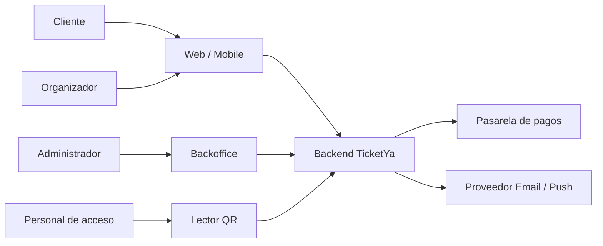
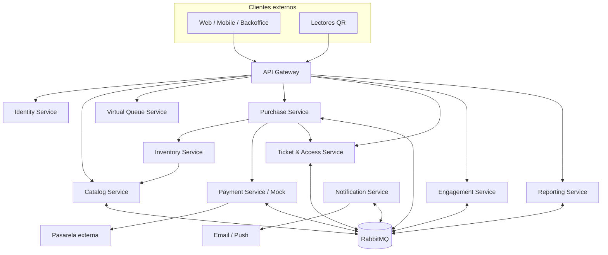
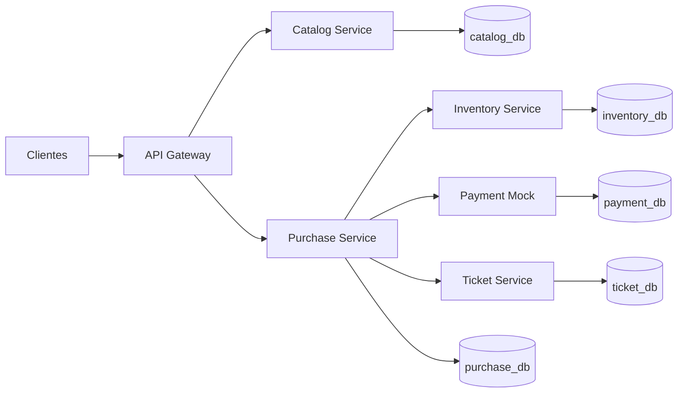
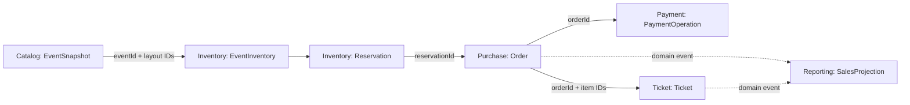
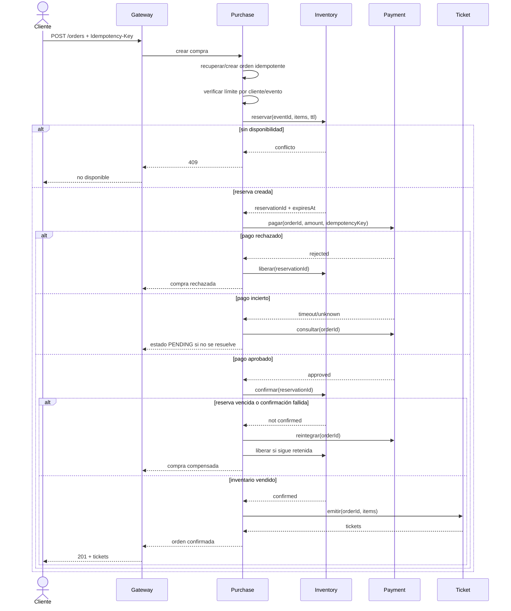
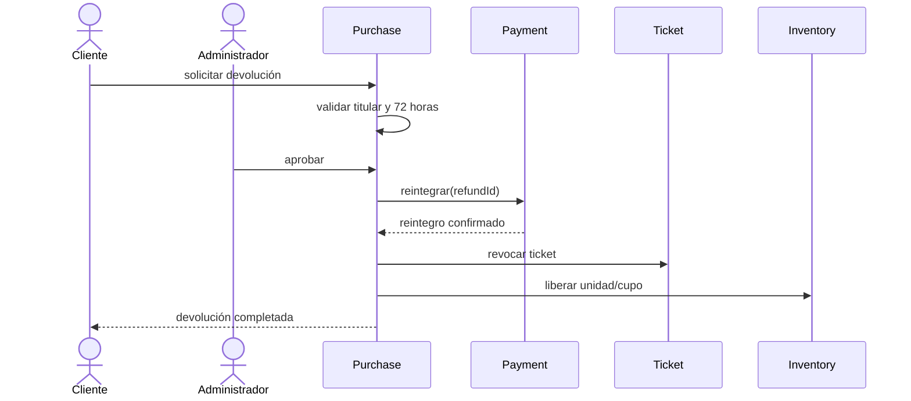
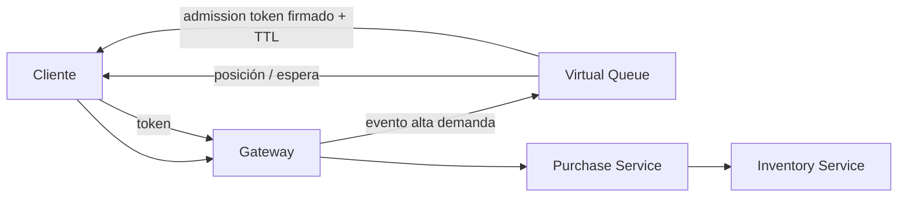
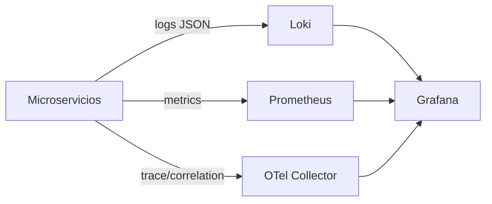
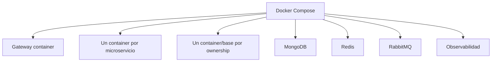

# Design

## Context

TicketYa parte de un repositorio sin implementación y debe evolucionar en dos entregas incrementales. El backend debe usar microservicios Spring Boot independientes, un API Gateway, persistencia por servicio y mecanismos explícitos para concurrencia, consistencia, resiliencia, seguridad y trazabilidad. Véase `proposal.md` para la motivación de este blueprint.

Este documento es un mock arquitectónico general: fija límites, responsabilidades y flujos de referencia, pero cada épica funcional deberá convertirlos en requisitos, contratos y tareas verificables. La primera épica detallada es `establish-event-catalog`; su diseño especializado prevalece para Catalog Service mientras no contradiga este blueprint.

Java 19 y Maven son restricciones del proyecto. Ningún artefacto versionado debe contener rutas personales de JDK o configuración local.

## Goals / Non-Goals

**Goals:**

- Dar al equipo una vista compartida del sistema completo antes de implementar microservicios aislados.
- Establecer una fuente de verdad por dominio y evitar bases o tablas compartidas.
- Resolver desde el diseño los riesgos de doble venta, reintentos de pago, expiración, devolución y uso duplicado de QR.
- Mostrar con claridad qué se construye en Entrega 1 y qué se agrega en Entrega 2.
- Servir como mapa de dependencias para refinar épicas verticales con OpenSpec.

**Non-Goals:**

- Definir todos los campos, endpoints o escenarios de cada capacidad.
- Reemplazar las specs funcionales, OpenAPI o diagramas ER detallados de cada épica.
- Crear proyectos Spring Boot, contenedores, bases o infraestructura ejecutable.
- Fijar prematuramente detalles de algoritmos de recomendación o política de fila virtual que no afecten los límites de servicios.

## Decisions

### 1. Principios arquitectónicos

1. Todo cliente externo entra por API Gateway.
2. Cada microservicio es dueño exclusivo de sus datos y se construye por separado.
3. Las decisiones críticas se confirman en la base autoritativa, nunca sólo en memoria o cache.
4. REST síncrono se usa cuando el usuario necesita una respuesta inmediata.
5. Mensajería se usa para efectos secundarios, proyecciones y procesos masivos.
6. Toda operación crítica es idempotente y trazable mediante `correlationId`.
7. Los eventos publicados, órdenes y tickets conservan snapshots históricos; no dependen de datos maestros mutables.
8. Los datos copiados entre servicios se relacionan por IDs, nunca por foreign keys entre bases.

### 2. Contexto del sistema



Actores y roles:

| Actor | Responsabilidad principal |
|---|---|
| `CLIENT` | Buscar eventos, reservar, comprar, consultar entradas y pedir devoluciones |
| `ORGANIZER` | Diseñar, publicar y consultar resultados de sus eventos |
| `ADMIN` | Gestión completa, lugares, suspensión, cancelación y aprobación de devoluciones |
| `ACCESS_STAFF` | Validar entradas del evento para el que fue autorizado |

Entrega 1 usa encabezados de identidad. Entrega 2 reemplaza ese mecanismo por JWT; los servicios mantienen sus reglas de autorización de dominio.

### 3. Arquitectura objetivo por contenedores



Los servicios de dominio no quedan expuestos directamente a clientes. El Gateway enruta, aplica controles transversales y valida JWT en Entrega 2, pero no contiene reglas de negocio.

### 4. Alcance incremental

#### Entrega 1 - núcleo síncrono



El primer incremento `establish-event-catalog` materializa sólo Gateway, Catalog Service y `catalog_db`. Los demás componentes aparecen en épicas posteriores de Entrega 1.

La integración entre publicación e inventario evoluciona en dos pasos:

1. La primera épica crea el snapshot publicado dentro de Catalog Service.
2. Al incorporarse Inventory Service, se agrega inicialización idempotente desde ese snapshot; esa épica modifica el flujo de publicación o agrega reconciliación sin reescribir el catálogo histórico.

#### Entrega 2 - plataforma completa

Se incorporan Identity, Virtual Queue, Engagement, Notification y Reporting, RabbitMQ, MongoDB, Redis, JWT, observabilidad centralizada, resiliencia, cache y despliegue completo con Docker Compose.

### 5. Responsabilidades y límites

| Servicio | Responsabilidad | Fuera de su responsabilidad |
|---|---|---|
| API Gateway | Entrada única, routing, rate limiting, correlation ID y validación JWT | Reglas de compra o inventario |
| Identity | Usuarios, roles, credenciales y emisión/renovación de JWT | Preferencias y recomendaciones |
| Catalog | Lugares, sectores plantilla, eventos, participantes, precios publicados y búsqueda | Disponibilidad, compras y tickets |
| Inventory | Inventario por evento, holds temporales, expiración y confirmación de venta | Cobro, precio maestro y QR |
| Purchase | Órdenes, límite por cliente, saga de compra, devoluciones y cancelación comercial | Modificar inventario o capturar QR directamente |
| Payment | Adaptar pasarela, intentos, idempotencia, consulta y reintegros | Decidir reglas de devolución |
| Ticket & Access | Emisión, QR, vigencia, revocación y uso único en acceso | Cobro y selección de asientos |
| Virtual Queue | Orden de llegada, posición, tandas y tokens de admisión | Reservar o vender inventario |
| Engagement | Preferencias, favoritos, historial derivado y recomendaciones | Fuente autoritativa de órdenes |
| Notification | Plantillas y entrega de email/push con reintentos | Bloquear la compra por una falla de envío |
| Reporting | Proyecciones de ventas, devoluciones, ocupación y recaudación | Ejecutar operaciones transaccionales |

**Alternativas consideradas:**

- Un servicio por entidad: descartado por fragmentar transacciones sin aportar autonomía.
- Un único Sales Service con inventario, órdenes y tickets: simplifica Entrega 1, pero impide escalar y razonar separadamente sobre doble venta, pagos y acceso.
- Separar Ticket y Access: se mantienen juntos para que la validación de uso único sea una operación atómica sobre la base dueña del ticket.

### 6. Ownership y persistencia

| Servicio | Datos autoritativos | Persistencia objetivo | Copias permitidas |
|---|---|---|---|
| Identity | Usuario, credenciales, rol, estado | PostgreSQL | Otros servicios conservan sólo `userId` y datos históricos mínimos |
| Catalog | Venue, sector plantilla, asiento plantilla, evento, participante, snapshot publicado y precio | PostgreSQL | Inventory y Purchase copian IDs/layout/precio necesarios para operar |
| Inventory | Inventario por evento, unidad/asiento, stock de zona, reserva y expiración | PostgreSQL; Redis sólo como acelerador | Layout inicial copiado desde snapshot de Catalog |
| Purchase | Orden, ítem, intento de saga, límite por cliente y solicitud de devolución | PostgreSQL | Snapshot de descripción y precio al comprar |
| Payment | Operación de pago, proveedor, estado, clave idempotente y reintegro | PostgreSQL | Referencia `orderId`, nunca datos completos de la orden |
| Ticket & Access | Ticket, QR hash, estado, propietario y uso | PostgreSQL | Snapshot mínimo del evento para validación y visualización |
| Virtual Queue | Cola, posición, sesión y token de admisión | Redis | `eventId` y ventana de venta |
| Engagement | Preferencias, favoritos y señales de recomendación | MongoDB | Historial derivado de eventos de compra |
| Notification | Entrega, canal, plantilla y estado de reintento | PostgreSQL o cola durable | Payload mínimo del evento de dominio |
| Reporting | Proyecciones de venta, devolución, ocupación y recaudación | PostgreSQL | Read models reconstruibles desde eventos |

MongoDB en Engagement satisface el requisito NoSQL: preferencias y señales varían por usuario y evolucionan sin joins transaccionales con ventas. Catálogo permanece relacional por sus invariantes y relaciones estructuradas.

Redis nunca es la autoridad para impedir doble venta. Una pérdida de cache no puede liberar ni vender un asiento.

### 7. Relaciones de datos entre servicios



No existe foreign key entre estas bases. Cada referencia remota se valida por contrato y se guarda como valor. Los snapshots preservan la semántica histórica aun si el dato maestro cambia.

### 8. Comunicación síncrona y asíncrona

REST síncrono:

- Consultas públicas y de gestión iniciadas por el usuario.
- Reserva de inventario y confirmación dentro de la saga de compra.
- Autorización/captura o consulta inmediata de pago.
- Emisión idempotente de tickets cuando la respuesta debe volver al comprador.
- Validación QR en el acceso.

RabbitMQ asíncrono en Entrega 2:

| Evento | Productor | Consumidores típicos |
|---|---|---|
| `EventPublished` | Catalog | Inventory, Engagement, Notification |
| `EventChanged` | Catalog | Notification, Reporting |
| `EventCancelled` | Catalog | Purchase, Ticket, Notification, Reporting |
| `PurchaseConfirmed` | Purchase | Ticket, Engagement, Notification, Reporting |
| `RefundCompleted` | Purchase | Inventory, Ticket, Notification, Reporting |
| `TicketIssued` | Ticket | Notification, Reporting |
| `TicketUsed` | Ticket | Reporting |

Los productores usan Transactional Outbox y los consumidores Inbox/idempotencia. La entrega es al menos una vez; ningún consumidor presupone exactly-once.

RabbitMQ se elige sobre Kafka por menor complejidad operativa y porque el volumen académico no requiere retención masiva ni replay distribuido de alto throughput. Reporting debe poder reconstruirse con eventos almacenados o una herramienta de reproceso controlada.

### 9. Saga orquestada de compra

Purchase Service orquesta la operación porque posee el estado de negocio de la orden y puede decidir compensaciones.



Estados sugeridos de orden:

```text
PENDING -> RESERVED -> PAYMENT_PENDING -> PAID -> CONFIRMED
   |          |              |             |
   +----------+--------------+-------------+--> REJECTED
                                             -> COMPENSATING -> REFUNDED
```

Si la emisión de tickets falla después de confirmar inventario, la orden queda `PAID_PENDING_TICKETS` y se reintenta idempotentemente. Sólo una falla permanente dispara compensación de pago e inventario; un timeout no se interpreta automáticamente como fracaso.

### 10. Mecanismo contra doble venta

Inventory Service y PostgreSQL son la autoridad incluso con múltiples instancias.

Asiento numerado:

```sql
UPDATE inventory_item
SET status = 'HELD', reservation_id = :reservationId, expires_at = :expiresAt
WHERE event_id = :eventId
  AND seat_id = :seatId
  AND (status = 'AVAILABLE' OR (status = 'HELD' AND expires_at < CURRENT_TIMESTAMP));
```

La reserva de varios asientos ocurre en una sola transacción. Si la cantidad actualizada no coincide con la solicitada, se revierte todo.

Sector no numerado:

```sql
UPDATE sector_inventory
SET reserved = reserved + :quantity
WHERE event_id = :eventId
  AND capacity - sold - reserved >= :quantity;
```

Confirmar exige estado `HELD`, mismo `reservationId` y `expires_at > now`. La expiración se procesa mediante job y también de forma lazy al intentar reservar. Redis puede mantener TTLs y acelerar el barrido, pero PostgreSQL decide el resultado final.

La prueba obligatoria ejecuta muchas solicitudes simultáneas contra el mismo asiento o último cupo, incluyendo más de una instancia de Inventory Service, y verifica exactamente un éxito.

### 11. Idempotencia

| Operación | Clave | Resultado repetido |
|---|---|---|
| Crear compra | `customerId + Idempotency-Key` | Devuelve la misma orden |
| Reservar | `orderId` | Devuelve la misma reserva activa o resultado final |
| Pagar | `orderId + attempt` | Consulta/reutiliza operación del proveedor |
| Confirmar inventario | `reservationId` | Conserva `SOLD` sin duplicar decrementos |
| Emitir tickets | `orderId + orderItemId` | Devuelve tickets ya emitidos |
| Reintegrar | `refundId` | Devuelve el reintegro existente |
| Validar QR | `ticketId` | Primer uso exitoso; siguientes usos rechazados |

Cada servicio persiste la clave y el resultado dentro de su propia transacción. Los reintentos automáticos sólo se habilitan para operaciones idempotentes.

### 12. Devoluciones y cancelaciones

Devolución individual:



No se libera inventario para reventa hasta confirmar el reintegro y revocar el ticket. Un reintegro incierto queda pendiente y se reconcilia con Payment Service.

Cancelación de evento:

1. Catalog cambia el estado a `CANCELLED` y publica `EventCancelled` mediante outbox.
2. Purchase crea reintegros idempotentes para órdenes afectadas, procesados por lotes.
3. Ticket revoca entradas.
4. Inventory cierra o libera inventario según política; no vuelve a vender un evento cancelado.
5. Notification informa a compradores.
6. Reporting actualiza sus proyecciones.

El proceso es eventual, observable y reanudable; no intenta una transacción distribuida única.

### 13. Fila virtual

Virtual Queue Service usa Redis para preservar orden y manejar alta concurrencia.



La cola habilita tandas y emite un token de admisión de corta duración ligado a cliente y evento. El token permite intentar comprar, pero no garantiza inventario. Inventory sigue siendo la autoridad. Una versión simplificada puede usar sorted sets de Redis y polling de posición.

### 14. Tickets y control de acceso

El QR contiene un token opaco o firmado; la base almacena su hash, no un payload que permita reconstruir credenciales sensibles. La validación comprueba ticket, evento, vigencia, revocación y uso.

Uso único entre instancias:

```sql
UPDATE ticket
SET status = 'USED', used_at = CURRENT_TIMESTAMP, access_point = :accessPoint
WHERE qr_hash = :qrHash
  AND event_id = :eventId
  AND status = 'VALID';
```

Sólo una operación obtiene una fila actualizada. Reintentos posteriores responden “ya utilizada”. `ACCESS_STAFF` debe estar autorizado para el evento solicitado.

### 15. Preferencias, recomendaciones, notificaciones y reportes

Engagement Service guarda en MongoDB preferencias explícitas —tipos, artistas, ciudad— y señales derivadas de `PurchaseConfirmed`. La primera versión recomienda por afinidad simple y co-compra; no requiere machine learning.

Notification Service consume eventos y entrega email/push. Sus fallas nunca revierten una compra confirmada. Usa reintentos con backoff, dead-letter queue e idempotencia por `eventId + recipient + template`.

Reporting Service mantiene read models por evento y sector para ventas, devoluciones, ocupación y recaudación. Sus datos son eventualmente consistentes y no participan del flujo transaccional de compra.

### 16. Cache

| Dato | Cache | Política |
|---|---|---|
| Catálogo y detalle publicado | Redis en Entrega 2 | TTL corto e invalidación por cambios de evento |
| Resultados de búsqueda frecuentes | Redis opcional | Clave por filtros/página, TTL corto |
| Preferencias/recomendaciones | Cache opcional | TTL moderado, invalidación por actualización |
| Disponibilidad de asientos | No como respuesta autoritativa | Consultar Inventory Service |
| Estado de orden, pago o ticket | No para decisiones | Consultar servicio dueño |

Un cache miss sólo afecta rendimiento. Una cache stale nunca debe permitir vender, devolver o validar incorrectamente.

### 17. Resiliencia

- Timeouts explícitos en toda llamada REST.
- Circuit breaker en pasarela de pagos y proveedores de notificación.
- Reintentos con backoff y jitter sólo para operaciones idempotentes.
- Bulkheads para que fallas externas no agoten threads o conexiones.
- Pago incierto produce estado `PENDING`, seguido de consulta/reconciliación; nunca cobro duplicado.
- Notificación se procesa asíncronamente y usa DLQ.
- Health checks distinguen liveness y readiness.

### 18. Seguridad

Entrega 1 identifica al usuario por encabezado para facilitar pruebas, sin considerarlo seguridad real. Entrega 2 incorpora JWT firmado con `sub`, roles y expiración.

El Gateway valida firma y expiración; cada servicio valida autorización y ownership. Los endpoints internos no se publican fuera de la red de servicios. Secretos y claves no se guardan en Git. Logs no incluyen contraseñas, tokens, QR completos ni datos de pago sensibles.

### 19. Trazabilidad y observabilidad

El Gateway acepta o genera `X-Correlation-Id`; todos los servicios lo propagan en REST, mensajes y logs. Cada request registra endpoint, usuario, estado HTTP y duración. Compra, devolución, cancelación y acceso generan logs de auditoría estructurados.

Objetivo de Entrega 2:



Para la entrega académica puede simplificarse el stack, pero el `correlationId` debe permitir seguir una operación completa aun sin tracing distribuido avanzado.

### 20. Despliegue

Entrega 1:

- Microservicios ejecutados localmente como procesos Java 19 independientes.
- Bases PostgreSQL en contenedores separados o instancias lógicamente aisladas.
- Configuración por variables de entorno.
- Gateway como única URL usada por Postman.

Entrega 2:



Docker DNS resuelve servicios dentro de la red; no se agrega Eureka mientras Docker Compose sea el único orquestador. Cada servicio debe poder construirse y ejecutarse por separado, aunque el repositorio use un POM agregador.

### 21. Mapa de épicas

```text
ARCH-00 establish-ticketya-architecture
   |
   +-- E1-01 establish-event-catalog
   |      lugares -> borradores -> snapshot -> búsqueda
   |
   +-- E1-02 establish-inventory-and-reservations
   |      inventario -> holds -> expiración -> doble venta
   |
   +-- E1-03 establish-purchase-and-ticketing
   |      orden -> payment mock -> saga -> emisión QR
   |
   +-- E1-04 establish-refunds-and-cancellation
   |      solicitud -> aprobación -> reintegro -> liberación
   |
   +-- E1-05 integrate-core-delivery
          Gateway -> OpenAPI -> Postman -> concurrencia -> README

   +-- E2-01 add-jwt-and-role-security
   +-- E2-02 add-virtual-queue
   +-- E2-03 add-messaging-and-notifications
   +-- E2-04 add-preferences-and-recommendations
   +-- E2-05 add-qr-access-control
   +-- E2-06 add-organizer-reporting
   +-- E2-07 add-cache-resilience-observability-and-compose
   +-- E2-08 execute-security-integration-and-load-tests
```

Cada épica puede ajustar detalles internos, pero un cambio de ownership, servicio dueño o protocolo crítico debe actualizar primero este blueprint.

## Risks / Trade-offs

- **[Demasiados servicios para el tamaño del equipo]** -> Implementar por épicas, combinar Ticket/Access y Engagement, y no crear servicios vacíos antes de necesitarlos.
- **[La saga aumenta estados y reconciliación]** -> Centralizar la orquestación en Purchase, persistir cada transición y diseñar compensaciones idempotentes.
- **[Eventos duplicados o fuera de orden]** -> Outbox/Inbox, claves idempotentes, versionado y consumidores tolerantes a repetición.
- **[Redis se interpreta como autoridad]** -> Documentar y probar que Inventory PostgreSQL decide toda venta y confirmación.
- **[Reporting queda temporalmente desactualizado]** -> Exponer fecha de última actualización y mantenerlo fuera de decisiones transaccionales.
- **[El blueprint se vuelve rígido]** -> Tratarlo como baseline revisable; las épicas aportan evidencia y deben actualizar decisiones globales cuando corresponda.
- **[Java 19 no es LTS]** -> Fijar versiones de toolchain y dependencias compatibles, usar la misma versión en CI y contenedores y no registrar rutas locales.

## Migration Plan

1. Revisar este blueprint con el equipo y registrar decisiones objetadas.
2. Validar que `establish-event-catalog` sea compatible y agregar una referencia a este documento en una actualización separada si el equipo la aprueba.
3. Refinar `establish-inventory-and-reservations` usando ownership y mecanismo de concurrencia aquí definidos.
4. Refinar compra, pagos y tickets con la saga y contratos idempotentes.
5. Al final de cada épica, revisar si cambió algún límite global y actualizar este cambio antes de continuar.
6. Usar los diagramas actualizados como base de la documentación exigida en cada entrega.

Este cambio no tiene despliegue ni rollback técnico porque sólo agrega planificación. Si el equipo rechaza una decisión, se actualiza el blueprint y se reconcilian las épicas afectadas antes de implementar.

## Open Questions

- Elegir en la épica de observabilidad si se despliega el stack completo Loki/Prometheus/OTel o una variante reducida que conserve logs centralizados y correlation IDs.
- Definir en la épica de fila virtual el tamaño de tanda, frecuencia de admisión y política ante abandono; no cambia el límite del servicio.
- Definir en la épica de recomendaciones la fórmula inicial de afinidad y co-compra; MongoDB y el consumo de señales permanecen iguales.
